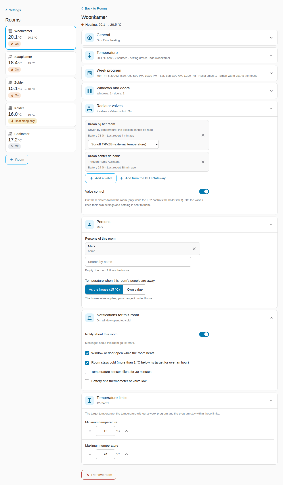
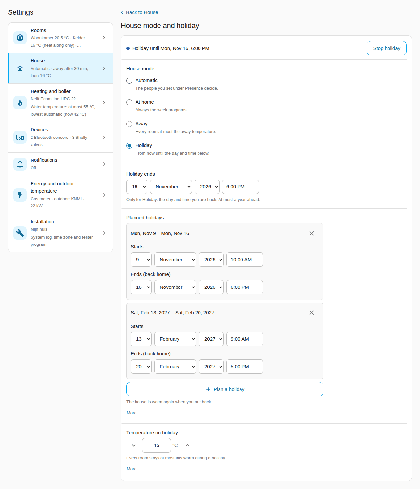
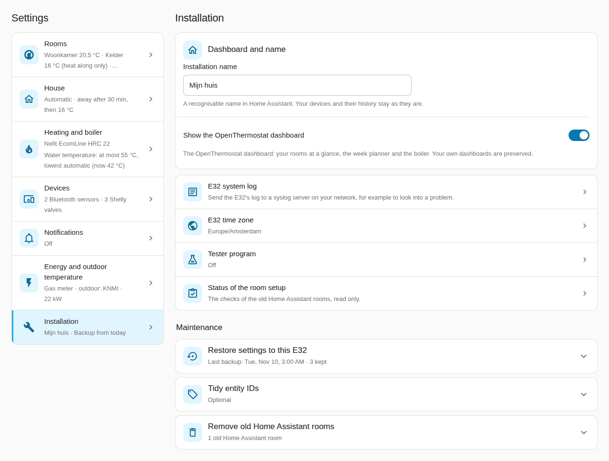

# OpenThermostat reference: how it works and the details

> **The firmware and the project's main repository are not public at the moment.** What these guides say
> about downloading the firmware or a release ZIP from GitHub, updating the E32's firmware from Home
> Assistant or with **Check for updates**, and the tester program's GitHub form does not work for now. The
> Home Assistant integration is installed and updated through the Marketplace as described. A few
> references to pages that are not public have no link here. Questions or problems:
> [open an issue](https://github.com/dielessen/openthermostat-ha/issues).

This is the reference for OpenThermostat: the E32 V2 on your boiler's bus,
with the Home Assistant integration. It explains how things work and lists the
details. To set up your thermostat step by step, read the
[user guide](USER-GUIDE.md) first. Installing a new E32, updates and
troubleshooting are in the [installation guide](INSTALL.md).

The E32 controls the boiler only after you confirm the takeover; the guided
**Boiler test and takeover** on the Boiler page is optional, and nothing else in
this reference makes the E32 control the boiler. A new E32 picks its route from the boiler bus: while
your old thermostat still asks the boiler for heat, it first runs a **trial
run** beside it and compares; without one it goes straight to the boiler test.
You can always choose the other route (see
[The attended switch-over](#the-attended-switch-over)).

**Supported boilers:** EMS Classic (EMS 1.0), directly on the bus or through an
adapter such as the Bosch EasyControl Adapter. EMS+ (EMS 2.0) boilers are read,
and controlled only once their model is verified; today no EMS+ model is (see
[EMS+ boilers](#ems-boilers-and-boiler-recognition)).

**Home Assistant is optional.** The room plan, week programs and Bluetooth
sensors live on the E32 and work without it. Home Assistant adds its own
sensors and thermostats as room sources, a dashboard, heating advice and
energy inputs.

## Contents

1. [Where do I set what?](#where-do-i-set-what)
2. [The dashboard in Home Assistant](#the-dashboard-in-home-assistant)
3. [Setting up the E32: the details](#setting-up-the-e32-the-details)
4. [Home Assistant: the details](#home-assistant-the-details)
5. [Rooms: changes, windows, away and holidays](#rooms-changes-windows-away-and-holidays)
6. [Learning: how the E32 tunes itself](#learning-how-the-e32-tunes-itself)
7. [Energy, gas and warnings](#energy-gas-and-warnings)
8. [Radiator valves](#radiator-valves)
   - [Shelly devices: floor pump, probes and valves](#shelly-devices-floor-pump-probes-and-valves)
9. [The trial run and the switch-over](#the-trial-run-and-the-switch-over)
10. [Boiler settings (preview)](#boiler-settings-preview)
11. [EMS+ boilers and boiler recognition](#ems-boilers-and-boiler-recognition)
12. [Backup and restore](#backup-and-restore)
13. [Logs and the diagnostics console](#logs-and-the-diagnostics-console)
14. [Tidy entity IDs (optional)](#tidy-entity-ids-optional)

## Where do I set what?

**Settings → …** is the last tab of the OpenThermostat dashboard. With the dashboard
shown, Configure has two items, **Open the settings page** and **E32 connection**
(see [below](#configure)); each row names the one place on the Settings tab. Without
the dashboard, Configure keeps every setting in its own item under the same names
(Rooms, House, Heating and boiler, Energy and outdoor temperature, Notifications, E32
devices, Dashboard and name, Advanced and diagnostics).

| What | Without Home Assistant | With Home Assistant |
| --- | --- | --- |
| Rooms: add, rename, remove, active or off | E32: Rooms | Settings → Rooms |
| Temperature sources per room and their order | E32: Rooms (Bluetooth sensors) | Settings → Rooms → the room → Temperature (HA entities and the E32's Bluetooth sensors) |
| Target, temperature without a week program, minimum and maximum | E32: Rooms | Settings → Rooms → the room → Temperature and Temperature limits |
| Week program per room | E32: Rooms (visual planner) | Settings → Rooms → the room → Week program (the week planner) |
| Reset times per room (E32 1.4) | E32: Rooms | Settings → Rooms → the room → Week program: markers on the day bars of the planner and the list under it (1.4.1) |
| Setting device per room (valve, tado, number) | — | Settings → Rooms → the room → Temperature → Setting device (optional) |
| House mode: automatic, at home, away, holiday | E32: Home | Settings → House → House mode and holiday, or the House mode control (E32 device, dashboard) |
| House mode Summer (E32 1.4.1 and newer) | — | Settings → House → House mode and holiday, or the House mode control; see [summer mode](#summer-mode) |
| Planned holidays (up to 8), the temperature on holiday, stopping a holiday | E32: Home → Holidays | Settings → House → House mode and holiday (plan, change, remove; the temperature on holiday; Stop holiday while one runs) |
| Who lives here (presence), how long before the house counts as away, and the away temperature | E32: Home (away temperature) | Settings → House → Presence and away temperature |
| Who uses a room (persons per room) | E32: Rooms (shown, read-only) | Settings → Rooms → the room → Persons |
| Away temperature of a single room | E32: Rooms → the room → Persons | Settings → Rooms → the room → Persons |
| Window and door contacts per room, and how long a window or a door may be open before the room pauses | — | Settings → Rooms → the room → Windows and doors (the contacts and the room's own pauses) |
| Levels of a room without a week program, default pauses for windows and doors | — | Settings → House → Room defaults |
| Radiator valves per room | E32: Rooms → the room → Radiator valves | Settings → Rooms → the room → Radiator valves (the valves, their model and Valve control) |
| Shelly devices (Plug, The Pill, BLU Gateway) and the gateway's valves (Look for valves at the gateway, or by number) (E32 1.1) | E32: System → Devices → Shelly devices | Settings → Devices → Shelly devices (add or remove a device, the probe roles, looking for valves at the gateway, adding a valve) |
| Heating circuits (floor pump, its probes) and Pump control by the E32 (E32 1.1) | E32: Home → Heating settings → Heating circuits | The circuit on the E32 page; Pump control by the E32 under Settings → Heating and boiler → Heating circuits |
| The floor's highest water temperature and the run-on while the water is warm (E32 1.1) | E32: Home → Heating settings → Heating circuits → the circuit → Advanced | Settings → Heating and boiler → Heating circuits |
| Lowest and highest water temperature for the boiler request; the lowest automatic (standard) or set by you | E32: Home → Water temperature limits | Settings → Heating and boiler → Water temperature limits |
| Smart warm-up and Weather compensation, both on by default | E32: Home → Heating settings → Advanced | Settings → Heating and boiler → Smart warm-up and weather compensation, or the switches on the E32 device |
| Smart warm-up of a single room: as the house (standard), on or off (E32 1.4) | E32: Rooms → the room → Week program → Smart warm-up | Settings → Rooms → the room → Week program (in the planner) |
| Water temperature in hard frost (−10 °C), for Weather compensation | E32: Home → Heating settings → Advanced | Settings → Heating and boiler → Smart warm-up and weather compensation, or the selection on the E32 device |
| Comfort style of the heating plan: comfort first, balanced (standard) or save most (firmware that plans the heating) | E32: Home | Settings → Heating and boiler → Smart warm-up and weather compensation, or the selection Comfort style on the E32 device |
| Letting the E32 plan the heating (once, after a week of good predictions) | E32: Home → Let the E32 plan the heating | The button Let the E32 plan the heating under Today's plan on the Learning tab, or on the E32 device (only while it waits; it asks first) |
| Letting a room learn again, after a change to its heating (E32 1.4.4) | E32: Rooms → the room → Learning | Settings → Rooms → the room → Learning; the button on the room's card on the Learning tab |
| Letting the house learn again, after a change to your boiler or heating (E32 1.4.4) | E32: Home → What the E32 has learned → Learn again | Settings → Heating and boiler → Learn again: house |
| Reading what the E32 learned (nothing to set): what it knows, how your boiler responds, yesterday compared with usual, free heat, the water temperature chart | E32: Home → What the E32 has learned, and Heating settings for the chart | Dashboard tab Learning; the sensors Known about your house and Boiler response on the E32 device |
| Gas meter, gas price, outdoor temperature, weather forecast, boiler power, water meter (all optional) | — | Settings → Energy and outdoor temperature |
| Messages on your phone: per person the phone, the house's problems and maintenance, per room its messages | — | Settings → Notifications |
| Pairing Bluetooth sensors (address, profile, encryption key) | E32: System → Devices → Bluetooth sensors | Settings → Devices → Bluetooth sensors → Pair a sensor (also rename and forget) |
| The devices the E32 hears on the boiler bus (nothing to set) | E32: System → Devices → On the boiler bus, and Boiler → All boiler data | Settings → Devices (On the boiler bus); each as a device via the E32 |
| Boiler model (name, picture and the display code table) | E32: Boiler → My boiler → Boiler model and picture | Settings → Heating and boiler → Boiler model (name and display codes); the picture on the E32 page |
| Letting the E32 change a few boiler settings (preview, off by default) | E32: Boiler → Boiler settings | Settings → Heating and boiler → Boiler settings (preview) |
| Which boiler the E32 recognised, and whether it may control it (nothing to set) | E32: Boiler → My boiler | The sensor Boiler recognition; Settings → Heating and boiler → Boiler model shows it too |
| After a boiler replacement: confirm the new boiler | E32: Boiler → My boiler → I changed the boiler | The repair A different boiler is connected → Fix |
| Sharing a result for an EMS+ boiler (testers only) | — | Settings → Installation → Tester program: Take part in the tester program, then Share result |
| The name of the installation, and whether it shows the OpenThermostat dashboard | — | Settings → Installation → Dashboard and name |
| Network, MQTT broker, time and time zone | E32: System → Settings | E32: System → Settings; the time zone also under Settings → Installation → E32 time zone |
| The status light (which board you have: off, E32 V2 or E32 V2.2) | E32: System → Settings → Advanced → Status light | E32: System → Settings → Advanced → Status light |
| Admin password of the E32 | E32: System → Password | E32: System → Password |
| Firmware updates | E32: System → Firmware update | The firmware update entity (Settings → Updates), or the E32 page. A new integration version: it appears under Settings → Updates (Marketplace) |
| Backup and restore of the settings | E32: System → Backup and restore | Daily and automatic; restore under Settings → Installation → Restore settings to this E32 (a backup Home Assistant keeps, or a backup file), or on the E32 page |
| Restart | E32: System → Restart device | E32: System → Restart device |
| Sign out of the E32 page | E32: System → Sign out (last item, once you are signed in) | E32: System → Sign out |
| Logs, diagnostics console and syslog | E32: System → Diagnostics and system log | E32: System → Diagnostics and system log; sending the log to a syslog server also under Settings → Installation → E32 system log |
| Shorter entity IDs (optional) | — | Settings → Installation → Tidy entity IDs |
| Removing the old Home Assistant rooms of an installation from before beta.19 | — | Settings → Installation → Remove old Home Assistant rooms, or the repair Old Home Assistant room no longer used → Fix |

**Both places count.** The house and heating settings (house mode, holidays, the
away temperature, the comfort style, Smart warm-up, weather compensation and the
water temperature limits) stay adjustable on the E32's **Home** page while Home
Assistant is linked; the page says "Also adjustable in Home Assistant". The E32
holds the settings. A change on the E32 applies at once and Home Assistant shows
it within a few minutes at most. Home Assistant never puts its own older copy back:
a Configure form sends only what you changed in it. If both change the same thing
at the same moment, the E32 refuses the second save and asks to try again.

The room plan is stored on the E32, and the E32 runs it. With Home Assistant,
the HA room editor is the main place to edit it; it reads the plan from the
E32 and writes it back. Bluetooth sensors stay paired on the E32, so they keep
working without Home Assistant; the E32 shares them with Home Assistant,
where each sensor appears as its own device and can be chosen as a room
source.

### The Settings tab

After an update the page can be older than the integration. The panel then says
"OpenThermostat was updated. Reload the page to use the new version." with the
button **Reload** and opens no screen until you press it, instead of mixing old
and new. The same button stands beside "The settings could not be loaded. Reload
the page." (a part of the panel did not load) and a screen that could not be read.

The last tab of the OpenThermostat dashboard, **Settings**, holds the settings of
the installation in seven entries, each with an icon and what is set now:
**Rooms**, **House**, **Heating and boiler**, **Devices**, **Notifications**,
**Energy and outdoor temperature** and **Installation** (the name and the dashboard,
the E32's system log and time zone, the tester program, and under **Maintenance**
restoring a backup, tidying entity IDs and removing old Home Assistant rooms). On a wide screen the
right side shows the installation at a glance: every room with its temperature and
state, the boiler and what it does, whether Smart warm-up and weather compensation
are on, and the next holiday; each opens its part. Each room card on the
**Overview** has a **Settings** button (bottom right) that opens its room here. The
tab is there for an installation on the E32 room plan with the dashboard shown;
without the E32 connection, Rooms, House, Heating and boiler and Devices say "Connect
the E32 first: Configure → E32 connection." The tab's own files load when you open
it; other Home Assistant pages carry only its small core.

Each screen shows the value in use now, with one line of explanation under each
choice and the rest behind **More**. Times and dates follow Home Assistant's
language and clock (24 hours in Dutch). It reads what Home Assistant already knows
(the room plan it last read from the E32); the live values (temperatures, targets,
batteries) come from the entities. A screen saves with the bar at its bottom
(**Save**, **Undo**) and sends only what you changed, with the same checks and the
same E32 writes as Configure, so a setting means the same in either place. When the
same setting was changed on the E32 or in Configure meanwhile, it says **Changed
elsewhere**, keeps your change marked and shows the rest as saved; **Save** again to
keep yours. A change you leave unsaved stays while you look at another entry ("Not
saved" on its row). Only an administrator of Home Assistant can save; others see the
same screens without fields to change. A screen that cannot read the E32 says why
(no connection, the password changed, firmware without the setting).

#### Rooms and House

**Rooms** shows every room as a card: the temperature now, the target, its state as
a coloured label (orange **On**, amber **Heat along only**, grey **Off**), what it
does now ("Heating: 20.1 → 20.5 °C", "Paused: a window is open") and its next reset
time. **+ Room** opens an empty room. A room's screen has a section for each part,
closed until you open it, each with one line of what is set; the panel remembers
which you opened. On a wide screen the rooms stay listed on the left.

| Section | What it holds |
| --- | --- |
| General | **Room name** (up to 40 letters; renaming keeps the room and its history), **Heating** (**On**, **Heat along only** or **Off**, the chosen one's explanation under it), **Heating type** (radiators or floor heating), **Off until** only while Off. |
| Temperature | **Temperature sources** with their value now and age (the first with a fresh value is used; **Use first**; at most four), the **Setting device (optional)** with what was written last, and the **Temperature without a week program**. |
| Week program | The week planner itself for this room, with its own save button; the reset times and Smart warm-up are in the planner. Leaving the screen with unsaved planner changes asks first. A new room: **Start with the standard week program**. |
| Windows and doors | **Window contacts** and **Door contacts**, and the pause after a window or a door opens: the house's value, or **Own value** for this room. |
| Radiator valves | The room's valves with how each is driven (by position, by temperature, or through Home Assistant), battery and last report, a model for a Zigbee2MQTT valve that can take one, **Add a valve** (from Home Assistant) or **Add from the BLU Gateway**, remove; **Valve control** (on: the valves follow the room). |
| Persons | **Persons of this room** (empty: the room follows the house) and the temperature when they are away: the house's, or an own value. |
| Notifications for this room | **Notify about this room** and which messages; the line under the switch says who gets them, or "Off: no messages about this room." |
| Temperature limits | The room's **Minimum temperature** and **Maximum temperature**: the target, the temperature without a week program and the program stay within them. |
| Learning (1.4.4) | **Learn again**: clears what the E32 learned for this room (after a change to the radiators or the floor heating) and lets it learn again; it asks first. Shown with E32 1.4.4 or newer. |



**Remove room** at the bottom asks first; the E32 forgets the room and Home
Assistant removes its devices, as Configure does. A part this E32 firmware does not
have is not shown.

**House** has three parts: **Presence and away temperature** (who lives here, away
after, the temperature when nobody is home), **House mode and holiday** (the modes
the E32 offers with their explanation, **Holiday ends** for a holiday that starts
now, **Planned holidays** with **Plan a holiday** and remove, **Temperature on
holiday**, and **Stop holiday** while one runs: the house goes back to the mode it had
before) and **Room defaults** (comfort and night without a week program, the pauses
after a window or a door opens: the values a new room starts with; each can be
changed per room on the room screen). The window and door
contacts are on each room's screen; an old link to them opens the room.



#### Heating and boiler, Devices, Energy

- **Heating and boiler** lists **Smart warm-up and weather compensation**, **Water
  temperature limits**, **Heating circuits** (with a circuit pump), **Comfort and
  boiler care**, **Boiler model** and **Boiler settings (preview)**, each with an
  icon and what is set now (Boiler settings: Off, or On with the changes of
  today). Each opens its own screen; every field has one line of help and the rest
  behind **More**:
  - Smart warm-up and weather compensation: the two switches, the **Comfort
    style** as three buttons with the chosen one's line under them, and the
    **Water temperature in hard frost (−10 °C)**.
  - Water temperature limits: the boiler's own maximum on top ("The boiler itself
    goes up to 75 °C"). With **Lowest water temperature: automatic** on, the line
    under it says the value the E32 uses now ("Lowest water temperature now:
    42 °C (learned)") and the lowest value appears once you switch it off. A
    highest temperature above 50 °C with floor heating, or above the boiler's own
    maximum, asks once before it is saved.
  - Comfort and boiler care: a compact list in two groups, **Set by the E32
    itself** and **Fixed settings**: each setting with its value now and, for the
    first group, the switch **Automatic** in the row. Tap a setting for its own
    screen: its explanation and your own value. **Back to automatic for all** and
    **Back to start values** (red) each ask first and are saved at once.
  - Boiler model: the list of models; what the E32 recognised on the bus on top.
  - Boiler settings (preview): see [Boiler settings](#boiler-settings-preview).
- **Devices** has the three blocks of the E32's System → Devices page, each with its
  own screens (the overview row says, for example, "2 Bluetooth sensors · 3 Shelly
  valves"):
  - **Bluetooth sensors**: the sensors with their temperature, how long ago they
    reported and "Measures for" the rooms that use them (or "Not assigned to a room
    yet"). A sensor's screen has its **Name** (a name taken from the room is marked
    "automatic"; **Keep this name** makes it your own) and **Measures for**: choose
    the room, and the sensor becomes that room's first temperature source and
    leaves every other room (one save on the E32). If the entity IDs in Home
    Assistant still carry an older name, a notice offers **Tidy entity IDs**.
    **Forget sensor** (after a question; the E32 deletes its key
    and restarts once). **Pair a sensor**: the E32 listens for about 30 seconds and
    the list under **Choose your sensor** shows what it hears with its signal
    (strong, fair, weak); **Search nearby** looks again ("Searching… (up to 90 s)"
    while it runs; the button is off only while a search really runs). Choose one, give it a
    **Name**, check the **Sensor type** (pvvx, Shelly H&T or Xiaomi; the screen
    guesses it and says so) and, for an encrypted sensor, enter its 32-character
    key, which only the E32 keeps; then **Pair**. Saving restarts the E32 once,
    about 30 seconds later. At most 8 Bluetooth devices.
  - **Shelly devices**: each with what it does, its address and whether it
    answers. **Shelly device** (the screen is called **Add a Shelly device**: the
    address, what it does, a name and the password; the E32 tests the address when
    you save, which takes up to 16 seconds) and **Remove device**. The password goes
    to the E32 only: Home Assistant does not keep it and never shows it again.
    On **The Pill**'s screen each probe gets its pipe (**Probe roles**, then **Save
    probe roles**). On a **BLU Gateway**'s screen, **Valves** lists its valves with
    their room (**Remove**, or **Add a valve** by its number) and **Look for valves
    at the gateway** asks the gateway for the valves it has paired: tap one to add
    it (it takes at most 5 valves).
  - **Batteries**: every battery of the installation on one list, the lowest
    first, each with its room, its kind, "Low / Fine / No report" and when it last
    reported; **Warn below** sets the one limit (15, 20, 25 or 30 %). The row on
    Devices says "{n} devices · {m} low".
  - **On the boiler bus**: the devices the E32 hears, nothing to set.
- **Energy and outdoor temperature** is Configure's form on one screen: one line of
  help per field (Configure's whole explanation behind **More**), and each chosen
  sensor's value now, large under its field, following Home Assistant (1.4.1).

#### Notifications

**Notifications** (1.4.1) asks two questions, each on its own screen; the overview
row says **Off** until something is on, then what is on ("On: the house,
Living room"). At the top one status line says where messages go now: "Messages go
to Ben (Pixel 8) · Anna without a phone · house messages to Anna (no phone: in
Home Assistant)." (green while someone is reached, red when a chosen phone is no
longer found, grey otherwise).

- **Who gets messages**: a row per person with their phone ("Pixel 8 (Home
  Assistant app)", a notify service, "… (not found)" or **No phone**) and the label
  **Also house messages** when that is on. Tap a person: one choice **Phone or
  app** (the app on their own phone on top and already chosen while nothing is;
  **Save** stores it, **Undo** goes back to **No phone**; leaving without saving
  keeps nothing) and one switch **Also messages about the house** (off by
  default; only the people with it on get the house messages). The help under
  each follows what you chose.
- **Which messages**: **The house** with **Notify about the house**; while it is on,
  the **Problems** and the **Maintenance** messages, each with one grey line of
  what causes it ("The boiler reports a fault."). The help under the switch says who
  gets them ("They go to: Anna."), or that nobody does yet, or "Off: no messages
  about the house.". **Rooms** below it: a row per room with its summary ("On:
  window open, too cold" or "Off"); a room opens its own screen at **Notifications
  for this room**, where its switch, its messages and its **Recipients** are set.
- **Recipients** (1.4.2): who gets a room's messages, chosen per room on the
  room's screen. The line says it: "Messages about Study go to Anna and Ben.",
  "… go to everyone with a phone." (a room that was never set) or "… go to nobody;
  they show in Home Assistant only." (an empty list). Someone without a phone
  shows as "Anna (no phone: in Home Assistant)"; a chosen person Home Assistant
  no longer knows is named under "Not found in Home Assistant". After the update
  every room with notifications on keeps the people it had; the room's
  **Persons** (presence) are a separate setting.
- **Batteries** (1.4.2): every battery of a thermometer, radiator valve, window
  or door contact or setting device is watched with one limit, **Warn below**
  (15, 20, 25 or 30 %, 20 by default; **Settings → Devices → Batteries**). The
  message names the device ("The battery of the radiator valve Landing valve in
  Bedroom is at 18 %"), comes again after 7 days while the battery stays low,
  and stops when it is 5 points above the limit. A device with a battery that
  has not reported for 24 hours is reported as "stopped reporting": probably
  empty. The sensor **Batteries low** counts them; the Overview shows a line only
  while it is above 0.

**Save** stores what you changed on that screen, with the same checks as
Configure (switched on without a message: "Choose at least one message, or switch
notifications off.", under the field). Home Assistant keeps these settings, not the
E32.

#### Installation

**Installation** (1.4.1; it holds what 1.4 called Dashboard and name and Advanced)
holds what belongs to the installation as a whole. The page does not ask the E32
until you open a row.



- The installation's **name** (1 to 80 characters) and **Show the OpenThermostat
  dashboard**, the same as Configure's. Hiding the dashboard asks first, because
  this tab goes with it; Configure then has all its items again. A new name reloads
  the integration once; devices and their history stay.
- **E32 system log**: sending the E32's log to a syslog server (**Send to a syslog
  server**, the server's IPv4 address, the UDP port, the level, the E32's own and
  the boiler bus messages; the fields for sending show once it is on), the level
  the E32 keeps for its own log page, and the "still running" message. Opening it
  reads the E32; **Save** writes all fields at once and reads them back.
- **E32 time zone**: the zone the E32 runs the week programs in, with what the E32
  and Home Assistant use now. **Use the time zone of Home Assistant** chooses
  Home Assistant's own zone. **Save** asks first, because the E32 restarts once to use
  it; the heating continues after about a minute. When the E32 holds another zone
  than the screen showed (changed on its page meanwhile), nothing is saved.
- **Tester program**: the switch **Take part in the tester program**; while it is on,
  the bus recording's state ("Recording: 12 of 30 minutes, 1,234 messages."),
  **Start a bus recording (30 minutes)** or **Stop the bus recording**, and **Share
  result** (see [EMS+ boilers](#ems-boilers-and-boiler-recognition)). Each action
  happens at once and says what it did.
- **Status of the room setup** (only while old Home Assistant rooms are left): the
  texts of Configure's checks of the old rooms, read only.

Under the heading **Maintenance**, each part opens in place, with the same questions
and sentences as Configure:

- **Restore settings to this E32**: the backups Home Assistant keeps (date and time,
  daily, manual or before a restore, the size, with passwords and keys), or a
  **Backup file** saved on the E32 page with its **Passphrase of this backup** (empty:
  restored without passwords and keys). **Another E32 (replacing a broken one)**
  takes the address and password of a new E32. **Check backup** lets the E32 check
  it and shows what changes; **Restore** asks first ("Restore these settings?"; onto
  another E32 one question says both: these settings go onto it, and Home Assistant
  uses it from now on), then shows the progress until the E32 is done, and what to
  enter again. See [Backup and restore](#backup-and-restore).
- **Tidy entity IDs**: the list of IDs Home Assistant would give today (only the
  unused ones, or all), **Tidy** after the question, and **Undo** for 30 days. See
  [Tidy entity IDs](#tidy-entity-ids-optional).
- **Remove old Home Assistant rooms** (only while one is left): the rooms, what
  happens to each room on the E32, and **Remove old Home Assistant rooms** after the
  question, with the progress.

### Configure

Configure is **Settings → Devices & services → OpenThermostat →** the gear icon.
Every submenu has **← Back**; after you save you are back in the menu, and
**Done** closes Configure.

With the OpenThermostat dashboard shown (1.4), the settings live on its
**Settings** tab and Configure has two items (1.4.1):

| Item | What is in it |
| --- | --- |
| Open the settings page | The way there: OpenThermostat dashboard → Settings, with its link; **Done** closes Configure |
| E32 connection | The E32's address and password |

Without the dashboard (and so without its Settings tab), Configure keeps every
setting in its own item, nine in all; the Configure paths elsewhere in this guide
are these:

| Item | What is in it |
| --- | --- |
| Rooms | Add a room, edit or remove a room |
| House | Presence and away temperature, house mode and holiday, room defaults |
| Heating and boiler | Smart warm-up and weather compensation (one form, with the comfort style), water temperature limits, boiler model, comfort and boiler care, boiler settings |
| Energy and outdoor temperature | Gas meter, gas price, outdoor temperature, weather forecast, boiler power, water meter |
| Notifications | Who gets messages (per person the phone and the house tick), Which messages (the house's messages; the rooms, each on its room screen) |
| E32 connection | The E32's address and password |
| E32 devices | Bluetooth sensors (rename, forget), Shelly devices (add or remove the Plug, The Pill, a BLU Gateway or a valve) and, read-only, the devices on the boiler bus: the E32's page System → Devices (1.3) |
| Dashboard and name | The name of the installation and whether it shows the dashboard (1.2.0: on the main menu) |
| Advanced and diagnostics | The E32 system log and time zone, the tester program, restoring a backup, tidying entity IDs, checks |

The Repairs dialogs (for example **Confirm again that the E32 may control the
boiler**) use Configure's own steps whatever the menu shows.

## The dashboard in Home Assistant

The **OpenThermostat** dashboard in the Home Assistant sidebar has these tabs, in this
order: **Overview**, **Rooms**, **Boiler**, **Learning**, **Diagnostics** and **Settings**.
Every tab uses the whole width of your screen, like the Overview (1.4.3): on a
phone one column, on a laptop two, on a large monitor up to four. **Diagnostics**
has few sections, so since 1.4.4 each of them spans two columns and the tab fills a
large monitor; only a section of half-width tiles side by side (Comparison's
**E32 and thermostat**) keeps one column.
While the house mode is **Summer**, every tab starts with a grey banner: "Summer
mode: the heating stays off until you switch this off; hot water and frost
protection stay." with the button **Switch summer mode off**, which asks once
("The house mode becomes Automatic.") before it switches.

- **Overview**, from top to bottom: the **house card**, then **Rooms**,
  **Today** and **House**. On a wide screen the house card goes across the whole
  width, **Rooms** is two columns wide with its room cards two by two, and **Today**
  and **House** stand beside it (1.4.3).
  - The **house card** shows the whole house at a glance:
    - A **status band** in the colour of what the boiler does now, in white
      letters: orange while heating (with the water temperature), blue for
      hot water, grey for "Boiler resting". While rooms want heat,
      a second line says how many and what the boiler request is. The band
      also says how hard the burner works and the boiler's display code
      ("burner 37 % · code -H"; point at it for what the code means): on a
      wide screen on its right, on a phone under the
      words. A problem comes first: the band turns red and says "Attention"
      with the first reason. Tap it to open Repairs; **All reasons** lists
      every reason.
    - The **house mode**, in a row of its own under the band: **House mode**
      with the mode large and, beside it, what it means in one line
      ("Someone is home", "Always the week programs", "Every room at most
      15 °C", "Until Sat 14 Nov", or the summer sentence), and the next planned
      holiday ("Next holiday: 19 Dec – 3 Jan"). Tap it to open the house mode
      control. When the E32 suggests summer mode (five warm days) or its end
      (three cold days), a grey row under it asks the question with one button
      to answer it ("Switch summer mode on").
    - Today's figures, large. The first is the room that is on, with its
      temperature, its target and why it heats or not (every room also keeps
      its own card under **Rooms**, the rooms that are on first).
      Then **Hot water** (the taps so far today, or "running now", and the
      hot water's temperature), **Gas today** (heating and hot water
      together) with a small line of the last 7 days beside it and the
      average day of the week before under it, and **Burner starts today**
      (with how many came in the last hour). While the band shows a problem, **Heating**
      (on, with the water temperature, or off) is added, because the band
      then cannot say it. A figure that your boiler or the E32 does not
      report is left out. The gas and the burner starts are read from Home
      Assistant's statistics; on the first day, until it has some, they show
      "—".
    - A **day strip** from midnight until now: when the boiler was heating,
      making hot water or keeping it warm, with the hours and "now" under it.
      Point at a part for its start and end time.
  - **Rooms**: a card per room, with the icon of its heating type (radiators or
    floor heating), its name, its temperature, large, with the target beside it,
    its **state** as a coloured label (orange **On**, amber **Heat along only**,
    grey **Off**, grey **Summer** while the house is in summer mode), and, in one
    line, what it does now: window open, away, warm enough, Smart warm-up heating
    early, and so on. The same line is the **Reason** sensor of the room.
    While the room follows its week program, the line goes on with the
    program: the level now and the next step ("Comfort until 22:30, then
    Night 18.0 °C"; a level the planner does not name shows its
    temperature). A holiday planned before that step is the next step
    ("then Holiday 12.0 °C"). It is left out while something else holds the
    room (a temporary change, away, a holiday, an open window) or when the
    program changes nothing in the coming week. The times are the E32's
    clock (its time zone as Home Assistant last saw it in the E32's
    settings, else Home Assistant's own).
    A card shows a label only for what differs from the usual: **Smart warm-up
    off** (or **on**) when the room's own choice differs from the house's, and a
    valve with a problem in red; otherwise a quiet grey line says how far the
    radiator valves are open. A muted line names the room's next reset time
    ("Resets at 22:00 to 14 °C"), and **Settings** (bottom right) opens the
    room on the **Settings** tab.
  - **Today**: for each room that is switched on, when it warms up next and
    what it will be then ("Tomorrow Living room warms up from 06:10 to be
    20.5 °C at 07:00"; a start on another day says "at 00:30 tomorrow" or
    "on 7 Nov"), and how the last warm-up went ("Today it was warm 4 minutes
    late" once today's warm-up is judged, else "Yesterday it was warm 4
    minutes early"; "did not get warm within 3 hours" when it never got
    there). The start shown includes what free heat saves, and a line says
    how much later it is. While the house or room is away, on holiday or a
    window is open, no warm-up is announced; the line says why. In the
    trial run the lines say "would". When the room is warm enough by itself,
    the line says so ("Tomorrow Living room is warm enough for 20.5 °C at
    07:00; if it cools down before then, the warm-up starts earlier"); in the
    first days, before the E32 has measured the room, the start is marked
    "(estimate)". A room that is off says that only frost protection keeps it
    warm. Under it one line on the water, for example "Outdoor 6.7 °C: the E32
    asks 42 °C water", with ", on the line it learned for your house" added
    only when the line is the learned one (1.4.3; when no room asks for heat,
    what it would send once one does). How the E32 comes to that figure is on the **Learning** tab, under
    **House and boiler**.
  - **House**: **Holiday** (**Plan** opens the Settings tab's **House mode and
    holiday**, where you plan one; without the room plan, Configure) and
    **Outdoor** (the outdoor temperature). The house mode and the next planned
    holiday are on the house card on top (1.4.1); only while there is no house
    card (no heat request or boiler activity from the E32 yet), this section
    shows **Home or away** (tap it to change the mode) and the next holiday.
- **Rooms** (1.4.3): one card per room, four side by side on a large monitor, two on a
  laptop, one on a phone. The rooms are one section; below it, **Bluetooth
  sensors** lists the sensors that belong to no room, with a line **Link to a
  room**. Each room card shows, from top to bottom:
  - **The top line**: the heating type's icon, the room's name and its **state**.
    On a room that is **On** or on **Heat along only** the state is a menu: tap
    it to choose **On**, **Heat along only** or **Off**. **Off** and **Summer** are
    plain labels. Red or grey labels beside it name what differs from the usual:
    **Window open** or **Door open**, **Smart warm-up off** (or **on**) when the
    room's own choice differs from the house's, and a valve with a problem. The
    state stays beside the name, also next to a long name and on a narrow phone
    (1.4.5); the red or grey labels take a line of their own under them.
  - **What it does now**, in one line, with the program step ("Heating · Comfort
    until 22:30, then Night 18.5 °C"). It is the room's **Reason** sensor.
  - **The arc**: the measured temperature large in the middle of an arc, with a
    dot where the target is; tap the arc to open the thermostat of the room in
    Home Assistant. Beside it **Target** with **−** and **+** (0.5 °C a step; the
    card sends the change a moment after your last tap). Under it a quiet line
    says when the change ends: "At 23:00 back to 18.5 °C", or "Heats again once
    the window is closed". On a room on Heat along only the label is **Heat along
    up to** and the buttons change that temperature.
  - **The presets**: **Program**, **Comfort**, **Eco**, **Night** and **Boost**,
    the same row on every room that is not Off, the room's current one marked.
    On a narrow card (below about 330 px) the row wraps onto two rows with
    every chip whole; it never scrolls sideways (1.4.5).
    **Program** goes back to the week program; the others hold until the next
    switch time (**Boost** one hour). Without a week program **Comfort**, **Eco**
    and **Night** become the room's temperature without a week program, the chip
    whose level equals that temperature is the pressed one, and
    **Program** ends a **Boost**; when the levels are the **Room defaults** of
    **Settings → House**, a quiet line under the row says "Comfort, Eco and Night
    use the room defaults". On Heat along only **Program** switches the room back
    to **On**. Hold a finger or the mouse on **Program** to see where it goes.
  - **The bar of today**: the day from 0 to 24 hours in the colours of the
    levels (**Comfort**, **Eco**, **Night**), a mark for now, the hours under it
    and the levels of today in a line under that. A hatched part before a
    switch time is Smart warm-up heating early, and the line over the bar says
    when: "Smart warm-up starts 04:20 · warm at 06:30" (or "No early start: window
    open"). A room without a week program has no bar and says "No week program".
  - **The last 24 hours**: a small line, the measured temperature (blue) and the
    target (orange). Tap it for the full history. A room that has no measurements
    to draw yet says "Not yet 24 hours of measurements." (1.4.6); the line
    appears by itself once there are some.
  - **The devices of the room**, as tiles with an icon: the thermometer (its
    temperature, humidity and battery), other sources, the setting device ("set
    to 21 °C"), each radiator valve ("4 % open · battery 41 %", or "set to
    19 °C" for a valve that is driven by temperature), windows and doors ("open
    since 12:08" in red, or "closed"), and persons ("home" or "away"). A setting
    device that only reports a range of temperatures (for example a Bosch Room
    thermostat II) shows its lower value, "set to 21 °C" (1.4.4). A valve that
    reports no setting of its own shows the temperature of its room, "set to
    19 °C". A valve whose message the E32 cannot read says in red **message too
    large (2.3 KB)** and counts as a valve problem on the card (not a Repair).
    A valve's second line is otherwise what the E32 found: **put back to 17 °C** (someone turned it
    and the E32 put it back), **running its own program** (Home Assistant shows
    it as soon as the valve reports its own program, since 1.4.6; the E32
    itself says it up to an hour later), **switched off by you**, or **not
    responding to the E32**. Tap a tile to open the device in
    Home Assistant.
  - **The buttons at the bottom**: **Week program** and **Settings** open the
    room's own screen on the **Settings** tab.
  A room that is **Off** shows only its temperature, where it comes from and the
  button **Switch on now**. While the house is in summer mode the card says so and
  a tap on a control explains that summer mode comes first. While the E32 is
  switched off or has not reported, the card says "The E32 is not reporting yet."
  A value a device does not report shows "no measurement", never "Unknown".
  What the E32 learns for a room is no longer here; it is on the **Learning** tab.
- No **Week program** tab since 1.4.1: a room's week program is on its own screen,
  **Settings → Rooms** → the room → **Week program** (the planner, with the room's
  reset times as markers above the days and as a list under it, and the room's
  Smart warm-up). The planner card of all rooms (`custom:openthermostat-e32-week`)
  can still be added by hand to a dashboard of your own; see the
  [user guide, step 11](USER-GUIDE.md#11-set-the-week-program).
- **Boiler**, in the order you need it. It opens with the **Now** card: a band
  in the colour of what the boiler does, in white letters (orange for heating,
  blue for hot water, grey for resting; red for a fault, with what to do). The
  band says it in words, with the display code ("Code -H: heating"), and on its
  right it shows the connection with the boiler and whether the boiler serves
  hot water. Under the band are four large figures: **Water to heating** (what
  the E32 asks, "E32 asks 30 °C, sent 35 °C" when the boiler got another value,
  for example its own minimum, and the most it asks near the target), **Water back** (with the
  difference), **Burner power** (a small arc and a word, from "burner off" to
  "full fire") and **Starts in the last hour** (calm, or switching on and off
  too often, and today's starts). Tap a figure for its history. A figure that
  your boiler does not report is left out. Then, from top to bottom: **Advice**
  (the heating advice, when there is any), **Today and this week** (the gas for
  heating and for hot water, the burner starts and the burner time of today, one
  chart with the gas per day of the last week, and the burner hours per day),
  **Hot water** (its temperature and target, the taps of today and a 24-hour
  timeline), **Last 24 hours** (graphs of the water temperatures, the burner
  power and the hot water), **What the boiler reports** (the values your boiler
  sends, in groups) and **Boiler settings**. On a wide screen **Today and this
  week**, **Hot water** and **What the boiler reports** stand side by side, the
  last one two rows high, with **Last 24 hours** and **Boiler settings** under
  them (1.4.3); on a phone **What the boiler reports** comes before **Last 24
  hours**. A section is hidden while the boiler reports nothing for it, so a
  heading never stands over nothing. Yesterday is not here; it is on the
  **Learning** tab.
- **Learning** (1.4.3; until 1.4.2 the tab also held the two switches): everything the E32
  learns, on one tab, so you read what it did. The two switches (**Smart
  warm-up** and **Weather compensation**) are under **Settings → Heating and
  boiler**; a quiet row at the bottom of this tab links there and says how they
  are set. From top to bottom:
  1. **What the E32 knows**: a ring with how much of your house the E32 knows
     ("The E32 knows your house: 62 %") and one line. Under it is the
     **learning path**, one label for each thing the E32 learns: green with a
     check when it is learned, amber with a clock and **what it still needs**
     when it is still learning ("Model of Bedroom · 2 of 3 days good", "Warm on
     time Bedroom · 2 more mornings"). A part the E32 cannot judge yet has no
     label. The old list "Still to learn" is gone.
  2. **Per room**: one card for each room, the rooms that are on first.
     - A label: **Learned** (green), **Learning** with how far it is (amber:
       "4 of 6 warm-ups", or "the coolest water"), **Heats along** (a room on
       Heat along only) or **Off**.
     - **Four facts**, each with a figure and a line under it: how long one
       degree takes ("1 °C in 2 h 10 min · warming up with water of 40 °C"), how
       fast the room cools ("0.26 °C per hour · cooling at 5 °C outside"), the
       **coolest water that warms in time** ("42 °C") and the free heat ("+2.4 °C
       per hour · free heat in the evening (sun, cooking, people)"). **A fact the
       E32 has not learned yet is a dotted tile that says what it still needs**
       ("2 more warm-ups", "after the warm-up is learned", "not seen yet", "after
       a night without heating"), never a number.
     - **Smart warm-up**, in one line: "starts at 04:20, so it is 21 °C at
       06:30", with "(estimate)" in the first days, "No early start: window
       open", or why none is needed.
     - **Warm on time, last 7 mornings**: seven dots, green when the room was
       warm on time, amber when late or early, an empty ring for a morning
       without a check, a weekday letter under each; the line under them says
       how yesterday went ("Yesterday warm at 06:34 (4 min late)").
     - **The room model** as a bar ("predictions 2 of 3 days good", or
       "trusted: its predictions hold").
     - **The advice**, if there is any ("Advice · …"), always with "Advice only:
       your week program stays as it is." A room on Heat along only shows the
       cooling and the advice for heating along; a room that is off says so in
       one line. Tap a row to open the sensor behind it.
     - **Reaches 19 °C (14 days)** (1.4.4, Heat along only): a tile "92 %" that
       says how much of the time the room was at its temperature while the
       house heated, counted in hours over the last 14 qualifying days. Before
       14 days it says "still counting: day 6 of 14". A heat-along room with a
       week program gets no figure, because its target changes during the day.
       The room's screen says it in a sentence: "Reaches 19 °C 92 % of the time
       (14 days)".
     - **Learn again** at the foot of the card (1.4.4): a text button that asks
       first and then lets the E32 learn that room again. It shows only with an
       E32 that offers it (1.4.4 or newer).
  3. **Today's plan**: what the E32 plans, with the button **Let the E32 plan
     the heating** once it is ready (firmware that plans the heating only).
  4. **House and boiler**: the chart **Water temperature by outdoor temperature**
     with the standard line (dashed), the line learned for your house (solid)
     and the point of now. The point reads "6.7 °C outside → 34 °C", "E32 asks
     42 °C" and "+8 °C for the rooms"; one sentence under the chart says how
     much warmer the water gets for every degree colder outside. Under the
     chart come the boiler's own figures, only those the E32 has: the highest
     water ("47 °C · highest water at 5 to 10 °C outside; the E32 asks at most
     45 °C"), the rest ("10 min · rest each time it reaches its temperature"),
     where it **burns steadily from** and where it **starts heating from**.
     Until the boiler is learned, one sentence says so.
  5. **Yesterday**: four figures large at the top (how early or late the first
     room that is switched on was warm, the burner starts per heating hour, the
     gas for heating and the degree-days), then **Noticed** (yesterday compared
     with your own usual days, one line for each thing that stood out, with what
     can cause it; information only), the missed comfort of the last days as
     bars, and the rest of yesterday. A figure the E32 did not measure shows
     "—" and is hidden on the dashboard; the figures stay after a restart of
     Home Assistant or of the E32 (1.4.1).
  6. **What it changed by itself**: every change with its date ("9 Nov · …"),
     all of them when one day changed several settings, and a link to
     **Settings → Heating and boiler → Comfort and boiler care**.
  7. **Worth checking**: advice that is no fault, one line each (a room that
     stays too cold while it asks for heat, a burner that keeps switching on
     and off after the self-tuning had its chance). It is hidden while there is
     nothing.
  8. **Who controls the boiler**: the burner as information and the check
     before the E32 takes over; only in the trial run or while the takeover
     waits for your confirmation.
  9. The quiet row: **Settings → Heating and boiler** and one line, for example
     "Smart warm-up on · Weather compensation on · Comfort style Balanced".

  Every part shows only once it has something to say. On a phone the sections stand
  under each other in this order; on a large monitor the knowledge strip and the
  room cards go across, and the others stand two columns wide beside each other.
- **Diagnostics**: it starts with **Connection with the E32**, one line per
  question: does the E32 report to Home Assistant (and since when it has been
  silent), do the room values reach the E32 (when not: since when, the last
  value the E32 refused and why, and what to do), does the MQTT broker take
  the messages, which firmware runs (with a note when an update is
  waiting) and, while there are any (E32 1.4.4), "Messages the E32 could not
  read: 3, last: zigbee2mqtt/…, too large (7.2 KB)": every device message the
  E32 received since it started and could not read, with the last one (not a
  Repair). More details stand behind **More**. Then come the E32 itself, the
  **Radiator valves** (1.4.4: every valve per room, in the words of the room
  card: opening or "set to 19 °C", battery, "not responding", what the E32
  found, and in red "message too large (2.3 KB)" for a valve whose message the
  E32 cannot read; a grey "shortened" beside a room's name (E32 1.4.5) means
  the E32 left some of that room's valve details out to keep the room within
  its size limit; it shows while the E32 reports valves),
  **Thermostat on the bus** (what a
  thermostat on the boiler bus asks, as the E32 hears it; mostly of use in the
  trial run), the energy and hot water counters, the raw boiler data and the
  hot water capability.

- **Settings** (last): every setting of the installation, on seven screens;
  see [The Settings tab](#the-settings-tab).

During a trial run a **Comparison** page opens from the **Learning** tab.

## Setting up the E32: the details

The [user guide](USER-GUIDE.md#step-by-step) has the steps. This part adds the details.

### Firmware, Wi-Fi and the first sign-in

A new E32 first needs the OpenThermostat firmware over USB; see
[installing the firmware](INSTALL.md#2-install-the-firmware-on-the-e32-first-time-over-usb).

1. Power the E32. Without Wi-Fi settings it opens its own setup network
   **OpenThermostat-xxxxxx** (password `openthermostat`).
2. Join that network with a phone or laptop. The setup page opens by itself;
   otherwise open `http://10.10.10.1/`.
3. Choose your **2.4 GHz** home network and enter its password. Settings are
   saved only after a successful connection.
4. Open the address the page shows on your home network. A new E32 is also
   reachable by its name `openthermostat-xxxxxx` (the end of its MAC address),
   for example `http://openthermostat-a1b2c3.local/` where your network
   supports `.local` names.
5. Sign in with user `admin` and password `admin`. Then choose your own
   password (8–64 characters) under **System → Password**; until you do,
   the Overview reminds you. Home Assistant asks for this password when you
   connect it. A forgotten password can be reset to `admin` with the
   `password-reset` command over USB.

### The time zone

Week programs, "today" and the daily comparison use the E32's own clock. Go
to **System → Settings**, section **Time**, check the time server and choose
your time zone from the list. When the page suggests the time zone of your
browser, **Use this time zone** fills it in. For a time zone that is not in
the list, choose "Other" and enter its POSIX text under Advanced, for example
`EST5EDT,M3.2.0,M11.1.0` (US Eastern); any time zone and summer-time rule
works. Choose **Save settings** and let the E32 restart. Without a valid clock
the week program is not used and the room keeps its **Temperature without a
week program**.

### The status light

The light on the E32's board sits on a different place on an E32 V2 (a single
light) and an E32 V2.2 (a colour light), and the E32 cannot see which board it
is. So the light stays off until you choose your board under **System →
Settings → Advanced → Status light**. Choose only the name printed on the
board: a wrong choice switches a part of the board that is no light. The choice
works as soon as you save, without a restart, and the settings backup keeps it.

The light looks again every tenth of a second:

- **On** (green on a V2.2): the E32 has the network, the MQTT broker (when you
  set one) and has heard the boiler in the last minute.
- **Slow blink**, 1 s on and 1 s off (red): one of those is missing. Just after
  a restart this is normal for a few seconds.
- **Fast blink**, 0.2 s on and 0.2 s off (blue): a firmware update or a new
  set of pages is being installed. This wins over every other state.
- **Two short flashes every 2 s** (amber): the rooms are set to active control
  and the E32 waits for you to confirm the takeover; see
  [the attended switch-over](#the-attended-switch-over).

Between 22:00 and 07:00 the light is dimmed, once the E32 has the time from the
internet. In the setup network (WiFi setup) the light blinks slowly: the E32
is not on your home network then.

### Your boiler on the bus

A newly installed E32 does not listen to the boiler yet. Under **System → Settings →
Advanced**, tick **Boiler bus (EMS) on**,
save and let the E32 restart. This only lets the E32 receive boiler data; it
does not send heat requests. Connect the E32 to the boiler's EMS bus as
described in the [installation guide](INSTALL.md#6-connect-the-e32-to-the-boiler)
(switch the boiler off first).

Then open **Boiler** and check that boiler values arrive (temperatures,
status). Under **My boiler → Boiler model and picture**, choose your boiler and **Save boiler
selection**; this changes the name and picture shown and which table explains
the display code. The E32 also recognises the boiler by itself: see
[boiler recognition](#boiler-recognition-my-boiler). EMS Classic boilers are
fully supported; an EMS+ boiler is read, but not controlled until its model is
verified (see [EMS+ boilers](#ems-boilers-and-boiler-recognition)).

The **Display code** on the Boiler page and the Overview is shown in words,
with the raw code next to it, for example a blocking fault with what to do.
The words come from the manufacturer's manual for the chosen boiler model, or
from a general EMS table; a code that is not in the table stays the raw code.
A fault or lockout is marked as a warning or an error. In Home Assistant the
**Display code** sensor keeps the raw code as its state, with the meaning,
severity and advice as attributes, and the **Now** card of the dashboard's
**Boiler** tab shows the meaning.

The E32 reads the boiler's own settings itself (heating on or off and its
temperature, maximum burner power, pump run-on, hysteresis, minimum burner
period, pump and hot-water settings) shortly after a start and then every 6
hours; from 1.1.0 it reads all of them, earlier versions only the heating
limit. The Boiler page and Home Assistant show each with the time it was last
read. **Read heating settings** under **System → Diagnostics and system log → For the installer** reads them right away.
It only reads and changes nothing on the boiler; it waits while the boiler
heats hot water (at most 30 minutes).

Not every boiler reports every value. **Boiler → My boiler → What your boiler reports** shows which
values your boiler has (**Values available**), which it does not have (**Not
fitted on this boiler**) and which have not come in yet (**Not reported
(yet)**). Home Assistant only creates entities for values the boiler has;
**Show anyway** reveals a value the boiler marks as not fitted.
A value that stays 0 for at least 10 minutes while the boiler is working (the Bosch EasyControl Adapter, for example, leaves the boiler's water temperature target and the burner and 3-way valve bits at 0) is listed as **not reported** ("stays 0 while the boiler works") and shown as "Not reported" instead of 0 or "off"; Home Assistant hides its entity. A lifetime counter that the boiler or its adapter never fills in (burner starts and hours behind a Bosch EasyControl Adapter, for example) says "Not reported by this boiler or adapter" on the Boiler page, and in Home Assistant it stays unknown with the same words instead of 0 (1.1.0).

### Bluetooth thermometers

This example uses a thermometer with pvvx firmware; Shelly BLU H&T and Xiaomi
Monitor 3 work as well.

1. In the pvvx configuration page, set the advertising format to **BTHome
   v2**. Unencrypted is simplest; if you enable encryption, note the
   32-character bindkey. The older PVVX Custom format also works.
2. Place the sensor in the room, away from radiators, windows and direct sun,
   within Bluetooth range of the E32.
3. On the E32, open **System → Devices** and, under **Bluetooth sensors**, choose **Search nearby**. The list shows up
   to 32 of the strongest nearby devices. (With Home Assistant: the dashboard tab
   **Settings → Devices → Bluetooth sensors → Pair a sensor** does steps 3 to 5
   for you: the search starts by itself; under **Choose your sensor** choose
   yours, check its **Name** and **Sensor type**, and choose **Pair**.)
4. Click your sensor and give it a clear name such as "Living room
   thermometer". Choose the profile **Thermometer with pvvx firmware
   (BTHome)**; the panel guesses it from the device's name and says so. Enter the
   bindkey only if you enabled encryption; keys are stored on the E32 and never
   shown again.
5. Choose **Save**. The E32 restarts by itself after about 30 seconds to apply
   the change.
6. After the restart the sensor shows a temperature. "Waiting" means nothing
   has been received yet: check distance, battery and address.

Up to eight Bluetooth sensors can be paired. Readings stay valid for 15
minutes, so a sensor that sends every few minutes is fine.

### Rooms on the E32

An E32 that was never linked to Home Assistant says "Not linked to Home
Assistant — you edit rooms here." on the **Rooms** page.

1. Choose **Add room** and give it a name, for example Living room. A new
   room opens fully. A saved room is a card that opens with a click, and its
   blocks **Temperature**, **Week program**, **Windows and doors**,
   **Persons** and (E32 1.4.4, saved rooms) **Learning** fold open separately; a
   closed block shows a one-line summary.
   The page remembers in this browser which blocks you opened.
2. Set the **State** to **On** and the **Heating type** (radiators or
   floor heating). **Off until** switches a room off until a date. **Heat
   along only** is for a room that should never start the boiler itself (a
   hallway, a cellar): it keeps its target and its valves open for it, so it
   warms while the boiler runs for other rooms. See
   [Heat along only](#heat-along-only).
3. Under **Temperature sources**, choose the Bluetooth sensor. Up to four
   sources in order: the first fresh one leads, the others are fallback.
4. Set the **Temperature without a week program (°C)** (for example 19 °C) and the
   room's **Minimum** and **Maximum**.
5. Turn on **Use a week program**. Choose a template under **Start from a
   template**, set the **Comfort**, **Eco** and **Night** temperatures, and
   adjust the blocks per day (up to six switch times per day). Each
   temperature holds until the next switch time.
6. Choose **Save rooms**.
7. Then check the **Water temperature limits** on the **Home** page and
   choose **Save limits** after a change (default 30–60 °C; the maximum can
   be set up to 80 °C). Floor heating fed directly without a mixing valve
   usually needs at most 45–50 °C. The page shows your boiler's own maximum
   heating temperature; the E32 never asks for more than that.
   **Lowest water temperature: automatic** is on by default: the E32 never
   asks for less than 30 °C and raises the lowest by itself where it learned
   that your boiler needs it (the lowest temperature your boiler starts at,
   and the steady-burn floor with Smart warm-up on). Turn it off to set your
   own lowest value; the E32 then uses exactly that value and never asks for
   cooler water, also when weather compensation would. The line under the
   fields says what the E32 uses now and why: "(standard)", "(set by you)" or
   "(learned)". Home Assistant has the same tick on the dashboard's **Settings →
   Heating and boiler → Water temperature limits** (the lowest value waits while
   the tick is on), with the value in effect under it. After the update
   from an older version, a lowest value of your own stays yours (the tick
   off); the standard 30 °C becomes automatic.

The E32 stores large week programs in a compact form, so 8 rooms with four
switch times a day fit. A plan that is still too large is refused with a
message, and nothing changes.

### Check it

On the **Rooms** page the room shows its temperature, its target and where the
target comes from (for example "Target temperature from the week program"),
and the calculated boiler request. The status reads "Measured". The
**Overview** shows the same rooms at a glance. Each room's card there says in
one line why the room heats or not, in the same words as Home Assistant: off,
window open, no reading, hot water, boiler rest, holiday, away, Smart warm-up
heating early, warm enough. This works without Home Assistant too.

## Home Assistant: the details

### Connecting Home Assistant

The [installation guide](INSTALL.md#8-mqtt-let-the-e32-talk-to-home-assistant) describes
each step in detail. In short:

You need Home Assistant 2026.10.0 or newer (the automatic tests run against 2026.10.0,
2026.10.4, 2026.11.0 and 2026.11.1; it is in use on 2026.11.x).

1. Set up Home Assistant's MQTT integration with a local MQTT broker, and
   enter the same broker under E32 **System → Settings → Home Assistant**: tick
   **Connect to the MQTT broker** and enter a broker user name and password. The E32 does not
   connect to Home Assistant through a broker without a login. Until you
   connect the E32 in step 3 the page says (E32 1.4.5) that the E32 sends
   nothing over MQTT without the Home Assistant link; step 3 switches the link
   on. When it links an E32 whose MQTT base was different, Home Assistant also
   clears the old firmware's "OpenThermostat 1.0.0" entities under that base
   (1.4.5).
2. Install the OpenThermostat integration package, restart Home Assistant and
   add OpenThermostat under Settings → Devices & services. You do not need to
   add a room in Home Assistant first.
3. Choose **Configure → E32 connection** and enter the E32 address and password.
   The address may be an IP address or a local name such as
   `http://openthermostat-a1b2c3.local`, `http://e32.fritz.box` or
   `http://e32.home.arpa`. Home Assistant switches the E32's MQTT connection
   to Home Assistant and waits for its first report (up to two minutes); the
   E32 may restart once.
4. From then on, rooms are managed in Home Assistant on the dashboard's
   **Settings → Rooms** (without the dashboard: **Configure → Rooms**). Your
   existing E32 rooms appear there unchanged.

Installed with an earlier integration version that needed a starter room in
Home Assistant? That room is no longer used. Remove it with **Settings →
System → Repairs → "Old Home Assistant room no longer used"** (or the dashboard's
Settings → Installation → Remove old Home Assistant rooms; without the dashboard
Configure → Advanced and diagnostics → Remove old Home Assistant rooms); see
[the installation guide](INSTALL.md#remove-an-old-home-assistant-room).

### Old Home Assistant rooms

Rooms set up in Home Assistant itself (the way before the E32 kept its own
rooms) are called **old Home Assistant rooms** everywhere. Their settings
appear only while such a room exists:

- On the dashboard's **Settings → Installation**, while an old room is left:
  **Status of the room setup** (the checks, read only) and, under Maintenance,
  **Remove old Home Assistant rooms**.
- An installation that is connected to the E32 without the dashboard keeps its
  everyday menu. Under **Advanced and diagnostics** it shows, while an old room is left, **Check
  the old rooms** (what is saved and what the valves report), **Water
  temperature limits of the old rooms** and **Remove old Home Assistant
  rooms**, which hands the rooms over to the E32 and removes them from Home
  Assistant.
- An installation that was never connected to the E32 and still has old rooms
  starts with **Old Home Assistant rooms** (change or remove one) and **Heating
  of the old rooms**. Without an old room it starts like a new installation,
  with **E32 connection**: connect the E32 and make the rooms there, under
  **Rooms**.

### The room devices

Every E32 room is a device in Home Assistant. Its model says what the room is:
"Room on the E32: radiators" or "Room on the E32: floor heating" (Dutch
"Ruimte op de E32: radiatoren" / "vloerverwarming"), and its software version
is the E32's firmware version. When you rename a room or switch it between
radiators and floor heating, the device follows as soon as Home Assistant
hears it from the E32 (within seconds); after a firmware update every room
device shows the new version. A name you gave the device yourself stays. The
model is written in Home Assistant's language; before the E32 has said which
kind of room it is (a first start) it reads "Room on the E32".

Each room also has its own group on the integration page. Deleting that group
does not remove the room: while the room is in the E32 room plan, the group
comes back with the same names, areas and history (the log says so). To remove
a room, open it on the dashboard's **Settings → Rooms** and choose **Remove room**
(or in the room editor: **Edit or remove a room**).

### The diagnostics download

Settings → Devices & services → OpenThermostat → ⋮ → **Download
diagnostics** gives one file for help with a problem. It never contains
passwords, keys, addresses or Wi-Fi names. Besides the E32 version, the room
plan, the last reports of the E32, the energy inputs and the entity counts it
holds, read out as figures:

- **setting_devices**: per room its setting device, whether Home Assistant
  writes the week program's temperature to it (a setting device and a week
  program), the device's own target, the temperature the E32 wants shown now,
  the last write and how long ago, a knob change on its way to the E32, and
  how often the device changed its target by itself (its own schedule). A room
  without a setting device names the thermostat that could be one.
- **learned_store**: what the E32 could keep of what it learned: the rooms
  restored at its last start, the rooms and parts in its last save, free
  storage, whether the last save left rooms out, the "Known about your house"
  figure now and before the last E32 restart, and the Repairs items about it.

### Repairs in Home Assistant

**Settings → System → Repairs** shows an item only when something is broken
or waits for your decision. Most items go by themselves once the cause is
gone; an item with **Fix** asks for one step. Information never appears there:
what changed, a design fact or an advice is in the help text of the form or in
this guide (since 1.4, for example, a room with one temperature source is
explained at the room's temperature sources). This is the complete list.

| Repairs item | When | Goes |
|---|---|---|
| E32 still uses the default password | The E32 still has its starting password; it accepts no changes until you choose one | Fix |
| E32 has no free web session | A change could not be sent: all 4 web sessions of the E32 stayed in use for two minutes | With the next change that reaches the E32 |
| The E32 uses another time zone | The E32 and Home Assistant use different time zones, so week programs would switch at the wrong time | Fix (the E32 restarts once) |
| No recent backup of the E32 settings | No backup of the E32 settings succeeded for 3 days | After the next backup |
| The E32 does not receive the room values from Home Assistant | The E32 stopped taking the room values Home Assistant sends | By itself |
| Room measurements paused: the clock of Home Assistant jumped | Home Assistant's clock ran backwards or jumped | By itself, once new measurements arrive |
| Heating needs attention | One of the heating problems of the **Heating problem** sensor ([Daily summary and warnings](#daily-summary-and-warnings)) | By itself |
| Boiler water pressure low | The boiler reports a low water pressure | By itself, above 1 bar |
| Confirm again that the E32 may control the boiler | The E32 controlled the boiler, but a firmware with new takeover rules (or a firmware of 1.4.5 or older after an update) asks again; it waits for you, with frost protection only. Since 1.4.6 an ordinary update keeps the takeover | Fix, or the E32 Boiler page → Boiler test and takeover |
| Another boiler: confirm the takeover again | The E32 hears a different boiler (another model or version) than the one the takeover was confirmed for (E32 1.4.6) | Fix, or the E32 Boiler page |
| The E32 talks to the boiler differently: confirm the takeover again | The boiler reports in another protocol, or the firmware uses another route to ask it for heat (E32 1.4.6) | Fix, or the E32 Boiler page |
| The E32 could not check the boiler: confirm the takeover again | After a restart the E32 could not check that it is still the same boiler: the boiler did not tell its model and version within 15 minutes, or the stored confirmation could not be read (E32 1.4.6) | Fix, or the E32 Boiler page |
| Check the boiler: a setting could not be put back | The E32 changed a boiler setting and could not confirm putting it back | Fix |
| A different boiler is connected | The E32 found another boiler on the bus | Fix |
| The E32 could not save what it learned / The E32 could not save everything it learned | The E32's saves have left rooms or parts out for a day; a restart before the next save loses them | After the next complete save |
| The E32 lost its stored settings | At its last start the E32 found its settings memory empty: rooms, what it learned, Bluetooth sensors and password are gone (E32 1.4.2) | When the E32 has its rooms back without the factory password, or when you ignore it |
| *device* seems to run its own schedule | A setting device changed its target by itself at the same time on 3 days | By itself, once it stops |
| *device* was a setting device and a driven valve | At the update to 1.4.2 a radiator valve was also a room's setting device; Valve control of its room was switched off | When you save the room |
| *device* does not take the room's temperature | Setting the room's setting device failed three times in a row | By itself, once a write works |
| Choose a new temperature source for *room* | A temperature source of the room no longer exists in Home Assistant | Fix, or by itself when the source comes back |
| Choose a temperature source for *room* | Removing an old Home Assistant room took the room's only source | Fix |
| Old Home Assistant room no longer used: *rooms* | Old Home Assistant rooms are left after the E32 room plan replaced them | Fix |
| Finish removing the old Home Assistant room | The E32 still has the connection settings of a removed old room | Fix |
| Radiator valve not reporting in *room* | A valve silent for more than two hours | By itself |
| The BLU Gateway does not answer | The E32 cannot reach the Shelly BLU Gateway of its valves | By itself |
| Radiator valve not found at the BLU Gateway in *room* | The gateway does not know a valve, or it is not paired | By itself |
| *circuit*: the pump's Plug does not answer | No answer from the pump's Shelly Plug for 3 minutes | By itself |
| *circuit*: the pump's Plug reports an error | The pump's Plug answers with an error | By itself |
| *circuit*: another device answers at the Plug's address | Another device answers at the Plug's address | By itself |
| *circuit*: the Plug refuses the E32's password | The Plug refuses the password the E32 has for it | By itself |
| *circuit*: the pump takes no power | The Plug is on, but the pump took almost no power for 2 minutes | By itself |
| *circuit*: the supply probe gives no reading | The supply probe gave no reading for 5 minutes | By itself |
| *circuit*: water too hot, pump off | The water stayed more than 5 °C above the circuit's maximum for 2 minutes | By itself |
| Temperature probe gives no reading | A probe at The Pill gave no reading for 5 minutes | By itself |
| The E32 cannot make a bus recording | The tester program is on, but the E32 has no memory free for a bus recording | By itself, or switch the tester program off |

### A room with a Home Assistant thermostat and a Bluetooth fallback

This example uses an existing thermostat in Home Assistant as the main source
and the paired Bluetooth thermometer as fallback.

1. Open the OpenThermostat dashboard, **Settings → Rooms**, and add a room or
   choose an existing one. (Without the dashboard: Settings → Devices &
   services → OpenThermostat → **Configure** → **Rooms**.) The fields below are
   those of Configure's room form; on the Settings tab the same fields stand in
   the room's sections (**Temperature**, **Week program**, **Windows and
   doors**, **Persons**).
2. Fill in the fields:
   - **Temperature sources from Home Assistant:** your thermostat's climate
     entity or a temperature sensor. Sources in °C, °F or K are converted to
     °C for the E32.
   - **Bluetooth sensors on the E32:** the thermometer.
   - **Use the Bluetooth sensors first:** off, so the HA source leads and the
     Bluetooth sensor is the fallback.
   - **Setting device (optional):** your thermostat, if you want to turn the
     room up or down on it. Home Assistant keeps it at the room's temperature
     (both ways); see
     [Week program and setting device](#week-program-and-setting-device).
     Leave it empty to use the room's own thermostat in Home Assistant.
   - **Temperature without a week program:** for example 19 °C.
   - **Week program on the E32:** the form starts with the "Workdays and
     weekend" template. Keep it and adjust it in the visual planner (on the
     OpenThermostat dashboard: **Settings → Rooms** → the room → **Week program**), or type one line
     per group of days, for example

     ```text
     mon-fri: 06:30 20.5; 22:30 18
     sat-sun: 08:00 20.5; 23:00 18
     ```

     A line without days applies to every day. Up to six switch times per day.
   - **Temperature limits** (folded section): the lowest and highest target
     this room may get.
   - **Windows and doors** and **Persons** (folded sections, optional): see
     [Windows and doors](#windows-and-doors)
     and [Away: the whole house and single rooms](#away-the-whole-house-and-single-rooms).
3. Choose **Submit**. Home Assistant forwards the selected entities to the
   E32 on every change and every five minutes. When the E32 comes back
   after an outage or a quick restart, all of them are sent again at once.
   A source that has not reported for 3 hours (a sensor that froze, a
   thermostat that went offline) is not sent again as if it were fresh; the E32
   then treats it as lost and uses another source of the room. If you rename a
   source in Home Assistant, the room follows it; if it is removed, a repair
   **Choose a new temperature source for ...** appears after 10 minutes.

The E32 in turn reports to Home Assistant calmly, in small messages: a room's
temperature (from 0.1 °C), the requested water temperature (from 1 °C) and the
boiler (water to heating and back from 0.5 °C, burner power from 5 %, burner, hot
water and faults at once) when they really change, at most every 10 seconds and
otherwise every 5 minutes; other boiler values at most once a minute; what it
learned every 15 minutes. A room's new target, or a new reason for it
(override, away, an open window), goes out within about 2 seconds of the E32
taking it at its next control step (every 10 seconds). A target you change in
Home Assistant, on a thermostat or in the week program therefore shows on the
E32 and back in Home Assistant within about 12 seconds, usually sooner. The values are kept by the MQTT broker, so a
restarted Home Assistant shows them at once. They only become unavailable when
the E32 reports itself offline or about 3 minutes pass without its heartbeat.

With Home Assistant in °F, the editor shows and accepts °F; the plan on the
E32 stays in °C.

To test the fallback, temporarily disable the thermostat's integration in
Home Assistant. After its value expires, the room status changes to "Fallback
source" and the Bluetooth sensor leads.

### The E32 Rooms page once Home Assistant is linked

The page then shows the rooms read-only and says "Managed in Home Assistant".
**Edit here anyway** unlocks editing on the E32 for the current browser
session. After about ten minutes without contact the page says "Home
Assistant is not reachable — you can change rooms here." Every saved change
goes to the same plan, and Home Assistant shows it too. The plan carries a
revision number: if Home Assistant changed it in the meantime, the E32
refuses your save, reloads the plan and asks you to make your change again.
Nothing is overwritten silently.

### What happens when Home Assistant is offline

- Room temperatures from Home Assistant entities stop arriving. The next fresh
  source in the room's list takes over, for example a Bluetooth sensor the E32
  receives itself. The room card shows which source leads.
- Without a target from Home Assistant, the room follows its **week program**
  on the E32. Without a week program (or without a valid clock) it keeps its
  **Temperature without a week program**.
- If no source of a room delivers a usable reading, the room keeps its last
  value for 30 minutes and then stops asking for heat.

## Rooms: changes, windows, away and holidays

### Temporary changes, open windows and away

These work on top of the room plan and never change it. They only change a
room's **target**: the water temperature limits, the boiler's own limit and frost
protection stay as they are. During the trial run they are computed and shown, like
everything else.

- **A manual change** (the temperature control on the E32 overview page, or the
  room's thermostat in Home Assistant): **Boost** heats to the room's maximum
  for an hour. A temperature you set yourself follows one rule, with E32 1.4.2:
  - *With a week program* it lasts until the **next switch time** of the program
    (for example 22:00), however far away that is, also over a quiet weekend. The
    E32 ends it itself and the room returns to its week program, also after a
    restart. After a restart the E32 waits for a valid clock before it applies a
    stored change; until then the room follows its plan. A change made while the
    E32 has no valid clock lasts 2 hours and is not kept across a restart.
  - *Without a week program* it becomes the room's **Temperature without a week
    program** (**Heat along up to** on a room that heats along), for good. The
    old value is gone. A reset time can set it again (see
    [Reset times](#reset-times)).
  - It never changes the room's state: an Off room stays Off, a room on Heat
    along only stays on it.
  - It ends when a holiday or Away begins later, and when the room is switched
    off. A room whose **Off until** has passed is on again.
  - With E32 1.4.1 (Home Assistant 1.4.2 still works with it) a change "until the
    next switch time" still lasts at most 24 hours.
- **Windows and doors** (Home Assistant: **Settings → Rooms** → the room →
  **Windows and doors**): see
  [Windows and doors](#windows-and-doors) below.
- **House mode** (E32: **Home**; Home Assistant: **Settings → House → House
  mode and holiday**, or the **House mode** control on the E32 device
  and on the dashboard):
  - **Automatic**: the people of the house decide. Choose them under
    **Settings → House → Presence and away temperature** (several person
    entities, or a group, zone or switch). When everyone has been away for the away delay (15
    minutes by default), every room is at most the away temperature. Someone
    home, or someone whose place is not known, keeps the house warm.
    A room can have **persons of its own** (the room editor in Home
    Assistant, section **Persons** → **Persons of this room**, for example a
    bedroom and its occupants). Such a room goes to its own away temperature
    (or the house one) when all of its persons have been away for the same
    delay, also while others are home. A room without persons of its own
    follows the house. The E32's room card shows what Home Assistant reports
    for the room's persons. See
    [Away: the whole house and single rooms](#away-the-whole-house-and-single-rooms).
  - **At home**: the week programs always, also when everyone is away (guests,
    a babysitter).
  - **Away**: every room is at most the away temperature until you switch back.
  - **Holiday**: away from now until a date and time, at the **Temperature on
    holiday** (Home Assistant: **Holiday ends** in **Settings → House → House
    mode and holiday**, or the **Holiday until** entity; E32 Home
    page: **Away until**, then **Start holiday**). Choosing Holiday in the
    list in Home Assistant starts the next planned holiday; without a planned
    holiday it tells you to plan one or to use **Holiday ends**. Afterwards
    the house returns to Automatic. To plan holidays ahead, see the
    [holiday planner](#holiday-planner). The E32 starts
    warming up early enough to be at the week program's temperature when you
    are back (from what it learned, else 45 minutes per °C for radiators and 2
    hours per °C for floor heating).
  - **Summer** (E32 1.4.1 and newer): the heating stays off until you switch
    this off; hot water and frost protection stay. See
    [summer mode](#summer-mode).

  The away temperature is **Temperature when nobody is home** (15 °C by
  default): on the E32 device, on the E32 Home page and in **Settings → House →
  Presence and away temperature**, all three the same setting. Frost protection always stays on.
  On holiday the **Temperature on holiday** counts instead (see the
  [holiday planner](#holiday-planner)).

In Home Assistant each E32 room has a thermostat: current temperature,
target, mode *Auto* (week program), *Heat* (a manual change) or *Off* (the
room is inactive in the plan), and the presets Comfort, Eco, Night and Boost.
Away is the house mode, not a preset of one room. Comfort, Eco and Night are
the room's three week-program levels, the same as in the week planner, where
each is set on its own; a room without a week program uses the **Room
defaults** of **Settings → House** (the thermostat's attribute "Comfort, Eco and
Night from" says which). A new target on the thermostat is a manual change: with
a week program it lasts until the next switch time; without one it becomes the
room's temperature without a week program, for good. It never changes the
room's state.

### Windows and doors

An open window or door pauses a room: it drops to frost protection (only heats
below 8 °C) and asks for no heat. When all its windows and doors are closed
again, it follows its program at once. Any sensor works that Home Assistant
knows as a window, door, opening or garage door sensor, of any brand (Zigbee,
Z-Wave, Shelly, Bluetooth, a template).

Choose them per room in Home Assistant: **Settings → Rooms** → the room →
**Windows and doors** (up to 8 per room, windows and doors together; after you
choose one, an empty field appears below it for the next):

- **Window contacts** and **Pause after (windows)**: the room pauses when a
  window has been open this long. Default 2 minutes, so airing briefly does not
  pause the room.
- **Door contacts** and **Pause after (doors)** (1.1.0): for doors you open
  often for a moment, such as the front door or the door to the garden for the
  dog. The room pauses only when a door has been open this long. Default 5
  minutes.

A sensor is a window or a door, not both. Every contact you chose before 1.1.0
is a window, so nothing changes until you move a door to **Door contacts**. The
defaults for rooms without their own delays are under **Settings → House →
Room defaults** (**Pause after a window opens**, **Pause after a
door opens**).

The delays count from the moment the window or door opened. The E32 keeps them,
so a restart of Home Assistant does not start them again; after a restart of the
E32 they start again when Home Assistant reports the open window or door (within
a few seconds once it is connected). If Home Assistant stops reporting, the E32
forgets an open window or door after 15 minutes and the room heats normally.

What you see: the room card on the dashboard and the room's **Reason** say
"Paused: Front door open since 14:05" (while the delay runs: "Front door
open: the room pauses soon"; without a contact Home Assistant can name, "A
door is open: the room pauses soon"). On the E32 overview the room says "Paused: a door
is open" or "Paused: a window is open", and the room's **Windows and doors**
block on the E32 Rooms page says which is open. The contacts themselves are
chosen in Home Assistant.

With E32 firmware 1.0.0 (before 1.1.0) the doors work too, with one
difference: the E32 then knows only "a window or door is open". Home Assistant
sends the door delay while only doors are open and the window delay as soon as
a window is open; a window opened while a door is already open can then pause
the room sooner than 2 minutes. The E32 pages then say "a window or door".

### Away: the whole house and single rooms

OpenThermostat turns rooms down while people are out. It does this for the
whole house, and for single rooms.

**The three rules**

1. **Everyone is away.** Every room goes to the house away temperature
   (**Temperature when nobody is home**, 15 °C by default). The house mode
   **Away** does the same. On **Holiday** every room goes to the
   **Temperature on holiday** instead, which is the away temperature until you
   set another.
2. **Only the people of one room are away.** A room can have its own people.
   When all of them are away, that room goes to its own away temperature,
   even while others are home. A room with two people only cools down when
   both are out.
3. **A room without its own people** follows the house. It only cools down
   when everyone is away (rule 1).

A room with its own people but without its own away temperature uses the
house away temperature in rule 2.

| Situation | Room without its own people | Room with its own people and its own value | Room with its own people, no own value |
| --- | --- | --- | --- |
| Someone home, the room's people home | Week program | Week program | Week program |
| Someone home, the room's people away | Week program | Its own away temperature | House away temperature |
| Everyone away | House away temperature | House away temperature | House away temperature |
| House mode Away | House away temperature | House away temperature | House away temperature |
| House mode Holiday (or a planned holiday running) | Temperature on holiday | Temperature on holiday | Temperature on holiday |
| House mode At home | Week program | Week program | Week program |

**Examples** (house away temperature 17 °C, living room 21 °C)

- **Anna's study.** The study has one person: Anna. Its own away
  temperature is 16 °C. Anna goes out and Ben stays home. The study goes
  to 16 °C. The living room has no people of its own, so it stays at 21 °C.
- **Both out.** Anna and Ben both leave, so everyone is away. Every room
  goes to the house value of 17 °C, the study too. When everyone is out, the
  house value counts for every room.
- **A room for two.** The bedroom belongs to Anna and Ben. Anna leaves,
  Ben is still home: the bedroom stays warm. It cools down only when both
  are out.

**Good to know**

- The away temperature is an upper limit. A room whose program is already
  cooler stays cooler.
- **At home** ignores who is home. No room cools down, also when everyone is
  out (for guests or a babysitter).
- An open window still pauses the room. That always comes first.
- Frost protection always stays on: any room below 8 °C asks for heat.
- A person counts as away only after the away delay (15 minutes by
  default). Someone whose place is not known counts as home: in doubt, the
  room stays warm.

**Coming home**

When one of the room's people comes back, the room follows its week program
again at once and starts to heat. The E32 cannot know in advance when you
come back, so the room needs some time: roughly 45 minutes per °C with
radiators and about 2 hours per °C with floor heating. A floor-heated room
that went 4 °C down can need most of a working day. For floor heating,
choose an own away temperature only 1 or 2 °C below the normal temperature.

A **Holiday** has an end date. Then the E32 starts warming up early enough to
be warm when you are back (see the [holiday planner](#holiday-planner)).

**How to set it up** (in Home Assistant)

1. Choose who lives in the house: the dashboard's **Settings → House →
   Presence and away temperature** (without the dashboard: **Configure →
   House → Presence and away temperature**).
2. Give a room its own people: **Settings → Rooms** → the room → **Persons** →
   **Persons of this room** (without the dashboard: **Configure → Rooms → Edit
   or remove a room** → the room → section **Persons**).
3. In the same section, fill in **Temperature when this room's people are
   away**, for example 16 °C. Leave it empty to use the house away
   temperature.
4. Choose **Submit**.

The E32 **Rooms** page shows the same value in the room's **Persons** block,
and you can change it there too, also without Home Assistant. The people
themselves are chosen in Home Assistant, because Home Assistant knows where
they are.

The value is stored on the E32 with the room. It is part of the E32's
settings backup and comes back with a restore.

**Where you see it**

- The E32 **Overview**, in the room's reason line: "Away: nobody of this room
  is home (16 °C)" or "Away: everyone is away (17 °C)". On holiday the line
  says "Holiday until …" with the temperature on holiday.
- The E32 **Rooms** page, in the room's **Persons** block.
- The room's thermostat in Home Assistant shows the lower target. Its
  attributes `away_reason` (`room_persons`, `everyone` or `house_mode`) and
  `own_away_temperature` tell why.

An E32 on old firmware has no away temperature per room. Home Assistant and
the E32 page then do not show the field, and every room uses the house value.

### Holiday planner

Plan holidays ahead, up to 8, each with a start and an end (back home). A
holiday starts and ends by itself. During it every room stays at most the
**Temperature on holiday** (5–25 °C); until you set one, that is the away
temperature (**Temperature when nobody is home**). Frost protection always
stays on. The E32 warms the rooms up before the end, so the house is warm when
you are back, and afterwards the house mode is what it was before the holiday.

**In Home Assistant:** **Settings → House → House mode and holiday**. The
screen lists the planned holidays and has:

- **Plan a holiday**: choose **Starts** and **Ends (back home)**. A start in the
  past starts the holiday now; the end is at most a year ahead. Holidays that
  overlap become one.
- **Change or remove a holiday** (shown while a holiday is planned): choose the
  holiday, change its times, or tick **Remove this holiday**.
- **Temperature on holiday**: the same setting as the number *Temperature on
  holiday* on the E32 device and on the E32's Home page.
- **House mode**: the house mode itself, as before.

While a holiday runs, the screen also has **Stop holiday**: it ends the
holiday now and the house goes back to its mode. The **Overview** tab of the
dashboard shows the next holiday ("Holiday from 20 Dec to 3 Jan", and "On
holiday until 3 Jan" while it runs).

**On the E32:** the **Home** page has a block **Holidays**: the list with
**Change** and **Remove**, **Add a holiday** (**From**, **Until**, **Save
holiday**), **Temperature on holiday (°C)** with **Save**, and, while a holiday
runs, "On holiday until …" with **Stop holiday**. Home Assistant and the E32
page edit the same list.

Good to know:

- Saving a holiday needs the E32's clock. Without a valid time the E32 says
  "The E32 clock is not set yet, so a holiday date cannot be used. Try again in
  a minute."
- Choosing **Automatic**, **At home** or **Away** as the house mode ends a
  running holiday; holidays planned for later stay.
- A holiday that is over leaves the list by itself.
- Planned holidays and the temperature on holiday are part of the E32's
  settings backup. A restore leaves out holidays that are already over.

### Summer mode

The fifth house mode, for the months without heating: "Summer mode: the
heating stays off until you switch this off; hot water and frost protection
stay." It has no end date and no temperature. It needs E32 firmware 1.4.1 or
newer; with older firmware Home Assistant does not offer it.

**Switch it on:** the **House mode** control (the **Overview**'s **Home or
away**, the E32 device) or **Settings → House → House mode and holiday**.
**Switch it off:** choose the mode you had before (the
house mode control shows it as its attribute `previous_mode`; the banner at the
top of the dashboard switches back to it). A holiday that was planned stays
planned; one that was running continues while its end is ahead.

What it does:

- No room gets more than its frost limit: week programs, reset times, manual
  changes, Smart warm-up, Away and Holiday do not apply. A room that is off
  stays off. Frost protection works as always.
- Hot water is untouched: the boiler makes it as always.
- Every Monday at 12:00 the E32 opens the valves it drives by position fully
  and runs its circuit pumps for one minute, so they do not stick. The house
  mode control shows the last time (attribute `summer_exercise`).
  Without a valid clock at that moment the exercise is shortened or skipped.
- A change on a setting device or a valve is put back within a minute.
- The learning (arrival times, warm-up per room, the self-tuning and the
  scoreboard's verdict) skips summer days; the day figures are still counted.

**On the dashboard:** a banner starts every tab ("Summer mode: the heating stays
off until you switch this off; hot water and frost protection stay.") with the
button **Switch summer mode off**, which asks once; the room cards say **Summer**
in grey instead of their state.

**In Home Assistant:** every room thermostat is **Off** with the attribute
`reason: summer`. Setting a temperature, a mode, a preset, a manual change
or away on it is refused with "Summer mode is on: switch it off first." and
nothing is sent to the E32. Each room's **Reason** says **Summer**.

**The season hint.** The E32 watches the outdoor temperature (if you gave it
one). After five days in a row with an average of 17 °C or more, while not in
summer, it asks "Five days above 17 °C outside on average. Switch summer mode
on?"; in summer, after three days of 12 °C or less, "It is getting colder.
Switch summer mode off?". It never switches by itself. Home Assistant shows the
question as the house message **Season** (Settings → Notifications → **Which
messages** → **The house** → **Maintenance**; ticked once for you in 1.4.1 when
your house messages were already on), once per hint: on a phone with the Home Assistant
app with the buttons **Switch summer mode on** (or **off**) and **Not now**,
elsewhere as the sentence alone. The question goes once you answer it (also by
switching summer mode yourself) or after seven days, and the same hint does not
come back. The house mode control shows it while it stands (attribute
`season_hint`), and the house card on the **Overview** shows it as a grey row
with one button. It is never a Repairs item.

**On the E32's own pages** (without Home Assistant): the **Home** page has
**Summer** as a fifth button next to Automatic, At home, Away and Holiday, and the
**Overview** says why no room heats while it is on.

### Week program and setting device

A room runs its own week program on the E32, also without Home Assistant.
A new room starts with "Workdays and weekend" (about 20 °C, 18 °C during the
day on workdays, 16 °C at night); change it in the week planner. A room
without a program keeps its **Temperature without a week program**: leave the
program empty (on the room's **Week program** screen, switch off **Start with
the standard week program**). Since 1.4 an empty field stays empty and
the screen shows the program the room really has; before, Home Assistant filled in
"Workdays and weekend" when the room was saved. After a save the list of rooms
says what the program now is. The planner
works with three levels, **Comfort**, **Eco** and **Night**; set each
temperature on its own (equal values and any order are allowed) and paint the
days with them. **Copy…** copies a day, **Undo** takes back a step, and
**Advanced: edit as text** shows the program as text. A room without a
program is a choice, not a fault: Repairs does not ask to give it one (since 1.4).
A room's **reset times** are markers above its days: an arrow down at the time,
with the value beside it ("14°", "on", "heat along" or "off"; hold the pointer on
it for the whole sentence). **+ Reset time** adds one on the day you last
touched, at 22:00 or the first free quarter after it. Drag a marker to move it in
steps of 15 minutes (on every day of that reset time), or with the keyboard the
arrow keys; tap it for its card: the time (as Home Assistant shows times), the
days (**Every day**, **Workdays**), the value (**Temperature** in half degrees
within the room's limits, **On**, **Heat along only** or **Off**) and **Remove**.
Under the planner the list **Reset times** has the same reset times, each with
change and remove, and below it the room's **Smart warm-up** (**As the house**,
**On** or **Off**). **Advanced: edit as text** also shows the reset times as
text, one per line, as in Configure's room form. **Save to E32** stores the
program, the reset times and Smart warm-up of the room together; when one of
them was changed elsewhere since the planner opened, nothing is saved and the
planner says so. The room's card on the dashboard says when the next one comes,
for example "Resets at 22:00 to 14 °C".

Optionally each room has a **setting device** (the room editor's "Setting
device" field): a thermostat or radiator valve in Home Assistant (for example a
tado or a TV02), or a number with a target. Home Assistant then shows the
room's temperature on that device, and when the room or the E32 changes or
comes back. This works both ways, with and without a week program. Turning the
device is a manual change of the room (until the next switch time with a week
program, for good without one), like a change on the room's thermostat in
Home Assistant or on the E32 page. A turn on an Off room only changes its
temperature; the room stays Off. Home Assistant sets the device to manual itself
(at most once an hour, three times) when it finds it on its own schedule.
A radiator valve can be a setting device or a valve the E32 drives, not both;
see [one role per valve](#radiator-valves). Turn off the device's own schedule (manual mode); otherwise it
changes the temperature by itself, and Repairs says so when it notices.
Without a setting device the room's thermostat in Home Assistant and the E32
page set the room. Only the device you chose is ever written to, never while
the room is off or paused for an open window, and at most once a minute.

The device shows the temperature the room aims for now: the program's, and
also a manual change (from the room's thermostat, the E32 page or the device
itself), a reset time and away or holiday. Nothing is written while the E32 does not know
the time yet (just after a restart without a network): its program does not
run then, and the room follows the device itself. Nothing is written to a
device that is unavailable either; when it is back it gets the room's
temperature, and the value it had is not taken as a turn of the knob.

Some devices (a tado, for example) report the temperature they had before
once more shortly after Home Assistant sets a new one. Home Assistant
remembers what the device showed just before each of its writes: that old value
within 10 minutes after the write is not a manual change. The room's
temperature is set again (after the minute's wait). If the device shows the old
value a second time in those 10 minutes, or any other value, somebody turned it
and it is a manual change as always.

**What the setting device did.** The room's thermostat in Home Assistant shows
it under **Attributes**:

| Attribute | What it says |
| --- | --- |
| `setting_device` | The setting device (its entity ID). |
| `setting_device_written`, `setting_device_written_at` | The last temperature Home Assistant set on it (°C) and when. |
| `setting_device_knob`, `setting_device_knob_at` | The last temperature taken from turning the device (°C), and when. |
| `setting_device_stale`, `setting_device_stale_at` | The last old value the device reported again after a write (°C) and when; it was not taken as a manual change. |
| `setting_device_own_schedule` | `true` while the device reports its own program (auto or a schedule preset) right now (1.4.6); Home Assistant then sets it to manual, so it is true only for a moment. The room screen's setting device line says "Running its own program". |
| `setting_device_error` | What went wrong last, in plain words (for example "Could not set 20.5 °C: …" or "… is unavailable"). Empty again once setting it works. |

These values are kept until Home Assistant restarts, and come back with the
next write or turn. A room without a setting device has none of them.

If setting the device fails **three times in a row**, **Settings → System →
Repairs** shows "*device* does not take the room's temperature", with the
last error. Check that the device is on and set to heat, that it takes a
target temperature (a thermostat that only has a range, such as the Bosch Room
thermostat II through Zigbee2MQTT, gets its lower value), and that the entity
still exists. The message goes away by itself as soon as setting the device
works again, or when the room gets another setting device.

Without Home Assistant the E32 keeps running the program; changes on the
device are not seen until Home Assistant is back, and then the program's
temperature is shown on the device again.

A setting device is a real device, also during the trial run: a radiator valve then
follows the week program, and a thermostat that controls your boiler (such as
a tado) gets the program's temperature, so the program decides through it
when the boiler heats. Leave the field empty if you only want to watch
first.

Bluetooth window sensors (for example Shelly BLU Door/Window) paired on the
E32 itself are not supported yet; connect them through Home Assistant.

### Heat along only

A room has three states: **On**, **Heat along only** and **Off** (with **Off
until** for a pause that ends by itself). Set it on the E32 **Rooms** page
(**State**), in Home Assistant under **Settings → Rooms** → the room →
**General** (**Heating**), or with the room's **Heating** selection, for example from
an automation.

**Heat along only** is for a room that should be warm when the heating runs,
but should never start the boiler for itself: a hallway, a landing, a cellar.
The room keeps its target (its week program, a manual change from the
thermostat, or its **Heat along up to** temperature). Its radiator valves get that target, so
they open while the room is cooler. But the room never asks the boiler for
heat, and its shortfall never raises the water temperature. It warms while the
boiler runs for the other rooms. An open window still pauses it.

**Frost protection stays.** Below 8 °C a room on Heat along only asks for heat
after all, only to keep it above 8 °C: from 7.8 °C until it is back at 8.2 °C,
with 8 °C as its target for the boiler. Its card and Reason sensor then say
"Heats along; below 8 °C it asks for heat".

**Off and on again.** Switch a room on Heat along only off (**Off**, **Off
until**, or the thermostat's Off in Home Assistant), and it remembers. When it
comes on again, through the end of **Off until** or the thermostat's Heat or
Auto mode in Home Assistant, it heats along only again, not On. The Rooms page
says so on such a room ("Off. Switched on again, it heats along only."); there
you choose its state yourself. Choosing **On** or **Heat along only** clears
the memory. The E32 keeps it in the plan as `"follow_when_on": true` on a room
that is off; firmware before 1.3 ignores it, so for it the room is off.

It takes no part in learning the warm-up times (Smart warm-up, the morning
check) and is no part of the heating plan, because it takes heat without
asking for it. The E32 still keeps its measurements. Its card says
"Heats along" in place of "Requesting heat" or "No request", and its Reason
sensor says "Heats along: it never asks for heat itself".

**From the room's thermostat (1.4).** The room's thermostat in Home Assistant
has the preset **Heat along only** beside Comfort, Eco, Night and Boost, so a
card, a voice assistant or an automation can set all three states. Choosing it
sets the room's state, like the **Heating** selection, also from Off; the preset
shows Heat along only while the room is on it. Since 1.4.2 setting a
temperature never changes the state: it is a manual change (see
[Temporary changes](#temporary-changes-open-windows-and-away)), so the room stays
on Heat along only. What the other controls do:

- **Heat mode:** from Off the room goes back to the state it had (On, or Heat
  along only), without a new temperature. Otherwise the current target becomes a
  manual change. Heat along only stays Heat along only.
- **Auto** and turning the thermostat on: from Off the room goes back to its
  state, and a running manual change ends.
- **Comfort, Eco and Night** are a manual change with the room's planner level.
  **Boost** keeps the state, also on Heat along only (the preset then reads
  Boost while it runs).
- **The preset "none" from Heat along only** is the way back to **On**.
- **A room that is Off:** with a week program the thermostat refuses a
  temperature ("This room is off. Switch it on first."); without one the
  temperature becomes the room's temperature without a week program and the
  room stays Off. While the room is Off the thermostat shows its stored
  temperature.

The action **Temporary temperature for a room** is the same manual change; it is
refused on an Off room, and "until the next switch time" is refused on a room
without a week program. Switching the setting device on the wall off or on does not change the
room's state.

Heat along only needs E32 firmware 1.3 or later; Home Assistant offers it (also
as the preset) only to such an E32.

**An Off room still shows its temperature** (E32 firmware 1.4). An **Off** room
asks for no heat at all, and its valves only protect against frost (8 °C). The
E32 keeps reading its sensors and reports the temperature and where it comes
from, without a target. The room's card on the E32, the Overview ("Now 17.2 °C"),
the room's thermostat and card in Home Assistant, its page on the **Rooms** tab
(one line: "Off · 17.2 °C (Bluetooth sensor)") and the history show it, without
gaps. Older firmware leaves them empty.

### Reset times

A **reset time** sets a room back at a fixed time: on that moment any manual
change ends and the room takes this value; the E32 does not work towards it.
It is a safety net, not a goal. Set them in the week planner (with the
dashboard: **Settings → Rooms** → the room → **Week program**; **+ Reset time**,
then drag or tap the marker, see
[week program](#week-program-and-setting-device)), on the E32 **Rooms** page (block
**Reset times**, under the week program), or as text in Configure's room form
(below). The rules:

1. **When.** A time (whole minutes) and one or more days, Monday to Sunday,
   in the E32's local time with summer and winter time, like the week program.
   At most four per room, never two on the same day and time.
2. **What it does.** Every manual change of the room ends: **Boost**, a
   temperature you set until the next switch time, also one from the
   setting device or Home Assistant. Then the value:
   - **A temperature** becomes the room's temperature. With a week program it
     holds until the program's next switch time; without one until the next
     reset time or a new manual change (which becomes the temperature without
     a week program). It is not stored; see 6 for a restart. It must lie within the
     room's minimum and maximum, in steps of 0.5 °C.
   - **A state** (**On**, **Heat along only** or **Off**) becomes the room's
     state, stored as if you chose it under **State**. **On** and **Heat along
     only** end **Off until**. **Off** remembers **Heat along only**, as in
     [Heat along only](#heat-along-only); a room that is already **Off until**
     a later moment stays so.
3. **After it** the room is free: a turn of the knob or a temperature from Home
   Assistant is an ordinary manual change again and lasts as always.
4. **No warming up towards it.** Smart warm-up, the heating plan and the
   learning of warm-up times look only at the week program. Smart warm-up still
   warms the room in time for the program's next switch time, also from a
   reset time's temperature.
5. **Order.** Away, holiday and the house mode stay on top (at most their
   temperature), an open window still pauses the room and frost protection
   stays. A reset time on the same minute as a switch time of the week program
   wins (the switch time comes first).
6. **Without a clock** nothing happens, as with the week program. After a
   restart, or as soon as the clock is known, the E32 applies the latest reset
   time of the past 24 hours that it missed, unless something was changed after
   it (a change made after the moment survives the restart). A reset time added
   later never acts for a moment before it existed.
7. **A room without a week program** is a room with only reset times.

**As text in Configure's room form** (without the dashboard: **Configure → Rooms →
Edit or remove a room**), the field
**Reset times (optional)** takes one per line: the days, the time, the value.

| Line | Means |
| --- | --- |
| `daily 22:00 14` | Every day at 22:00 back to 14 °C. |
| `mon-fri 21:30 14.5` | Monday to Friday at 21:30 back to 14.5 °C. |
| `daily 23:00 heat along` | Every day at 23:00 to Heat along only. |
| `sat-sun 09:00 off` | Saturday and Sunday at 09:00 off. |

The days are written as in the week program (`mon`, `tue`, … `sun`, ranges such
as `mon-fri`, lists such as `sat,sun`; `daily`, or no days, is every day). The
states are `on`, `heat along` and `off`. In Dutch: `ma-vr 22:00 14`,
`dag 23:00 meeverwarmen`, `aan`, `uit`. Temperatures in your Home Assistant unit,
in whole or half degrees, within the room's limits. Two reset times on the same
day and time are refused before anything is sent.

**Where you see them.** The room's card on the E32 shows the next reset time
when it comes today
("Resets at 22:00 to 14.0 °C"); while a reset time's temperature holds, the
target says "Target temperature from a reset time". For Home Assistant and
automations, the room status carries `next_reset` (`{"utc", "temperature_c"}`
or `{"utc", "state"}`, `null` without one) and `setpoint_source` `reset`. In
Home Assistant the week planner shows each reset time as a marker above its day
and changes them there (a 1.4 planner, without that, leaves them alone when it
saves); the room card on the **Overview**
names the next one ("Resets at 22:00 to 14 °C"); the room's thermostat has the
attributes `next_reset` (when) and `next_reset_value` (its temperature, or
`active`, `follow` or `inactive`); a setting device on the wall gets the reset
time's temperature; and the diagnostics download lists every room's reset times.
In the room plan (`GET`/`POST /config/heating`) a room has `"resets"`: a writer
that leaves the key out keeps the room's reset times, an empty list removes
them. Reset times need E32 firmware 1.4: with older firmware Home Assistant shows
one sentence instead of the field and sends nothing about them, and the E32
before 1.4 ignores them, so going back to 1.3 loses them.

## Learning: how the E32 tunes itself

### Warm on time (Smart warm-up)

A time in the week program means "warm at that time": with 21 °C at 09:00 the
room should be 21 °C at 09:00, not start warming then. **Smart warm-up** does
that by itself. The E32 learns how fast each room warms up and cools down, and
starts heating early enough, with the coolest water that still gets the room
warm in time (cooler water lets the boiler condense, so it uses less gas). It
never asks for water below the lowest or above the highest water temperature
you set, nor above the boiler's own maximum, and it starts at most 8 hours
ahead.

**From the first morning.** A room that is not learned yet does not wait for
the program time. The E32 starts early at once, as an **estimate**: 2 hours
per °C that the room is still below its coming target for floor heating, 45
minutes per °C for radiators, and at most 3 hours (floor) or 90 minutes
(radiators) ahead. The pages say so: "starts at 07:40 (estimate; it learns from
every morning)". The warm-up time counts as learned after one water
temperature; until the coolest water is learned too, the pages say "The
warm-up time is learned; the coolest water is still being learned."

**It checks every morning.** After each rise of the program the E32 looks at
whether the room was warm at that time (within 0.1 °C of the target). A
morning that was less than 10 minutes early or late teaches it nothing. Beyond
that the next start moves a little at a time (E32 1.4.6): by 30 per cent of
the part beyond those 10 minutes, so a room that was 40 minutes late starts 9
minutes earlier the next morning, and one that was 40 minutes early starts 9
minutes later. One morning moves the start by at most 15 minutes, and the
start never ends up more than an hour away from the E32's own estimate of the
warm-up time. Before 1.4.6 one morning could move it by up to half of the
warm-up time, which made the start swing from day to day. A warm-up of less
than 10 minutes keeps small steps (more than 10 minutes late: 10 per cent
longer; more than 15 minutes early: 8 per cent shorter). A room that is not
warm within 3 hours counts as 3 hours late. Only starts the E32 really made are
judged. The E32 keeps the result for each room over a restart and when you
reorder or rename rooms.

**A restart does not cost the morning (E32 1.4.6).** A judged morning is
stored at once, so a power cut a minute later does not lose it. If you update
or restart the E32 (the restart button, an update) before the switch time, the
morning still counts when the E32 was down for at most 5 minutes, or for at
most 15 minutes once the room had arrived. A longer stop in the middle of a
warm-up, or a restart after the switch time, teaches it nothing from that
morning.

**After the switch time (E32 1.4.6).** A room that is still short when its
switch time comes keeps getting the water the warm-up asked for until the room
is warm (the E32 counts a room as warm within 0.1 °C of its target), for at
most 90 minutes after the switch time. Before 1.4.6 the water could fall back to
the cooler weather-curve water at the switch time, and the room crept up the
last tenths. It never asks more than the warm-up asked, and never more than the
limits you set or the boiler's own maximum. It ends earlier when somebody
changes the room's target by hand, when the program no longer asks for that
temperature, when the room is paused (window, away, holiday, summer mode), or
when the room's reading is not fresh. A restart of the E32 ends it too: the
normal control then heats on.

**When the start counts as learned (E32 1.4.6).** Before 1.4.6 a room counted as
learned after three judged mornings, whatever they were. Now the E32 looks at the
last five *usable* mornings of each room, and the timing is **learned** only when
four of them were within a quarter of an hour of the switch time, early or late.
Until then the room is still **collecting**
(fewer than five usable mornings) or **checking** (five, but not four of them
within a quarter of an hour). A morning is not usable when the E32 restarted
during it, when the room had more than 10 minutes of hot water in the warm-up,
or when it was within 0.3 °C of the target at the switch time and arrived only
by creeping up the last tenths. An unusable morning still moves the start, it
only does not count as proof. A learned timing that loses its proof (fewer than
five usable mornings among the last eight) is held back until five usable
mornings prove it again. Only a learned timing
lifts the cap on a start estimate that no learned rate backs, and "Known about
your home" counts the morning check as known only then.

**Within limits.** All corrections together (the morning check, and the free
heat of the sun and the house, which starts a warm-up later) keep a planned start
within 70 to 150 per cent of the E32's own estimate of the warm-up time (one
5-minute step can add up to 4 minutes). The factor of the morning check stays
between 0.7 and 1.5 (before 1.4.6: 0.5 and 2.0), and a value stored by 1.4.5
outside it is brought inside when the E32 starts. After the update to 1.4.6 every
room collects usable mornings again, which takes about a week; meanwhile "Known
about your home" can be lower and an estimate cap stays on a room that has no
learned rate.

*What to expect in the first days:* the first starts are a guess, so a room can
be warm a little early or late. Every morning moves the next start towards the
right time, so it gets closer with each morning, and the pages tell you how it
went.

*What this does not do (E32 1.4.6).* Warm on time is an aim, not a promise.
In the simulated houses of the test bench:

- Floor heating is on time (between 15 minutes early and 5 minutes late) on 27 to
  40 per cent of the mornings, radiators on 76. The warmth stored in a floor is
  hidden from the room sensor, so the same shortfall can wait 10 minutes one
  morning and over an hour the next before the room starts to rise.
- In a house with several rooms on one boiler a warm-up can still start hours too
  early (up to 3 hours 45 minutes), and the E32 corrects that more slowly than
  1.4.5: at most a quarter of an hour a morning, never below 70 per cent of its own
  estimate. A stricter bound per kind of heater is written but not switched on,
  because it made such a house later.
- A floor whose manifold pump starts only at about 45 °C: the E32 still asks
  cooler water for part of the day, on the worst simulated day for 277 minutes
  (1.4.5: 152). The floor's working temperature is not part of this release.
- A room that has not learned how fast it warms keeps its capped first estimate
  until it has, so a room that needs longer is late until then. 1.4.5 lifted the
  cap after three mornings, good or not.

The room card on the E32 Overview, the Home page's "What the E32 has
learned" and Home Assistant (the learned overview, and the attribute
`smart_warm_up` of the room's thermostat) say what it does, for example:

- "Smart warm-up: starts at 07:20 so it is 21 °C at 09:00." (learned)
- "Smart warm-up: starts at 07:40 so it is 21 °C at 08:50 (estimate; it learns
  from every morning)." (an estimate)
- "Smart warm-up: heating early for 08:00 (21 °C)" (the room's reason line
  while it heats early)
- "Yesterday warm at 09:12 (12 min late); tomorrow 10 % earlier." (the morning
  check on the E32 pages. The second part says how much earlier or later than
  its standard the room now starts, "tomorrow 8 % later" for example; the steps
  build on each other, and the part is left out while the start is at its
  standard.) Home Assistant says what this morning changes. With an E32 1.4.6 or newer:
  "Yesterday warm at 09:12 (12 min late); next time it starts a little earlier (at most a quarter of an hour a
  morning).", and "a little later" after an early morning; a morning within 10 minutes says nothing about
  moving the start. With an older E32 it says "about 10 min earlier" or "a little earlier", as before. While Home
  Assistant has not yet read the E32's version it names no minutes.

**Home Assistant says how far a room's warm-up time is** (HA 1.4.6 with an E32
1.4.6 or newer). The Learning tab, the Learning card and the chip "Warm on
time" under "Known about your home" show one of four states, as the E32
reports it:

- "Still learning its warm-up time. 2 of its last 3 mornings count; it needs 5
  that count."
- "Adjusting its warm-up time. It has 5 mornings that count, but fewer than 4
  of them are within a quarter of an hour of the switch time."
- "Learned. At least 4 of its last 5 mornings that count were within a quarter
  of an hour of the switch time."
- "Not learned for now.", with the reason: too few of its recent mornings
  counted, the correction moved a lot in one day, or the correction is at its
  limit. The E32 keeps watching the room.

The last mornings follow in words, oldest first: "1 h 6 min early, 3 min late
(not counted), on time, not warm within 3 hours." A morning may not count, for
example after a restart or with much hot water in use; Home Assistant does not
say why. The chip "Warm on time" is green only when the E32 says learned.
Right after the update to E32 1.4.6 every room says "No morning counts yet".
With an older E32 Home Assistant shows none of this, and the chip turns green
after three judged mornings, as before. The same facts are in the overview
sensor's attribute `rooms[].facts.lead` (`state`, `reason`, `mornings`,
`clean`).

**The valves and the thermostat come along.** While Smart warm-up heats early
for a room, that room already has its coming target: with 21 °C at 17:30 and a
start at 16:45, the room's target is 21 °C from 16:45. So radiator valves open
for the early heat, and the thermostat in Home Assistant shows 21 °C, with the
attributes `warming_up_for` (the program time, 17:30) and `scheduled_target`
(21 °C). The room card and the Rooms page say "Warming up for 17:30". The
morning check still judges the room against 17:30, and the boiler's request is
the same as before. This happens only while the room runs its week program: a
temporary target, away, a holiday or an open window decide the target as
usual. A room on **Heat along only** or off takes no part. The coming target
reaches the valves within about 10 seconds after the early start.

**Per room: as the house, on or off.** Not every room needs to be warm at its
switch time: for a guest room or a hall it can be enough, and it saves gas, when
it starts heating at the switch time. Each room has its own **Smart warm-up**:

- **As the house** (the standard choice): follows Smart warm-up of the house.
- **On:** this room is warm at its switch times, also when Smart warm-up of the
  house is off.
- **Off:** this room starts heating at its switch times. It gets no early start,
  no morning check and no part in the heating plan; its valves and thermostat
  get the program's target at the switch time. The end of a holiday is still
  warmed up for ("Warming up for your return").

Choose it in Home Assistant under **Settings → Rooms** → the room → **Week
program** (under the planner), or on the E32 under **Rooms**, the room, **Week
program → Smart warm-up**. Only the early start is per room: the coolest water
and the boiler's limits follow the house's switch. The pages and Home Assistant
say it for such a room: "Smart warm-up is off for this room: heating starts at
07:00." The room card on the dashboard shows the chip **Smart warm-up on** only
for rooms that warm up early. The E32 keeps the choice in the room plan
(`"smart_warm_up": "on"` or `"off"`; a room as the house has no key, so firmware
before 1.4 treats every room as the house), and the room's status says
what is in effect (`smart_warm_up` `"on"` or `"off"`). It needs E32 firmware 1.4
or later; Home Assistant offers it only to such an E32.

Weather compensation is on by default too: colder outside means warmer water,
before the rooms cool down. (Earlier releases called it "Follow outdoor
temperature" or "heating curve".) The E32 starts with a standard setting and
learns your house's own from steady heating periods of three hours. The
learned overview in Home Assistant says which it uses ("Weather compensation:
standard for now, learning from your house (2 of 6 steady periods)" or
"Weather compensation: learned for your house"); the E32 Home page says the
same. The E32 can use an estimate from its
[house model](#the-house-model-and-weather-compensation) in between, and
[a chart](#the-chart-water-temperature-by-outdoor-temperature) draws the line. Without an outdoor
temperature (from the boiler or Home Assistant) the water temperature follows
the rooms only, and the status says so. The coolest water per room is used once
learned ("Coolest water: still learning from each warm-up" until then).

**Water temperature in hard frost (−10 °C)** says how warm the water to your
heating gets when it is −10 °C outside. In milder weather the E32 picks less.
Not sure? Leave it on **Automatic** (floor heating 40 °C, radiators 55 °C):
the E32 learns it for your house. You find it in Home Assistant under
**Settings → Heating and boiler → Smart warm-up and weather compensation**, as a
selection on the E32 device, and on the E32's Home page under Heating settings
→ Advanced.

Both are on for every installation. An installation that had the former
option "Warm on time with the coolest water" or weather compensation (then the
heating curve) off (their default) has them on after the update; what you
switch off yourself stays off. Switch them off under E32 **Home → Heating
settings → Advanced**, under **Settings → Heating and boiler** in Home
Assistant (**Smart warm-up and weather compensation**), or with the
switches on the E32 device. Without Smart warm-up heating starts at the program
time: it may be cooler for a while after each program time, and floor heating
can take an hour or more.

### Learning results

Each room device in Home Assistant also has three learning sensors. With
**Smart warm-up** on (the default, see "Warm on time" above) the E32 uses what
they show once a room has been learned; switched off they are advice only.
During the trial run nothing is sent to the boiler either way.

| Sensor | Meaning |
| --- | --- |
| Learning status | Collecting data, Learning or Learned. Learning uses stable heating periods without hot water and with fresh readings, so it takes several heating periods. With firmware that keeps a model of the room, its attributes also show the model: its state, how many of the needed days were good, its prediction error 3 and 6 hours ahead, the heat loss in kW per degree, the house's time constant in hours, how long before heat shows (minutes), hours per degree at 50 °C water and the heating type it uses. |
| Recommended water temperature (1 °C) | The coolest water (flow temperature) that warms the room by 1 °C in an acceptable time. Unknown until learned. Its attributes show what the room control asks now, for comparison. |
| Smart warm-up start | When the E32 starts heating to reach the next higher week-program temperature on time. Its attributes compare night strategies (holding a night temperature versus letting it drop) in kWh, m³ and €. |

What the E32 has learned is kept when it restarts, loses power or gets a
firmware update, so learning carries on where it was (it is saved every 6
hours, at midnight, before a restart or update and, since 1.4.6, as soon as a
morning has been judged; a power cut loses at most the last few hours). When a save could not keep every room, or not all of what
it learned about the house and the boiler, or a restart lost a large part (what
it knows about your house fell by more than 30 points), Home Assistant says so
under **Settings → Repairs**; the message goes by itself after the next
complete save or once the figure is back. The E32 keeps its settings and what
it learned in a small settings memory of 630 places; it always keeps enough of
them free for its own settings (the room plan, the Bluetooth sensors, the
connection with Home Assistant), so what it learned waits when it does not fit
beside them. The message says how many places are free, how many the E32 keeps
and how many what it learned needs; the E32 tries again at the next save, 6
hours later or at the next day change.

Since 1.4.4 the E32 keeps fewer places free for its own settings (usually 155
instead of about 270) because a plan save makes its own room first: it erases
what it learned, and the E32 writes that again a moment later. Houses with seven
or eight rooms now keep what they learned for every room. The message still
only comes when what it learned really does not fit; its numbers add up (what
it needs is always more than the free places beyond those it keeps).

Since 1.4.5, on a house with many rooms the E32 keeps what it learned, the
scoreboard and the hot-water days in its settings memory too; when you change
the plan it briefly makes room and writes them again at once. Before, the
scoreboard's yesterday and the week's hot-water figures could not be written
there and started from zero after a restart. What it learned still comes first:
if it grows, it takes their room and they are written again within the hour.
The room plan is also stored more compactly, which frees about 20 places on a
seven-room E32.

### Learn again

In Home Assistant (1.4.4): a button **Learn again** on each room's device and
**Learn again: house** on the E32 device (diagnostic buttons, for automations;
they are created once the E32 offers the feature and then kept); on the room's
screen in the settings panel the last block **Learning**; **Learn again: house**
under **Settings → Heating and boiler**; and the text button on the room's card
on the **Learning** tab. The card and the panel ask first ("Clear what the E32
learned for the living room? It learns again by itself; the week program
stays."); the button entity itself presses at once. On an E32 older than 1.4.4 a
press says to update the E32 first, and the panel and the card show nothing.

**Learn again** (E32 1.4.4) clears what the E32 learned for one room or for the
house, and it learns again by itself. Use it after a change to your heating:
other radiators, a new boiler, floor heating added, a room with a new use. It
asks first ("Clear what the E32 learned for the living room? It learns again by
itself; the week program stays.") and it is not needed for normal changes of a
setting or a week program. Where: on the E32, the **Rooms** page (per room, block
**Learning**) and the **Home** page (under **What the E32 has learned**); Home
Assistant has a button for each room and one for the house. An E32 older than
1.4.4 does not offer it, so the buttons are missing.

| | Cleared | Stays |
| --- | --- | --- |
| **A room** | the warm-up and the cooling (how long one degree takes, how fast the room cools), warm on time (the morning check), the room's model, the free heat | the room itself (name, heater type, sources), every other room, everything of the house |
| **The house** | the weather compensation, how your boiler responds (its highest and lowest water temperature), the water temperature at which it burns steadily, the settings the E32 set itself (with their change log) | every room's learning, the week programs, every setting including your own, the gas meter calibration, the days already recorded (heating periods, yesterday, hot water, the night comparison), the boiler's lowest flame and its boiler signals |

The E32 writes the cleared state at once, so a restart does not bring the old
values back. If it could not (rare: the settings memory is full), the answer says
so and the clearing is written at the next save. A room starts from its start
values; the tiles say what each fact still needs.

The predictions need a valid clock; the night-setback estimate also needs an
outdoor temperature (from the boiler or from Home Assistant). The product
device also shows hot water today (taps, keeping warm, burner time) and
whether the burner switches on and off too often (information, not a fault).

### Yesterday in figures

Once the E32 has measured a day, **Yesterday** shows how that day went, so you
can see whether the thermostat gets better. The figures are kept over a
restart; whatever the E32 did not measure is left out.

| Figure | Meaning |
| --- | --- |
| Heating time | How many hours the heating ran. |
| Burner starts per heating hour | How often the burner started for each hour of heating. Fewer starts are gentler on the boiler. |
| Short burner runs | The hours in which the burner switched on and off too often. |
| Gas for heating (estimate) | kWh; an estimate, not a meter reading. |
| Degree days (how cold it was) | A measure of how cold the day was (base 18 °C), so you can compare days. |
| Per room | How many minutes late or early the room was warm ("warm 12 min late", "warm 5 min early" or "warm on time") and how far it went above its target ("0.3 °C too warm"). |

In Home Assistant it is the section **Yesterday** on the **Learning**
tab. Four figures stand large at the top: how many minutes early
or late the first room that is switched on was warm, the burner starts per
heating hour, the gas for heating and the degree days; tap one for its
history. The rest follows in lines ("Bathroom: warm 12 min late · 0.3 °C too
warm", "Heating time: 6.2 h · Short burner runs: 0.4 h"). It is the only
Yesterday of the dashboard, so it also holds the daily summary (see
[Daily summary and warnings](#daily-summary-and-warnings)): the burner time and
starts, the gas for heating and hot water and, per room, how long it asked for
heat. Under it is a chart of the missed comfort per day. On the E32 it is on
the **Home** page, under **What the E32 has learned**.

Each figure is also a sensor, so Home Assistant keeps its history: per room
**Warm on time yesterday (minutes late)** (negative: early) and **Above target
yesterday** (°C), and on the OpenThermostat device **Burner starts per heating
hour (yesterday)**, **Short burner runs yesterday**, **Heating energy yesterday
(estimate)** and **Heating energy per degree-day (yesterday)** (kWh/°C·d). The
state is yesterday's figure; they are under Diagnostic on the device page. A
sensor appears the first time the E32 has a figure for it, and from then on it
stays. On a day without that figure (a room that was off or away, a mild day
without a figure per degree-day, a day the E32 lost in a restart) it says
Unknown, with the day in its attributes, and the dashboard leaves that figure
out; it never shows another day's figure. Older firmware has none.

### What the E32 knows, and what it still lacks

The E32 also learns from your boiler and your house, and it says how far it
is. There is nothing to set for any of it: the E32 tunes itself and you read
what it did. This section and the five that follow describe what you find on
the pages; an E32 on old firmware shows none of it, and Home Assistant then
leaves the new sensors unknown and the new section out.

The first thing to read is one figure, **The E32 knows your house: 70 %**. It
says how much of what the E32 can learn about your house it has learned. Under
it, in words, stands what is still missing, for example "It still has to see
how fast the living room warms up". The figure rises by itself while the
heating runs. It is information and changes nothing the E32 does. It is
rounded down, so 100 % means nothing is missing. Only at 100 % the card
says "It has learned everything it needs; it keeps checking as the seasons
change"; before that it never shows 100 %, and it lists what is missing.

| What counts | Share |
| --- | --- |
| How fast each room warms up (what Smart warm-up needs) | 25 % |
| How fast each room cools down | 15 % |
| The Weather compensation line, learned for your house | 15 % |
| The morning check of each room: three mornings judged | 15 % |
| The lowest water temperature your boiler heats at (known once the E32 found it, or while it controls the boiler) | 10 % |
| How your boiler holds its temperature, or how much heat your house takes per °C of water temperature ([listening to the boiler](#listening-to-the-boiler)) | 10 % |
| How fast your house loses heat and what the radiators and floor give ([the house model](#the-house-model-and-weather-compensation)) | 10 % |

The room parts are the share of your active rooms. A part that does not apply
counts as known: the morning check, for example, only counts rooms whose E32
week program has a rise, and only while Smart warm-up is on. The part about
your boiler counts once the E32 has learned a ceiling or the boiler's own rest
(see [listening to the boiler](#listening-to-the-boiler)), or how much heat
your house takes per °C of water temperature. The last one needs your boiler's
return temperature, so a boiler that reports it gets there even when it never
stops by itself. Only a boiler that reports no return temperature and never
stops by itself has nothing to learn here: its state stays **No return
temperature** and the figure tops out below 100 %.

On the E32 you find the figure on the **Home** page under **What the E32 has learned**. In Home Assistant the **Learning** tab
starts with **What the E32 knows**, and the sensor **Known about your house** on the E32
device has the percentage as its state and the missing items, as sentences, in
its attributes.

### Listening to the boiler

The E32 asks your boiler for a water temperature. A boiler that reaches it
(give or take a few degrees) switches its burner off by itself, rests for a
while and starts again, or it burns at its lowest power while the water still
climbs above the request. Both happen although a room still asks for heat:
the E32 asked for more than the house takes at that moment. The E32 hears this
from values every EMS boiler reports (the water temperatures, the burner, hot
water and the burner power). It never reads or changes a boiler setting, and
it listens only while it controls the boiler itself.

What it learns from it:

- **A ceiling for the water temperature.** After a request in which the
  boiler stopped by itself twice, the E32 takes the request minus 2 °C as the
  most worth asking and keeps one ceiling per outdoor temperature range
  (below −5 °C, −5 to 0, 0 to 5, 5 to 10, 10 to 15 and 15 °C and up). The
  first such request already sets a ceiling, and the pages say **Learned**.
  From then on the E32 asks no more than the ceiling near the target
  temperatures (see the next point), as long as Smart warm-up is on (the
  default). The result is cooler water and fewer burner starts. It never goes
  below the lowest water temperature the E32 asks of your boiler or above your
  highest water temperature. Not counted: the first 10 minutes of a request
  (the circuit is still filling), a room that is catching up on a warm-up, and
  anything around hot water.
- **A cold morning is not slowed.** The ceiling is what the house takes near
  its target temperatures, where the boiler's holds happen. While the room
  that is furthest from its target is 1 °C or more below it, the E32 asks the
  full water temperature, whatever the ceiling says.
- **A ceiling that proves too low corrects itself.** For every 6 hours of
  heating at or above the ceiling in which the boiler does not stop by itself,
  the ceiling goes up 1 °C. The season or the house may have changed.
- **The boiler's own rest.** After such a stop the boiler waits before it
  starts again (the middle value of its last eight rests, once it has seen
  three). A request sooner only meets a boiler that will not start yet, so
  the E32 keeps its own **burner rest** at least that long, never more than 15
  minutes. When a room is more than 0.3 °C below its target the rest is not
  lengthened: comfort comes first. The burner rest you or the self-tuning set
  is not changed; the boiler's rest only lies on top of it.
- **The heat your house takes.** When your boiler reports the return
  temperature, the E32 works out from steady burns how much heat the radiators
  and the floor take: in kW now, and in kW per °C of water temperature above
  the rooms. The [house model](#the-house-model-and-weather-compensation) uses
  that figure, and it counts for the knowledge figure too.
- **The water temperature at which your boiler burns steadily.** At its lowest
  flame a boiler that is too big for the house switches itself off and on
  many times an hour when the water asked is cool. The E32 finds the lowest
  water temperature at which your boiler keeps burning (from its lowest burner
  power and how much heat the house takes per °C of water) and, with Smart
  warm-up on, asks at least that much. Slightly warmer water then means far
  fewer burner starts and costs at most 4 % condensing efficiency. It learns
  this per 2 °C of water temperature from the last weeks: what it saw more
  than about two weeks ago no longer counts. It also learns downwards: once a
  day, in a quiet hour (no warm-up, no hot water, no open window, nobody away,
  the rooms at their targets) and while the boiler burns well above its lowest
  flame, the E32 asks 2 °C cooler water for half an hour. When the boiler keeps
  burning and the rooms stay warm it keeps the cooler water; when the boiler
  switches itself off and on or a room cools down it goes back at once and
  tries that temperature again after a week. It never goes below your lowest
  water temperature.

On the E32 the **Home** page says it in one sentence under **What the E32 has learned**, for example "Your boiler holds about 43 °C and rests
6 min; near the target the E32 asks at most 41 °C." (The ceiling it names holds
near the target temperatures; a room that is 1 °C or more below its target gets
more. With Smart warm-up off the sentence says what the E32 would ask.) While
the boiler is still listening but the heat per °C is already known, the sentence
says that figure instead: "Your boiler has not held a water temperature by
itself yet; every degree the water is warmer than the rooms gives your house
about 0.3 kW. The E32 keeps listening."
Home Assistant shows the same on the **Learning** tab, under
**House and boiler**, as tiles (the highest water, the rest, where the boiler
burns steadily and where it starts heating), and has the sensor **Boiler response** on the E32 device.
Since 1.4.5 the E32's **Home** page shows **House and boiler** in the same words
and figures: the learned water line ("Learned for your house: the water gets
about 0.62 °C warmer for every degree colder outside.", or "Estimated from your
house: ..." and "The standard line for now: ..." while it is still learning),
small tiles for the highest water at the outdoor temperature of the moment, where
the boiler **burns steadily from** and where it **starts heating from** (only the
ones it knows), and, when the lowest water temperature decides, the note "The
lowest water temperature decides here: weather compensation would ask for
38 °C, but your boiler burns steadily only from about 49 °C water, so the E32
asks for 49 °C."
The water temperature at which the boiler burns steadily stands on both, with
what the daily try did last: "The E32 tried 2 °C lower water (47 °C) yesterday and kept
it: the boiler burnt steadily there." (or that it went back, and why; while a
try runs: "The E32 is trying 47 °C water for half an hour ..."). Under the
chart **Water temperature by outdoor temperature** Home Assistant (and, since
1.4.5, the E32 page) adds "The lowest water temperature decides here: ..." while
that temperature is above what weather compensation would ask.
Its state is:

| State | Meaning |
| --- | --- |
| Still listening | The E32 has not yet seen enough of how your boiler holds its temperature. A boiler that never stops by itself can stay here; the knowledge figure still counts it once the heat the house takes per °C is known. |
| Learned | The E32 knows a ceiling or the boiler's own rest. The sentence above says what it found. |
| No return temperature | Your boiler does not report the water coming back, so the E32 cannot see how much heat the house takes. Everything else works as usual, and the state becomes Learned as soon as the E32 knows a ceiling or the boiler's own rest. |
| E32 not controlling the boiler | The E32 listens once it controls the boiler itself (not during the trial run). |

The attributes of the sensor give how often the boiler held its temperature
today, its rest, the ceiling it learned for this outdoor temperature, the heat
the house takes (kW) and the kW per °C of water temperature.

### The house model and Weather compensation

From how fast the rooms warm up and cool down, or else from the gas used per
degree of cold, the E32 works out two figures for the house: how much heat it
loses per degree colder outside, and how much heat the radiators and the floor
give per degree of water temperature (taken from the boiler's measurement
above when there is one). Their ratio is the steepness of the Weather
compensation line: how much warmer the water must be for every degree colder
outside.

Weather compensation learns that line from steady heating periods of three
hours and needs six of them, which can take weeks in a mild autumn. Until then
the E32 uses the house model's estimate instead of the standard line, when it
has one (from two rooms whose heat loss is known, or from three days with a
gas figure and degree-days). It never makes the line less than half as steep
as the standard one, because an estimate must not leave rooms cold. When the
six periods are in, what it measured replaces the estimate. The pages say
which line is in use: "Weather compensation: estimated from your house for
now, learning more (2 of 6 steady periods)". The model is worked out again
every hour from what the E32 has learned.

### Yesterday against your usual days

Every day the E32 compares yesterday with the usual days of your own house,
not with other houses. It keeps a usual value for four figures: gas for
heating per degree of cold, burner starts per heating hour, heating hours per
degree of cold and, per room, the warm-up minutes per °C. The usual value is a
running average over your days; the first five days are averaged. From
the fifth day on, yesterday is judged against it before it is added to it. A
figure that is more than 30 % away from usual (and by more than a small
minimum) gets one sentence, with what can cause it:

| You read | It compares | What can cause it |
| --- | --- | --- |
| Yesterday used 35 % more gas per degree of cold than usual. | Gas for heating per degree-day | A window or door left open, or a room set warmer. |
| Yesterday used 20 % less gas per degree of cold than usual. | The same | Sun, a cooler setting or fewer hours at home. |
| Yesterday the burner started 40 % more often per heating hour than usual. | Burner starts per heating hour | Fewer, longer burns are gentler on the boiler; the thermostat watches this. |
| Yesterday the heating ran 30 % longer per degree of cold than usual. | Heating hours per degree-day | A window or door left open, or a room set warmer. |
| Yesterday the living room warmed up 50 % more slowly than usual. | The room's warm-up minutes per °C | A window left open, a closed radiator valve or furniture in front of the radiator. |

At most four sentences stay. They describe yesterday only: every new day
replaces them, and a day with less than an hour of heating leaves none and is
not counted in the usual values. A mild day or a day with too little data is
not judged. This is information. It is never a **Heating problem**, never a
Repair, and you do not need to do anything.

On the E32 you find the sentences on the **Home** page under **What the E32 has learned**, under **Yesterday compared with usual**. In Home
Assistant each one is a notification (dismiss it and it stays dismissed until
the sentence changes) and the list is on the **Learning** tab,
under **Yesterday**, as **Noticed**.

### Free heat from sun, cooking and people

Sun through the windows, cooking and people warm a room without the boiler. If
Smart warm-up ignored that, it would start too early and the room would end up
warmer than its target. The E32 learns it per room and per part of the day
(six parts of four hours, from midnight). It looks at stretches of at least
half an hour in which no heat reached the room (after the radiators or the
floor stopped giving heat: 30 minutes for radiators, 2 hours for a floor) and
sees whether the room still rose by 0.2 °C or more. That rise joins the
average of that part of the day; a flat or falling stretch counts as zero. A
stretch in which it was warmer outside than inside is not judged.

From five stretches in a part of the day the E32 uses the number: a warm-up
that falls in that part of the day starts later, its lead shrinking by the
share of the warm-up rate that comes for free, but never to less than half of
the usual lead. The morning check still judges every start, so a wrong guess
is corrected the usual way: a room that is late gets an earlier start next
time. A room that never warms up by itself shows nothing and keeps its lead.

The room's learned details say it in words, for example "In the afternoon this
room warms up by itself, about 0.4 °C per hour (sun, cooking or people)" and,
when it changes a start, "Smart warm-up now starts 20 min later for it, so it
does not heat what comes for free." The E32 **Home** page always shows them,
under **What the E32 has learned**. Home Assistant shows them, per room
as the fourth fact of the room's card on the **Learning** tab, when the E32's report
for that room has room for them.

### The chart: water temperature by outdoor temperature

**Water temperature by outdoor temperature** shows how warm the water to your
heating gets at each outdoor temperature:

- the **standard line** (dashed) is what Weather compensation starts with; it
  follows from the **Water temperature in hard frost (−10 °C)**;
- the **line learned for your house** (solid) appears once the E32 has learned
  the line, or estimated it from the house model. The further below the
  standard line, the cooler water your house needs;
- **Now** marks today's outdoor temperature and what the E32 asks at it, and
  the point at **−10 °C** shows the water temperature in hard frost.

The chart stays between your lowest and highest water temperature. **Show the
values** lists the same as a table. With Weather compensation switched off the
chart shows what it would ask.

On the E32 it is on the **Home** page under **Heating settings**, in the water
temperature block. In Home Assistant it has its own part on the **Learning**
tab, and you can add the card to a dashboard of your own
(`custom:openthermostat-heating-curve`; `show_name: false` leaves out its
title).

### The heating plan

With firmware that plans the heating, the E32 keeps a model of each room beside
the heating. It predicts the room 1, 3 and 6 hours ahead and checks itself
against what really happens. **What it learned** says per room how far it is:
"The E32 is collecting readings for a model of Living room", "The E32 is checking
its predictions for Living room (2 of 3 days good)", "The E32 trusts its model of
Living room: heat loss 0.09 kW per degree, the room needs about 3.1 hours per
degree at 50 °C water", or, after a worse spell, "...went back to its last good
model and checks it again". Until you confirm, this is only a check.

The E32 also makes a plan for the next 24 hours and checks it the same way. The
sensor **Heating plan** on the E32 device shows when it plans to start heating
next. While nothing is to start it says so in a few words (since 1.4.6): "Not
planning (still learning)", "Not planning (checking its plans)", "Not planning
(ready for your confirmation)", "Not planning (checking again)", "Planning
(nothing to start)", "Not planning", or "Waiting for the E32" while Home
Assistant hears nothing from it; it is never Unknown or Unavailable. Its
attributes, and the dashboard's **Today's plan** (tab Learning), show:

- how far the planner is, in the same line as the E32's Home page: collecting,
  checking ("3 of 7 days, 2 of 5 mornings predicted within 20 minutes"), ready
  for your confirmation, planning (or planning but heating as before for a
  moment, with the reason), or back to checking after a worse spell;
- why it plans what it plans, for example "Starts at 06:15 with 52 °C water so
  Living room is 20.5 °C at 09:00. With 37 °C water it would have needed to start
  at about 02:00 and the boiler would have started about 70 times." While it only
  checks, the sentence starts with "If the E32 planned the heating:";
- the next blocks (start, end, water temperature), when the room should be
  warm, how sure it is, and how the last morning went ("Last time the plan would
  have started at 06:15; the E32 started at 06:05. Living room was warm at
  08:51.");
- the morning check: "This morning: 6 minutes early.", "Yesterday morning: 12
  minutes late.", "on time" or "not warm within 3 hours" (the minutes from the
  program time until the room was within 0.1 °C of its target). The attribute
  **morning_minutes** holds the last seven mornings of that room, oldest first.
  Firmware before 1.3 shows neither.

While the E32 plans, the sensor **Water temperature set by** can read **The
heating plan**.

**How a planned warm-up ends (firmware 1.3).** A planned warm-up starts the burner
once. It heats until the program time, or until the room is within 0.3 °C of the
coming temperature, whichever comes first. The burn that is on then is finished,
not cut: it goes on until the room is at its target, or until the normal room
control asks for heat itself (the burner stays on), at most an hour after
the program time. On a slow floor the plan may stop earlier and let the floor
carry the room to the program time, but only while the room is as warm as the
plan expected; a room that lags behind heats on. The plan never starts a second
warm-up for the same program step. If the plan has to let go during a warm-up (a
comfort warning, a check that fails), Smart warm-up takes over that morning. The
plan's warm-up times use each room's own heat uptake, learned from its mornings
(the house figure until a room has one).

**Your one confirmation.** Once its predictions for the main room have been good
for a week, the **Learning** tab shows the button **Let the E32 plan
the heating** under **Today's plan** (and the E32 device gets it too). It is an
invitation, not a fault, so there is no Repairs item. Press it and confirm. The E32 never starts
planning by itself. If its plan gets worse (more than one comfort warning a day
for three days, or a morning more than an hour early or late), it goes back to heating as
before by itself and checks again; once it is ready again, Home Assistant asks
you again. The button exists only while the E32 waits for you. With
notifications on, **The house → Maintenance → E32 ready to plan the heating**
sends one message each time it is ready.

**Comfort style.** What the plan weighs, in the E32 Home page's words:
**Comfort first** (warm on time above all; it may use a little more gas),
**Balanced** (warm on time with as few burner starts and as little gas as fit;
the standard choice) or **Save most** (as little gas and as few burner starts as
possible; a room may be a little cooler for a moment). The selection **Comfort
style** on the E32 device, **Settings → Heating and boiler → Smart warm-up and
weather compensation**, or the E32 Home page.

**Weather forecast.** Under **Settings → Energy and outdoor temperature →
Weather forecast** you choose a weather entity with an hourly forecast. Every
hour Home Assistant sends the outdoor temperature of the next 24 hours to the
E32. A weather entity you chose as the outdoor temperature is used unless you
empty the field. Without a forecast, or when the weather service fails, the E32
uses its own daily pattern of the outdoor temperature. Older E32 firmware gets
no forecast.

### Comfort and boiler care: the self-tuning

The E32 also sets its own comfort and boiler settings, such as the burner rest
between starts and the burner run time, and keeps adjusting them as it learns
your house. It changes them by at most one small step a day. After a restart it
first waits 2 hours, and 24 hours after its first start or a change that
affects the control. You see them, and can change one, under **Settings →
Heating and boiler → Comfort and boiler care** in Home Assistant, or on the
E32's **Home** page under **Comfort and boiler care**. **Back to automatic for
all** lets the E32 set them all again; **Back to start values** puts back the
values it started with.

## Energy, gas and warnings

### Energy inputs and heating advice

Under **Settings → Energy and outdoor temperature** you can choose a gas
meter (m³ or kWh), a gas price sensor or a fixed price, the calorific value of
your gas, an outdoor temperature sensor or weather entity, your boiler's
heating power and a water meter (a flow in L/min, or a meter reading in m³ or
L). All fields are optional; leave a field empty to not use it. With a gas
meter the E32 calibrates its heat and gas estimates. The water meter stays in
Home Assistant: it tells tapping from keeping warm (see below), except with a
hot water tank, where the E32 counts the taps itself.

The **Heating advice** sensor and its dashboard section list what could be
tuned: short cycling, a maximum heating temperature far above what the house
needs, a return too warm for condensing, the water temperature your rooms really need,
night setback, hot-water temperature and water pressure. Each item says what
was seen, why it matters, what to change and where, with its confidence. It
is advice only and never changes a setting; a rule without enough data says
what is missing.
Since 1.4.2 advice is no Repairs item: a room that stays too cold while it asks
for heat and a burner that keeps switching on and off after the self-tuning had
its chance are lines under **Worth checking** on the **Learning**
tab. Repairs is only for faults.

### Gas for heating, hot water and keeping warm

With a gas meter in the energy options, *Gas for heating* and *Gas for hot
water* share the meter by what the boiler did (without a meter they are an
estimate from the burner power the boiler reports). Hot water is split once more:
*Gas for tapping hot water* is what taps used, *Gas for keeping hot water
warm* is the boiler reheating its store or exchanger without a tap, nothing
more. Their attributes show per day the rounds, burner minutes and gas. The
E32 decides per hot-water episode with the most direct signal the boiler
reports (the attribute `dhw_method`):

- `flow`: a DHW flow meter. Flow during the round is a tap.
- `storage`: a boiler with a cylinder (a hot water tank). Since E32 1.4.2 the
  E32 counts the taps from the boiler's hot water flow, with about how many
  litres, and a charge only when the tank is really charged. There is no
  tapping/keeping-warm split: the gas is hot water only. After the E32 has
  reported a tank for a full day, Home Assistant removes the sensors
  *Keeping warm today*, *Tapping gas* and *Keeping-warm gas* and adds
  *Charges today* (see below). With E32 1.4.1 the taps of a tank stay 0, and the
  sensor says it needs the E32 update.
- `dhw_temperature_fall`: neither, so the DHW temperature. A tap brings cold
  mains water, so the temperature falls deep or stays down. A small tap
  (washing hands) may only cool the sensor before the round, so a round also
  counts as a tap when the sensor fell before it faster than it does before
  this boiler's own rounds at night (01:00-05:00, when nobody taps). The
  sensor sits where heat enters the store and falls fast after each reheat
  while the heat mixes through, so this is only a comparison with the nights,
  not a heat loss. The attribute `dhw_baseline` says `night` once the E32 has
  seen four night rounds since its last restart, and `default` before that
  (then only a fall faster than 2 °C a minute counts).
- `water_meter`: with a water meter in the energy options, Home Assistant
  decides instead, for every boiler. A round with water flowing during it, or
  in the 2 minutes before it, is tapping; one without is keeping warm. A round
  the meter did not cover (no reading) stays in *Gas for hot water* only. A
  water meter also sees cold water (a toilet flush), so a round at the same
  time as one counts as tapping. The meter finds small taps that the
  temperatures alone miss.

Add heating and hot water to the Energy dashboard; tapping and keeping warm
are parts of hot water, so leave them out there.

**With a hot water tank (E32 1.4.2).** *Hot water taps today* is the number of
taps counted from the hot water flow, with the attributes `litres` (about),
`minutes` and `peak_flow_l_min`. *Charges today* (diagnostic) is the number of
real charges, with `minutes`. The *Burner power* may read above 100 % during hot
water (up to 250 %): some boilers report it as a share of the heating maximum;
the boiler-now card says so. Every hot water figure is booked when a tap or a
charge ends and reaches Home Assistant within five minutes after that (the E32's
own Boiler page within seconds). The weekly summary says "Tank charges". After
an E32 restart today's hot water figures are held, not doubled.

**Hot water flow (1.4.5).** *Hot water flow* ("Warmwaterdebiet", L/min) is the
flow the boiler measures at the tap. It is on the boiler device with the other
boiler values, shown and not under Diagnostic, and appears once the boiler's
flow has moved (two different values while Home Assistant runs). An adapter
such as the Bosch EasyControl fills it with zero or a constant, so a flow that
never moves never makes this sensor. Once it exists it stays, and after a
restart it comes back with the first report, 0 L/min included. On the
**Boiler** tab the **Hot water** section shows it right after the temperature
and its target: "Tapping now" with the flow while a tap runs, "No tapping" at
0. In 1.4.3 this sensor was hidden and under Diagnostic; 1.4.5 shows it once,
unless you hid it yourself. An EMS+ boiler has *Hot water flow (EMS+)*
instead, with the same tile.

*Boiler activity* says what the boiler does now: idle, heating, tapping,
keeping warm, charging the tank, or hot water it cannot sort. A tap shows
as keeping warm until its fall is clear, usually within half a minute. On the
dashboard's **Boiler** tab, the **Hot water** section shows this as a 24-hour
timeline next to the boiler's heating state; the day strip of the house card
on the Overview shows it for today. The chart **Gas per day** under **Today and
this week** always shows heating and **Hot water (total)**. A second small chart,
**Hot water: tapping and keeping warm**, appears only when both gas sensors
exist and the hot water is not a tank. While the boiler heats a tank the card
legends say **Charging the tank**. On the E32's own Overview, the boiler history has
a hot-water strip: the share of each 5 minutes tapping and keeping warm (a
cylinder's charging counts as keeping warm there).

### Daily summary and warnings

The **Heating problem** sensor answers "is my heating OK?". It turns on only
for real problems that last:

- a room without a usable measurement for 30 minutes;
- no report from the E32 for 10 minutes;
- low or high water pressure;
- a room that asks for heat but stays more than 0.5 °C below its target for
  3 hours (a gap in the E32's data starts the wait again);
- the E32 online but without a working link to Home Assistant for 15 minutes;
- after the switch-over: a warning of the E32's active control for 5 minutes,
  or the E32 waiting 10 minutes for you to confirm the switch-over again. A new
  installation that never let the E32 control its boiler is not a problem while
  it waits: its next step is the boiler test on the Boiler page.

The burner switching on and off often is on this list only when it persists
(E32 1.1.0): the E32 first lengthens the burner rest step by step, and shows it
as learning information. Only when it reaches the limit of the rest, or three
days pass without fewer starts, it says "The burner keeps switching on and off
too often, even after a longer rest. Have the boiler's settings checked." and
Home Assistant lists "Burner switches on and off too often". With an older E32
it stays learning information.

If the E32 stays online but sends no room and boiler values for 15 minutes,
Home Assistant shows them as unavailable and the list gets a reason that says
the E32 is online but its room and boiler values have not come in; restart the
E32. Old learned values then no longer show as current.

Each problem except the water pressure (which has its own message) also
appears under **Settings → System → Repairs** as **Heating needs attention**,
and clears itself once the cause is gone. On the dashboard, the band of the
**house card** turns red while the sensor is on and names the first reason; a
tap on it opens Repairs. The sensor's `problems` and `reasons` attributes say
what is wrong, so you can use it in your own notification automation.

The **Daily summary** sensor on the OpenThermostat device shows the last
finished day; its attributes hold the last two weeks (three weeks are kept).
Per day: burner time, burner starts and short runs (under 10 minutes), gas
for heating and hot water (and tapping and keeping warm), the outdoor
temperature when one is set, per room how long it asked for heat and how
long it took to reach a raised target (late after 2 hours), and the missed
comfort minutes: the minutes, added up over the rooms, that a room was more
than 0.3 °C below its target while in use (not paused for away, a holiday or an
open window), as the E32 counts them; a late morning counts too. With older E32
firmware it is per room, the minutes a room asked for heat more than 0.5 °C
below its target after its first 2 hours. The attribute `counts` of **Missed
comfort time (total)** says which. Only time with E32 data counts; a day with less than 20
hours of data is marked partial. **Burner time (total)**, **Burner starts
(total)** and **Missed comfort time (total)** are running totals with long-term
statistics, so their change per day is the daily figure. The **Learning** tab of
the dashboard shows yesterday in figures, with the missed comfort of the last
days as bars. The gas and the burner hours of the last days are bars under
**Today and this week** on the **Boiler** tab.

### Where the entities are

On a device page the entities you use every
day stand in the main list: the thermostat, Temperature, Heat demand, Reason,
gas, Boiler activity, Heating problem and the hot water taps. Settings
(for example a room's **Heating**: On, Heat along only or Off, and **Off until**) stand under
Configuration, and figures that only inform (Target temperature, Control
status, Learning status, Recommended water temperature, **Smart warm-up
start** (was Predicted heating start), Burner starts last hour, **Requested water temperature**, **Known about
your house**, Boiler response, the three running totals and the yesterday
figures) stand under Diagnostic; entities that already exist move there too.
Entity IDs stay the same on updating; some names changed. The running totals say what they are: **Burner starts (total)**,
**Burner time (total)** and **Missed comfort time (total)** (they were
"... today"). The yesterday figures say "(yesterday)" in their name, for
example **Heating energy per degree-day (yesterday)** in kWh/°C·d.
**Device uptime** keeps no long-term statistics any more. The first time
the integration starts after the update it relabels the old degree-day
statistics to the new unit and deletes the old uptime statistics; the history
of the other figures stays, and no repair is shown.

**Since 1.2.0** the E32's own figures change in steps, so Home Assistant keeps a
history row only when something really changed: **Device uptime** in steps of
0.1 h (every 6 minutes; a restart still shows as a drop), **Free memory**,
**Minimum free memory** and **Maximum allocable memory** in whole kB. **Device
uptime** also carries the E32's own MQTT figures of the last minute (messages,
bytes, queue peak, latency) and, in its history, the disconnects and dropped
messages since the E32 started. The diagnostic sensor **Last restart** (E32
1.2.0 and newer) says when the E32 started and why: power (on, or a power dip),
an install or a restart request, an automatic restart by the E32 (with the
reason), or a crash; with the previous run's uptime and lowest free memory.
Older firmware never shows it.

**Since 1.4** the diagnostic sensor **Errors** on the same device
(OpenThermostat E32 Errors) counts
the error lines in the E32's system log since it last started (it starts at 0
again after a restart; clearing the log on the E32 does not reset it). Its
attributes show the last error line (at most 120 characters; a line that might
hold a password or another private value is hidden, as in the log) and when it
was logged. The figure
arrives with the E32's heartbeat, once a minute. A few errors after a restart
or a network drop are normal; a count that keeps rising tells you to look at
System → **Diagnostics and system log** on the E32. It never raises a repair.
E32 firmware before 1.4 never shows it.

**Devices since 1.2.0.** An installation has three kinds of devices:
**OpenThermostat E32** (model E32 V2: the rooms' controller, the house, what it
learned, gas, its own diagnostics, backup and firmware), the boiler, named after
the model you chose ("Nefit EcomLine HRC 22"; **Boiler** without a choice), with
all its values (water to heating, pressure, burner power, display code) and its
settings, **Boiler recognition** and **Changing boiler settings**, and
**Thermostat on the boiler bus** for another thermostat the E32 hears on the bus.
The bus address and product number are the boiler's model and model ID, no longer
part of its name. Entity IDs and history stay; only the device changes. The
seven "Old: ..." energy counters are gone (their history stays in the recorder):
the figures are **Gas for heating** and **Gas for hot water**, and on boilers
that send them the **Estimated energy ...** counters. After the takeover **Ready
for E32 control** goes (it comes back in a trial run), the everyday **Requested
water temperature** stays, and **Water temperature sent to the boiler** (the
last request actually sent) is diagnostic. A boiler value whose setting has its
own control ("... (boiler setting)") is disabled while that control exists.

## Radiator valves

Radiator valves (TRVs) follow their room in one of two ways:

- **Zigbee2MQTT valves** on the same MQTT broker: the E32 drives them itself.
  Home Assistant is not needed for it; it only shows and configures the valves.
- **Any other valve Home Assistant controls** (ZHA, Z-Wave, Shelly, a cloud
  integration, and so on): it is a `climate` entity in Home Assistant, and
  Home Assistant drives it on the E32's behalf, with the same rules.

Supported models:

| Model | What is sent | What is read back |
| --- | --- | --- |
| Bosch BTH-RA (recommended) | setpoint, room temperature (`remote_temperature`), manual mode | valve position (`pi_heating_demand`), battery % |
| Sonoff TRVZB | setpoint, heat mode (`system_mode`), room temperature (`external_temperature_input`, then the sensor set to it) | battery % |
| Sonoff TRV Gen2 (TRV-ZBT) | the same as the TRVZB (5–30 °C); needs Zigbee2MQTT 2.12.1 or later | battery %, set temperature and mode (its 2.3 KB messages are read since 1.4.4); no opening: the E32 drives it by temperature (it sends the target, the valve opens and closes), and the pages say "Driven by temperature; the position cannot be read" (Sonoff confirmed the Gen2 cannot be driven by position) |
| Tuya TV02 | setpoint (manual preset) | low-battery flag |
| Other (setpoint only) | setpoint (under the name the valve uses: `occupied_heating_setpoint`, else `current_heating_setpoint`) | what it has: the setpoint, battery % or low flag, its opening (`position` or `pi_heating_demand`, shown only, never used for the boiler), and its mode only to leave a valve someone switched off alone (1.4.4) |
| Home Assistant climate entity | by Home Assistant: setpoint (`climate.set_temperature`), heat mode (`climate.set_hvac_mode`) | from the valve's device in Home Assistant: battery % or low flag, opening when it reports one |

The Zigbee2MQTT keys come from the Zigbee2MQTT device pages; check them on
your own valve before you rely on them. Which devices were checked against what
a real device sends, and how, is in the [device matrix](DEVICES.md). A valve or
thermostat that is not read well: [Add a device: send a
capture](ADD-A-DEVICE.md).

**Any climate valve through Home Assistant (1.4.4).** Every valve Home Assistant
knows as a `climate` entity works, whatever the brand, also one that only has a
temperature range: its target is read from `target_temp_low`, and set with
`target_temp_low` while its `target_temp_high` is kept. A setting device that
only reports a range (a Bosch Room thermostat II) works the same way.

For the Sonoff valves the E32 first sends the room temperature and only then
selects it as the valve's sensor, because Zigbee2MQTT refuses that choice
without a value. It reads which sensor the valve reports: older Zigbee2MQTT
versions call the choice `external`, newer ones `remote_temperature`, and the
E32 uses whichever your valve reports. If the valve still uses its own sensor
10 minutes later, the E32 asks again.

**A valve that restarts without telling (E32 1.4.6, issue #19).** After a
battery change or its own update some Sonoff TRV-ZBT valves silently go back to
their own sensor and regulate on the radiator's temperature. The E32 compares
what the valve reports as its temperature with the room temperature it sent. If
it differs by more than 1 °C in every report for 30 minutes, the E32 sends the
room temperature and the sensor choice again; that is 30 to 45 minutes after
the restart. It tries at most three times. If the valve still does not follow,
it is left alone and its tile says **not responding to the E32** until it follows
the room again. It is checked only for a valve the E32 drives, with a room
temperature, outside summer mode and while the valve is not switched off, and
only for this model: other models are not checked, and a valve whose own sensor
happens to read within 1 °C of the room is not noticed. Home Assistant shows
nothing while the E32 waits and tries. The heat mode keeps the valve off its own
week schedule; the E32's program is the only one. The valves' own settings,
such as the opening limits, window detection and child lock, stay yours to set
in Zigbee2MQTT.

**Choosing the valves.** In Home Assistant: the dashboard's **Settings → Rooms** →
the room → **Radiator valves** (without the dashboard: Configure → **Rooms** → *Edit
or remove a room* → *Edit room*, section **Radiator valves** of the room form, also
when you add a room). Just pick the valves' climate entities, of any
brand; OpenThermostat's own thermostats, the room's thermostat source and the
valves of other rooms are not offered. OpenThermostat works out the route of
each valve itself and shows it in plain words:

- *works without Home Assistant*: a Zigbee2MQTT valve of a model the E32
  knows (Bosch BTH-RA, Sonoff TRVZB, Sonoff TRV Gen2, Tuya TV02) on the E32's
  Zigbee2MQTT base topic. Its Zigbee2MQTT friendly name comes from the
  device's MQTT topics, so a device renamed in Home Assistant still works.
- *through Home Assistant*: every other valve, including a Zigbee2MQTT valve
  whose model is not recognised.

Under **Choose the models myself (advanced)** you can still choose the model
of a Zigbee2MQTT valve (or *Through Home Assistant*) after saving. A valve that
was set up before keeps its model. A valve set up *through Home Assistant*
that the E32 can drive itself moves to the E32 the next time you save the room
(the form shows it first); only choosing *Through Home Assistant* for it under
Advanced keeps it there, and that choice is remembered. A stored Zigbee2MQTT
valve Home Assistant does not know is listed under **Kept valves** and keeps
working.
On the E32 itself: the room card
on the Rooms page has a **Radiator valves** block with its own *Save valves*
button; Home Assistant valves show there read-only, as *Home Assistant climate
entity (set in Home Assistant)*. At most 4 valves per room and 16 in all.

**Nothing happens until you switch it on.** Each room has a **Radiator valve control**
switch (entity ID ending in `_valve_control`), off by default. The E32 sends
to a room's valves only while that switch is on **and** the E32 controls the
boiler itself (active control after the attended switch-over). During the trial run,
or with the switch off, nothing is sent to any valve, and a room without valves
behaves exactly as before. The session field `actuator_output_enabled` says
whether the E32 drives valves right now.

**What the E32 does with them.** It sends the room's target as the valve's
setpoint and, where the valve takes one, the room's own measured temperature;
the valve's own regulator then sets its opening. Valves that report their
position feed back into the water temperature: when every valve that asks for
heat is only partly open the water temperature goes down a step, when one is fully open while its
room is still more than 0.5 °C too cold it goes up a step; at most 1 °C per
10 minutes and 8 °C in all. The water temperature limits and the boiler's own
maximum still apply.

**All valves closed.** When every room that asks for heat has only valves that
report themselves closed (5 % or less) for 10 minutes, the E32 stops its boiler
request (reason `valves_closed`): there is no open circuit to heat. A room
without valve control (for example the floor heating) keeps the request going,
and a valve that stopped reporting never counts as closed.

**Valves driven by temperature.** A valve that cannot report its opening (the
Sonoff TRVZB and TRV Gen2, the Tuya TV02, Other) is driven by temperature: the
E32 decides the temperature, the valve only opens and closes. It is left out of
the average opening. On the room card the valve's tile says "set to 20.5 °C":
what the valve reports as its setting, else the temperature the E32 gave the
room's valves ("set to 8 °C" while the room is off). The
sensor's attributes hold the same: `set_to_c`, `set_to_text`, `driven_text` and
`driven_by_temperature` (the valves' names; until 1.3 `self_regulating`).

**Battery saving.** A new setpoint only on a change of at least 0.5 °C (at
most once a minute, refreshed every 6 hours); the room temperature at most
every 10 minutes and at least every 25 minutes. A simulated two weeks with four
valves costs well under 2 % battery per valve.

**Home Assistant valves.** Home Assistant sends such a valve the room's target
(8 °C while the room is off), rounded to the valve's step and within its own
limits, on the same rules: only while the room's valve control is on and the
E32 controls the boiler itself, a new setpoint only on a change of at least
0.5 °C, at most once a minute and again after 6 hours. Once per control period
it sets the valve to `heat` when the valve has that mode; it never turns a
valve off. It does not send the room temperature, and these valves do not feed
back into the water temperature (a room with one never counts as all closed).
Health: a valve that is unavailable for 2 hours is offline; the battery comes
from a battery sensor on the valve's device in Home Assistant (or its
low-battery sensor). The valve counts in the room's *Radiator valve position*, *Radiator valve
battery* and *Radiator valve problem* entities and in Repairs, like a Zigbee2MQTT valve;
on the E32 page its state reads *Driven by Home Assistant*. A failing service
call is logged once and tried again a minute later at the earliest.

**A valve turned by hand (1.4.2).** The E32 watches the set temperature and the
mode of every valve it drives, in every house mode. When someone turns a valve it
puts the room's temperature back within a minute (for a gateway valve at its next
status poll), at most once a minute. If the valve does not take the value it tries
again after 10 minutes, three times, then gives up until the valve shows the E32's
value again. A valve that returned to its own program (Sonoff, Tuya, Bosch) is set
to manual again at most once an hour, three times. A valve someone switched off on
the valve itself is left off. A radiator valve that is the room's setting device is
not driven by the E32 at all (one role per valve).

**A room with many valves (1.4.5).** The E32 sends a room's valve details to
Home Assistant as one message of at most 1,536 bytes. A room with up to eight
valves with long names can come to more; since E32 1.4.5 the E32 then leaves the
least important details out, the valves heard least recently first: the moment
of a finding, the old readings of a valve that is offline, the model, the
finding, and last the readings of the others. Name, state, link and role of
every valve stay. Diagnostics notes **shortened** beside the room (the Valve
position sensor has the attribute `trimmed`). A shortened valve can show a blank
battery, no "set to" line or a finding without its time; before 1.4.5 such a
room dropped out of Home Assistant altogether. Nothing needs to be done.

**Message too large to read (1.4.4).** The E32 reads the state a Zigbee2MQTT
valve sends up to 6 KB. A Sonoff TRV-ZBT sends about 2.3 KB (seven week programs
and an update note), a Bosch thermostat about 0.7 KB; both are read, so
battery, set temperature and mode show (before 1.4.4 anything above 1 KB was
dropped and the valve stayed unknown, issue #15). A message that is larger than
6 KB, cut off or broken cannot be read: the valve then says **Message too large
to read** with the size of the last message (for example "2.3 KB") on the E32
Rooms page, and the room counts it as a valve that is not working. It goes by
itself with the next state the E32 can read. Since E32 1.4.5 a valve that was
read a moment ago says so on the third unreadable message in a row, which takes
minutes (a valve reports every few minutes; one or two unreadable messages
between readable ones change nothing). With E32 1.4.4 and older it kept its
reading for 2 hours first. **What to do:** report it with the valve
model and Zigbee2MQTT version (the size helps); nothing on the valve needs to
change.

**When something fails.**

- A battery below the limit (20 % unless you change it under **Settings →
  Devices → Batteries**): a message that names the valve and a red badge on the
  dashboard, no Repairs item; the valve is still driven.
- A valve that has not reported for 2 hours: a Repair; the room is shown as
  degraded but keeps heating on its other temperature sources. When the valve
  is back it gets its mode, setpoint and room temperature again.
- No room measurement (Home Assistant down, a sensor gone): the E32 stops
  sending the room temperature, so the valve falls back to its own sensor, and
  after 30 minutes the room stops asking for heat. The E32 never heats blind.
- A room with only one temperature source: if it fails, the room stops asking
  for heat after 30 minutes. A second source, for example a Bluetooth
  thermometer, covers that (no Repair since 1.4; the room form says so at its
  temperature sources).
- The E32, the broker or Zigbee2MQTT gone: the valves keep regulating on their
  last setpoint.
- Home Assistant gone: Zigbee2MQTT valves stay driven by the E32 (as long as
  the broker runs); Home Assistant valves keep their last setpoint until Home
  Assistant is back.

**MQTT broker.** The E32's broker user must be allowed to subscribe to
`zigbee2mqtt/<valve name>` and to publish to `zigbee2mqtt/<valve name>/set`
(or the base topic you use in Zigbee2MQTT).

## Shelly devices: floor pump, probes and valves

With E32 firmware 1.1 (E32 V2 only) the E32 drives three kinds of Shelly
devices itself, over their local HTTP interface on your home network. Home
Assistant, the message broker and the Shelly cloud are not in the chain: they
can all be away and the pump, the probes and the valves keep working. Home
Assistant only shows what the E32 reports.

| Device | What the E32 does with it | Where |
| --- | --- | --- |
| Shelly Plug S Gen3 | switches the floor pump; reads on/off and its power | Settings → Devices → Shelly devices; the circuit under Settings → Heating and boiler → Heating circuits |
| The Pill (DS18B20 probes) | reads the water to and back from the floor, and optionally back from each floor loop | Settings → Devices → Shelly devices (the pipe of each probe) |
| Shelly BLU Gateway Gen3 | the bridge to the Shelly BLU TRV valves: reads each valve, sends its target or opening | Settings → Devices → Shelly devices (Look for valves at the gateway, or the valve numbers); Settings → Rooms → the room → Radiator valves |

**Limits:** at most 6 Shelly devices, at most 5 valves per gateway (more need
a second gateway), at most 24 valves in all and 8 per room (more than 4 per room
only through the gateway), at most 2 heating circuits. Devices are added by
their IP address; there is no network search, so give each one a fixed address
in your router. Valves are paired with the gateway in the Shelly app first.
Then **Look for valves at the gateway** lists what the gateway has paired (its
number and the gateway's name for it) and one tick adds a valve; or you type
its number (200, 201, …). The E32 asks the gateway only when you choose it,
one question at a time, never on a schedule.

**Budgets in one line:** the E32 asks the Plug every 15 s, The Pill and each
valve about once a minute (at most 12 questions a minute per channel); each
valve gets at most one command per 2 minutes and 200 a day; the pump at most
one change a minute; MQTT gets one small document per circuit and one for the
probes, on a change and every 5 minutes.

### Health words

| On the E32 page | Means |
| --- | --- |
| Connected | The device answers. "last heard 4 s ago" says when. |
| Waiting for the first answer | Just added, or the E32 just started. |
| Not reachable since 14:32 | No answer for 3 minutes. The E32 keeps asking once a minute. |
| Another device answers at this address | The address now belongs to another device; the E32 sends it nothing. |
| The password is not accepted | Type the device password again under Change or remove. |
| Reporting / Silent for 15 minutes / Not reporting | A valve's own reports through the gateway: fine, silent for 15 minutes, silent for 2 hours. |
| Not found at the gateway / Not paired with the gateway | The gateway does not know the valve number, or the valve is not paired. |
| Gateway not reachable | The valve is fine, but its gateway does not answer. |

The **Overview** has one line for all of them: "A Shelly device has a problem:
see System → Devices". Home Assistant raises a Repair for each problem
that matters (see below).

### Heating circuits and the pump rule

A heating circuit is a group of rooms with its own pump or water, such as the
floor heating. Set it up on **Home → Heating settings → Heating circuits**:
its rooms, its pump (a Plug) and its probes. The pump rule, in order:

1. **Too hot:** the water to the floor stays 5 °C above its highest
   temperature (default 50 °C) for 2 minutes. The pump goes off, also against
   a switch by hand. It starts again once the water is below that.
2. **Frost:** a floor room below 7 °C, or a probe below 5 °C: the pump runs.
3. **Heat:** a room of the circuit asks for heat and the boiler heats (or the
   water to the floor is warm): the pump runs, whatever the water temperature.
4. **Run-on:** after the heat, so the rest of the heat reaches the rooms. Once
   on, at least 5 minutes.
   - **Without both water probes:** 10 minutes (**Pump keeps running after the
     heat**).
   - **With both water probes, while the water is warm:** as long as the water
     to the floor is at least 2 °C warmer than the water back, and at least the
     10 minutes while it is. A smaller difference ends it after 1 minute (a
     short dip does not). At most 30 minutes (**Run on while the water is warm,
     at most**, 0–120). It also ends once a room of the circuit is 0.5 °C or
     more above its target, and when a probe has no fresh reading (3 minutes),
     the 10 minutes finish it. Too hot (rule 1) always wins. The card says
     "Running on: the water is still 3.8 °C warmer than the water back".
5. **Against sticking:** after 7 days without running, 1 minute in the daytime.

You can switch the pump by hand (**On** or **Off**, 30 minutes to 24 hours),
on the E32 page or with **Floor pump mode** in Home Assistant. After that time
it is automatic again.

**Observe first.** "Pump control by the E32" is off by default. Then the E32
works the rule out and shows it ("The E32 would switch the pump on now: a room
needs heat."), but switches nothing. Switch it on after watching it for a few
days. Even then the E32 switches the pump only while it controls the boiler
itself.

**The dead man.** At rest the pump is on: set the Plug to "on after a power
cut" in the Shelly app. When the E32 switches the pump off, it tells the Plug
to switch back on after 30 minutes, and repeats that every 10 minutes. When the
E32 or the network fails, the pump is on again within 30 minutes.

**Hardware safety stays.** A maximum limiter (STB) of the floor stays in series.
Only the pump's **minimum** switch (a thermostat that holds the pump off below
35–40 °C) is bridged or set to its lowest, by an installer. With that switch
still in the way, the E32 says "The pump draws no power".

### Where the heat goes (zones)

With a circuit, the E32 works out who asks for heat: **the floor only**, **the
radiators**, **the floor and the radiators**, or **nobody**. The water
temperature follows the circuits that ask: a floor alone gets low water (its
design water is 40 °C at −10 °C outside), the radiators their own. The Home
page and the Home Assistant sensor **Heat goes to** show it. Two extra lines
can appear:

- **Held at the lowest water temperature: the floor water is too hot.** Only
  the floor asks, and its water is too hot: the E32 asks the boiler for its
  lowest water temperature until the mixing valve brings it down.
- **No open path for the water: the floor pump is off and the radiator valves
  are closed.** A room asks, but the water cannot flow. With valve control on,
  the E32 then stops the boiler as when all valves are closed.

The learning uses the floor's real supply (the probe after the mixing valve)
and pauses while the floor pump is off, so it learns the floor's true lowest
water temperature. The first time the pump runs with power, the floor's lowest
learned values are learned again once. With loop probes, the E32 compares the
floor loops over hours of floor heat and says when one returns 3 °C or more
warmer or cooler than the others (for example "Floor loop 2 returns 4 °C cooler
than the others"). It changes nothing itself.

### Valves through the BLU Gateway

| Role | What the E32 sends | When the E32 or the gateway is away |
| --- | --- | --- |
| Radiator valve | the room's target (8 °C when the room is off) and the room temperature | the valve keeps regulating to its last target |
| Floor loop valve (on the floor manifold) | an opening: 100 % at rest, 0 % only while its room is warm enough and a radiator room asks; the room's first loop never below 10 % | the valve keeps its last opening |

A command is "sent", then "confirmed by the valve" once the valve's own report
shows it. When the answer does not come, the command is "not sure it arrived":
the E32 then waits for the valve's next report and never sends it blindly
again.

**Keep this radiator open (as the water's path).** All radiator valves shut and
the floor pump off while the boiler heats is only safe with a bypass in the
boiler or the circuit. Until you know yours has one, tick this for one radiator,
for example the bathroom. While the boiler heats and no other way is open, the
E32 holds that radiator open. Not for a floor loop valve.

### When something is away

| What is away | What the E32 does | What you see |
| --- | --- | --- |
| Home Assistant or the broker | Nothing different: the Shelly devices go over HTTP | Home Assistant shows nothing new; the E32 pages are normal |
| The Plug (silent, unplugged) | No pump commands; asks again every minute; the rooms keep asking for heat | "Not reachable since …", a Repair in Home Assistant after 3 minutes; an unplugged Plug that is plugged in again switches the pump on by itself |
| The gateway | The valves keep their last target or opening; no commands; their rooms are left out of "all valves closed" | "Gateway not reachable" at its valves, a Repair |
| One valve | It keeps its last target; a command waits for its next report | "Silent for 15 minutes", then "Not reporting" after 2 hours |
| A probe | The pump rule goes on without it; too hot water is not watched meanwhile | "No reading", a Repair after 5 minutes |
| The E32 restarts | First fresh answers from the devices, then commands | Briefly "Waiting for the first answer" |

Everything picks up again by itself; nothing needs to be confirmed.

### In Home Assistant

- Each circuit is its own device (**Floor circuit**) with **Floor pump**
  (running or not), its reason in words, its power, **Floor supply**, **Floor
  return**, their difference, **Floor circuit problem**, and the select **Floor
  pump mode** (Automatic, On for 1 hour, Off for 1 hour). Probes that no
  circuit uses appear on the E32 device (**Floor loop 2 return**, …).
- **Heat goes to** (diagnostic, on the E32 device): where the heat goes now,
  with `path` and `limited` as attributes.
- **Settings → Heating and boiler → Heating circuits** on the dashboard (without
  it: **Configure → Heating and boiler → Heating circuits**): **Pump control by the
  E32**, **Highest water temperature to the floor** (30–70 °C, 50 by default)
  and **Run on at most (minutes)** (0–120, 30 by default), the same settings as
  on the E32 page. **Floor pump reason** says "Running on (rest heat)"; while the
  water is still warm its attributes add `warm` and the difference `delta_c`.
- **Settings → Rooms → the room → Radiator valves**: **BLU Gateway valves**,
  **Floor loop valves** and **Keep this radiator open**.
- **Settings → Devices** on the dashboard, or **Configure → E32 devices → Shelly
  devices** without it (1.3): the devices the E32 knows,
  each with its state and a gateway's valves; **Add a device** (on the dashboard: **Shelly device**, a screen called **Add a Shelly device**; its address,
  then the E32 tests the connection as on its page, then what it does, a name
  and the device password, which goes to the E32 only), **Add a valve to a BLU
  Gateway** (by its number), **Remove valves** and **Remove a device**. Each is
  one save of the whole Shelly list, read and written in one sign-in, so a
  change on the E32 page meanwhile is kept. A Plug that switches a circuit's
  pump is removed only after the pump left the circuit. Since 1.4.1 the
  dashboard's **Settings → Devices** also gives The Pill's probes their pipes
  (**Save probe roles**) and looks for valves at the gateway; a device's name,
  address or password stay on the E32 page.
- Repairs: the pump's Plug does not answer, refuses the password, has another
  device at its address or reports an error; the pump takes no power; water too
  hot (an error); a probe gives no reading; the BLU Gateway does not answer; a
  valve not found at the gateway. Each clears itself once the cause is gone.
- A circuit, probe or valve that leaves the E32 takes its entities along.

## The trial run and the switch-over

### Reading the trial run comparison

If a thermostat controls your boiler over the EMS bus, the comparison puts the
E32's decision next to what that thermostat actually asked of the boiler. You
find it on the E32 Boiler page under "Comparison with your thermostat (today)",
below the boiler test.
Home Assistant adds today's figures as sensors (heating time and burner
starts today for the E32 and the thermostat, and their agreement) once it has
seen such a thermostat; a home without one gets no comparison sensors. The
generated dashboard links to the comparison from the **Learning**
tab ("E32 compared with your thermostat") only during the trial run, and only while that thermostat is
heard. Once the E32 controls the boiler and hears no thermostat any more, the
link and the Comparison page disappear, and after about ten minutes Home
Assistant removes the comparison sensors (their history is kept; a sensor you
renamed or changed stays). They come back by themselves if you return to a
trial run with a thermostat on the bus.

| Line | Meaning |
| --- | --- |
| Compared time | How long both sides were observed today. |
| Heating time E32 / thermostat | How long each side asked for heat. |
| Burner starts E32 / thermostat | How often each side would start or started the burner. Fewer starts is gentler on the boiler. |
| Agreement (both on or both off) | Share of the compared time in which both sides made the same choice. |
| E32 water temperature range / Thermostat water temperature range | Lowest, highest and mean requested water temperature (flow temperature). |
| E32 starts within 5 min of a thermostat start | How many of the thermostat's starts the E32 matched closely. |
| Without thermostat data | Time in which the thermostat's request was not seen; excluded from the agreement. |

The table below shows the last seven days.

### Ready for the E32 to control the boiler?

Right above the comparison, the Boiler page shows the check **Ready for the E32
to control the boiler?**. The E32 judges its own trial run, so you need no Home Assistant,
token or script for it. Each line is green (passed), orange (waiting for more
data, with the progress so far, such as "51 of 72 h") or red (with what to do):

| Line | Passes when |
| --- | --- |
| Stable for 72 hours | 72 hours without a hang or unexpected restart. A planned restart (a firmware update, the restart button, restoring settings) does not reset it; a crash, a watchdog or supervisor restart or a power cut does. |
| Heating periods compared | At least 10 heating periods of the thermostat, among them a night setback, a morning warm-up and an hour without heat demand. |
| Heat at the same moments | At least 20 starts and stops of the thermostat; 80 % of them with an E32 start or stop within 30 minutes, half within 5 minutes and 90 % within 15 minutes. |
| Water temperature stays below the safe maximum | The E32 never asked for more than the lowest of the plan maximum, the boiler's own heating limit and 80 °C. Judged after an hour of heat requests; a single request above it fails. |
| Not more burner starts than the thermostat | After 10 thermostat periods, the E32 has no more heating periods than the thermostat. |
| Room sensors work | Every active room has a fresh reading, and a backup sensor has stepped in at least once. While no room has a backup sensor this line stays red. |

Only when every line passes does it say "Ready: start the boiler test and takeover
above"; that test is the last step (see [The attended switch-over](#the-attended-switch-over)).
The trial run is optional. The figures cover the last seven days and are kept
over restarts. In active mode the check is hidden.

Without an EMS thermostat on the bus there is nothing to compare. The check
says so and lists only the stability, the room sources, the boiler heard on
the bus (in the last 5 minutes) and the boiler maximum known (the E32 read the
boiler's heating limit itself).

Home Assistant shows the same check (until the E32 controls the boiler) as the sensor *Ready for E32 control* on the
E32 device (Ready, Waiting for more data, Not ready, or Not applicable once the
E32 controls the boiler), with each line's result and figures as attributes,
and on the **Learning** tab of the generated dashboard (next to the
comparison during a trial run). It adds one thing the
E32 cannot see of itself: when Home Assistant did not hear the E32 for five
minutes or more, the 72 hours count from the moment it was heard again. The
sensor raises no repair issue.

The trial run does not show how the boiler and its adapter react to the E32's
request; that is tested during the switch-over.

### The attended switch-over

The firmware can control the boiler, but it never starts on its own: it sends
nothing to the boiler until you confirm the takeover. Switch over only with
someone present at the boiler.

**Which route the E32 offers.** A new E32 without a stored room plan
listens to the boiler bus for two minutes. When another thermostat still asks
the boiler for heat, it starts with the trial run ("Your boiler still gets
requests from another thermostat, so the E32 first runs alongside it"); when
none is heard, it starts in active control with the boiler test ("No other
thermostat was found on the boiler bus, so you can go straight to the boiler
test"). Until it knows, it says "Checking the boiler bus…" and stays in the
trial run. Choose the other route at any time with **Trial run first (compare
with your thermostat)** or **Go straight to the boiler test**. A stored plan
keeps its mode.

**Boiler test and takeover (optional).** Boiler → **Boiler test and
takeover** (the Rooms page links to it from Active control): no other thermostat on the boiler (an old one disconnected),
confirm the takeover, start heating, hot water while heating, stop heating,
done. It is the only boiler test (the attended heating test of the Boiler page
is retired), and no existing thermostat is required: the page
speaks of an old thermostat only when the E32 has heard one. The E32 checks every step
from the boiler's reports and shows each as passed, waiting or failed in plain
words; the details and pass criteria are in
[INSTALL.md section 12](INSTALL.md#12-the-route-to-the-takeover-boiler-test-or-a-trial-run-first).
Its temporary room target has an end time and never changes the week
program. When a safety rule stops it, the page says "Stop and give control
back to your thermostat" (without a thermostat the E32 ever heard: "Stop E32
control") with the steps. The E32 remembers the result over restarts and
updates ("Last test: passed on 1 Nov 2026, 21:12."). **I have already done
this test** keeps your own mark with its date, shown as a mark and never as a
passed test; **Undo my mark** takes it back. An E32 that has controlled this
boiler before shows the test as not needed, folded away, with **Run the test
anyway**. The Boiler page shows the same in one line with a link ("Boiler
test: passed on … · Open"), and Home Assistant on the sensor *Ready for E32
control* (`boiler_test_summary` and the other `boiler_test` attributes).

**By hand**, following the switch-over procedure, it involves:

1. Physically disconnecting the existing thermostat from the boiler bus. Two
   thermostats must never send boiler requests at the same time.
2. Confirming on the Rooms page: "My thermostat is disconnected from the
   boiler — let the E32 take over". The E32 then waits for fresh room readings
   and the boiler bus before it takes over.
3. Tests with someone at the boiler: start, stop and burner power; hot water
   while heating; an E32 restart; loss of Wi-Fi, Home Assistant and room
   measurements; and the boiler adapter's behaviour when the E32 stops sending.
4. Handing back with **Give control back to my thermostat** (without a thermostat the
   E32 ever heard: **Stop E32 control**): the E32 asks the boiler for zero for one
   minute, then you reconnect the thermostat if there is one.

Safeguards in active control: the E32 stops and warns when another thermostat
still sends boiler requests; without room measurements it asks for no heat
until a reading returns; frost protection switches on below 8 °C; the
requested water temperature never exceeds the plan maximum (at most 80 °C) or the boiler's own
maximum heating temperature setting. While the E32 controls the boiler, the
installer check (System → Diagnostics and system log → For the installer: readings, zero-only check) is refused; the
boiler test does not start while that check or a boiler settings change uses
the connection to the boiler.

After the switch-over follow one to two weeks of active control with daily
checks; the **Daily summary** in Home Assistant gives the figures for each
day.

## Boiler settings (preview)

Your boiler keeps its own settings in its memory, such as the hot water
temperature. The E32 reads them itself (see
[Your boiler on the bus](#your-boiler-on-the-bus)). With E32 firmware that has
boiler settings, it can also change a few of them, but only after you allow it.
This is off by default: while it is off, the E32 only reads these settings.
Without that firmware, Home Assistant shows no **Boiler settings** item and the
E32 Boiler page shows no **Boiler settings** block.

**Where.** In Home Assistant: the dashboard's **Settings → Heating and boiler →
Boiler settings (preview)** (without the dashboard: Configure → **Heating and
boiler** → **Boiler settings**). While changing is off, the screen shows the
everyday settings with their values under the card that allows it (read only).
The line on top says whether changing is on
("Changing boiler settings: **on**: 2 of 12 changes used today"); the list shows
each everyday setting with its value, whether it is verified on your boiler and
**Changed by the E32** when its value came through the E32. Tap a setting to
change it. On the E32: the **Boiler** page, block **Boiler settings**. All of them
change the same settings.

**Switching it on and off.** Home Assistant: under **Allow the E32 to change
boiler settings** read the text, tick **I understand: I watch the boiler after a
change** and choose **Allow**. The E32 page: the switch **Allow the E32 to change
boiler settings** shows the risk text, then **I understand** and **Switch on**. To
switch it off: **Stop the E32 changing boiler settings** at the bottom of the
screen in Home Assistant (it asks first), or the same switch on the E32 page. A change you are watching is put back first; settings you kept
earlier stay as they are on the boiler.

**The settings.** Everyday settings: **Heating on the boiler**, **Maximum
heating temperature (boiler)** (on the E32 page: Maximum water temperature
(boiler)), **Hot water on the boiler**, **Hot water temperature** (usually 50 to
60 °C) and **Hot water comfort**. The installer settings (burner power,
switching margins, burner rest, pump run-on, pump speed and mode, and the hot
water details such as circulation and disinfection) are under **Advanced
(installer settings)** in Home Assistant: it asks first (**I change this at my
own risk**) and then stays open for 30 minutes ("Advanced open, 25 min left";
**Close** closes it sooner, and so does stopping), and under **Show installer
settings (at your own risk)** on the E32 page. There the everyday settings also offer the boiler's whole range. A
setting your boiler does not support is hidden.

**How a change works.**

- A setting **verified on this boiler** is written at once and read back:
  "Written and read back".
- Any other setting is **not yet verified: try it while you watch**. No setting
  is verified on any boiler yet, so for now every change is watched. After the
  change, **Watch your boiler** for up to 15 minutes. Then choose **Keep the new
  value** or **Put it back** (on the E32 page: **Keep** or **Put back**, with a
  countdown). If you do neither, or choose **Done (the E32 puts it back after 15
  minutes)**, the E32 puts the old value back by itself, and Home Assistant
  shows the notification **Boiler setting put back**. While it runs, the card
  **The change you are watching now** opens the dialog again.
- Switching the heating or the hot water off asks first (**Really switch it
  off?**): while you watch it stays off for up to 15 minutes; if you keep it, it
  stays off until you switch it on again.
- During a watch Home Assistant keeps no connection to the E32 open, so every
  other change keeps working. On the E32 page, only the browser that started a
  change can keep it or put it back.

**Limits.** The E32 changes one setting at a time, at most 12 a day, and the
same setting at most every 30 seconds. It refuses a value outside the
setting's range, and a maximum heating temperature above the highest water
temperature of your home (raise that limit on the Home page first). A setting
can be changed while the E32 heats with the boiler; it changes nothing while the
boiler test, a reading or a firmware update uses the connection to the boiler,
or just before it restarts or updates ("The E32 is about to restart or update;
try again in a minute"). Boiler settings work on EMS Classic boilers only, for
now: on an EMS+ boiler the E32 only reads them.

**When putting back fails.** Home Assistant shows the repair **Check the
boiler: a setting could not be put back**, and the E32 page a red box **Could
not put it back: check the boiler** with **Acknowledge**. Until you confirm,
the E32 changes no boiler setting. Check the setting on the boiler itself and
set it back there if needed; then choose **Boiler checked** on the screen (or
**Fix** in the repair) in Home Assistant, or **Acknowledge** on the E32.

**In Home Assistant.** The diagnostic sensor **Changing boiler settings** on the
boiler device says Off, Allowed, Waiting for you: keep or put back, or Check the
boiler, with the last setting, its result and when. An everyday setting that is
verified on your boiler also gets its own control on the boiler device, named
"... (boiler setting)" (its read-only value is then disabled); installer
settings never get one.

The protocol details and what could not be verified yet are in
EMS boiler settings.

## EMS+ boilers and boiler recognition

EMS+ (also called EMS 2.0) is the newer boiler bus of Bosch, Buderus, Nefit,
Junkers and Worcester boilers. With E32 firmware that has the **My boiler**
block, the E32 reads an EMS+ boiler and shows what it would ask of it. It
controls an EMS+ boiler only when that boiler model is **Verified** in the
E32's list of boiler models. **Today no EMS+ model is verified**, so the E32
controls no EMS+ boiler yet. Your EMS+ thermostat stays in charge.

Getting a model verified needs testers with that boiler: see
[the tester program](#the-tester-program-and-the-path-to-verified).

### Boiler recognition (My boiler)

The E32 asks the boiler which model it is (its product number and software
version) and listens to which kind of messages it sends (EMS Classic or EMS+).
It compares that with its own list of boiler models. The answer is on the
**Boiler** page, in the block **My boiler**, under the boiler test: the model, the
product number, the version, the protocol and one sentence. A boiler outside the
list is named from EMS-ESP's device library, for example "Nefit TopLine / Buderus
Logamax plus GB162"; a product that library does not know reads "Unknown model
(product 99, version 1.2)".

| State | The sentence on the page | What it means |
| --- | --- | --- |
| Not recognised yet | Not recognised yet: the E32 is waiting for the boiler to identify itself. | The boiler has not said which model it is yet, or the E32 is still listening. Recognising takes about 10 minutes after a start. |
| Reading only (EMS+) | Reading only: this boiler model has not been tested with OpenThermostat yet. The E32 shows its values and what it would ask, but does not control it. | An EMS+ model that is not in the list, or listed but not tested or not verified yet. |
| Reading only (EMS Classic, not listed) | Not in the list yet: the E32 controls it the Classic way, as it did before; share a recording so it can be listed. | No row for this Classic product number. The Classic way still works after the takeover. |
| Reading only (EMS Classic, listed) | Not tested with OpenThermostat yet: the E32 controls it the Classic way, as it did before; share a recording so it can be tested. | The list has this Classic model, but not this version, not tested, or for the other protocol. |
| Tested by you (EMS Classic) | Tested by you: the E32 can control this boiler. Share the result so others can too. | A test on this very boiler passed, but nobody has reviewed it yet. |
| Tested by you (EMS+) | Tested by you: the result waits for review; the E32 does not control this boiler yet. | Your attended test passed on this boiler. Until a review makes the model **Verified**, the E32 only watches. |
| Verified | Verified: the E32 can control this boiler. | The model is verified in the list, after a review of testers' results. |
| A different boiler (EMS+) | A different boiler is connected. Control is off until this boiler is confirmed. | The product number, version or protocol differs from the boiler the E32 knew. The E32 remembers this over restarts until you confirm. |
| A different boiler (EMS Classic) | A different boiler is connected. The E32 still controls it the Classic way; confirm the boiler so it is recognised again. | As above; the Classic way does not depend on the list. |

Under the sentence, **Why** gives the reason:

| Why | Meaning |
| --- | --- |
| No boiler reports yet | No boiler messages have come in since the start. |
| Recognising the boiler (10 minutes) | The protocol must stay the same for 10 minutes before the E32 decides. |
| The boiler speaks two protocols, reading only | Both EMS Classic and EMS+ messages come from the boiler. The E32 only reads. |
| This boiler model is not in the list yet | No row for this product number. |
| This boiler talks differently than its listed model | The list has this product, but for the other protocol. |
| This boiler software version is not tested yet | The list has this model, but not this version. |
| Not tested with OpenThermostat yet | The model is listed, but not tested. |
| Cannot be controlled safely (no clean stop) | A test showed that the boiler does not really stop when it is asked for no heat. The E32 never controls it. |
| Tested on this boiler, not yet reviewed | A test passed, here or on this model, but the result is not reviewed yet. |
| Verified for this boiler model | Reviewed and verified. |

The state keeps one of five names (Home Assistant's sensor **Boiler
recognition** uses the same five); the sentence follows the protocol, so it is
true for both. The block then says what it means ("The E32 reads your boiler and
can control it." for an EMS Classic boiler and a verified model, otherwise "The
E32 reads your boiler and shows what it would ask; it does not control it yet.")
and what to do next. After **A different boiler** it shows
the button **I changed the boiler**. Did you replace the boiler? Choose it: the
E32 then recognises the new boiler from scratch, in about 10 minutes, and
controls it only if its model allows it. Did you not replace it? Check the
cable between the E32 and the boiler. **Boiler settings and all boiler data**
jumps to the rest of the page.

**On an EMS Classic boiler the state is information only.** Whether the E32
controls a Classic boiler still depends on the boiler test and your takeover,
as before (see [the attended switch-over](#the-attended-switch-over)). So a
Classic boiler that is not in the list says **Not in the list yet: the E32
controls it the Classic way**, and the takeover still works. Only for an EMS+
boiler does the state decide.

The E32 recognises the boiler again after every start. A tested state of an
EMS+ boiler is kept only until the E32 restarts; after a restart it is
**Reading only** again, until the list itself says more.

### What the E32 reads from an EMS+ boiler

An EMS+ boiler sends most values by itself. The E32 reads 32 values from it:

- **Status:** the display code (three characters, as on the boiler's own
  display), the cause number, and the status display information.
- **Water and burner:** the water temperature to heating, the water back, the
  boiler's own water temperature target, the flue gas temperature, the burner
  power asked and the burner power, burner on, the flame current, heating
  active, the burner rest left before its next start, and the water pressure.
- **Pump:** heating pump on, and its speed.
- **Hot water:** hot water active, the 3-way valve, the hot water temperature
  and its target, the flow at the tap, hot water on or off, and the hot water
  temperature set on the boiler.
- **Counters:** burner starts and burner time, heating starts and heating
  time, hot water starts and hot water time.
- **The boiler's own settings:** heating on or off, the maximum heating
  temperature and the maximum burner power. The E32 asks for these (and for the
  hot water settings) shortly after a start and every 6 hours. It waits while
  the boiler makes hot water. Asking is a question, not an order: it changes
  nothing on the boiler.
- **Faults:** the last fault the boiler logged and the fault active now. An
  active fault of the "locking" kind counts as a lockout for 3 minutes.

The values appear on the **Boiler** page and, in Home Assistant, as entities of
the boiler. Home Assistant only creates an entity for a value that came in.
The E32 also reads the identity of the boiler (product number and version).

The E32 never sends anything to an EMS+ boiler other than these questions,
until the boiler's model is verified, or during the attended test below.

### The trial run on an EMS+ boiler

On an EMS+ boiler the E32 runs the usual **trial run**: it follows your rooms
and week programs, and works out what it would ask of the boiler. It compares
that with what your EMS+ thermostat asks. The **Boiler** page shows the
comparison under **Comparison with your thermostat (today)**, and Home
Assistant in the **Comparison** view (see
[reading the trial run comparison](#reading-the-trial-run-comparison)).

The E32 also keeps four figures side by side: the water temperature it would
ask, what the thermostat asks, the target the boiler holds now, and the
boiler's maximum. These are in the E32's status data and in a shared result;
the pages do not show them yet.

The boiler test on the **Boiler** page does not run on an EMS+ boiler. The E32
does not offer the switch-over for it until the model is verified.

### When the E32 may control an EMS+ boiler

All of this must be true, every time:

1. The E32 recognised the boiler since its last start (10 minutes).
2. The boiler's model is in the list, and verified both for asking for heat
   and for stopping.
3. No other thermostat asked the boiler for heat in the last 10 minutes.
4. Nothing went wrong since the start (see below).
5. You confirmed the takeover, as for any boiler.

**Tested by you** is not enough today. Whether a passed test on your own boiler
may let the E32 control it, before a review, is still an open question for the
project owner. Frost protection follows the same rule: on an EMS+ boiler that
is not verified, the E32 does not heat for frost protection either. Your
thermostat does.

**While the E32 controls a verified EMS+ boiler** (no boiler today):

- It sends its request at every turn the boiler gives it, and repeats it every
  30 seconds while the request still changes.
- The boiler must show the new target within 30 seconds. A target of 0 means
  the boiler is locked out: a warning, not an error.
- While the boiler makes hot water, the E32 waits, unless the model is
  verified for hot water during heating.
- Twice in a row a target that does not match, or another thermostat that asks
  for heat: the E32 sends its stop, goes back to the trial run and stays there
  until the next start.

### The attended test

This test proves, on your own boiler, that the E32's request for heat works and
that its stop really stops the boiler. It is only for testers who want to
help, and only with someone at the boiler. The steps are in the
[user guide](USER-GUIDE.md#b-the-attended-test-only-if-you-want-to-help) and
the [installation guide](INSTALL.md#an-ems-boiler-the-attended-test-with-the-thermostat-disconnected).

**Who can start it.** The E32 starts the test only when:

- the boiler is an EMS+ boiler, recognised since this start, and not "a
  different boiler";
- its model is in the list and not verified yet, and its stop is not known
  to fail;
- you said that the thermostat is disconnected, and the E32 heard no other
  thermostat for 10 minutes;
- the E32 does not control the boiler itself, and nothing went wrong since
  the start;
- no firmware update, boiler test or boiler setting change is busy.

**Where.** On the E32 **Boiler** page, in the block **Test your EMS+ boiler**
under **My boiler**. The block shows only on an EMS+ boiler while the E32 only
watches it, or during the test; firmware without the test shows no block. Home
Assistant has no button for it: the test needs someone at the boiler and the
E32 page.

| Do | You see |
| --- | --- |
| Open **Boiler** and read the block. | What the test does, and one line: whether a test is possible now ("Not tested yet: you can test this boiler.") or why not, for example "This model is not in the list yet; it cannot be tested." While your thermostat is still heard: "The E32 still hears your thermostat. Disconnect it and wait about 8 min." |
| Check the list (thermostat disconnected for 10 minutes, someone at the boiler, a photo of the display). Tick **The thermostat is disconnected**. Choose **Start the test**. | A code from the E32 and "Confirm within 60 s.", counting down. |
| Choose **I am at the boiler** (or **Cancel**). | Each step in words, "This step ends within 9:41.", and "Asked: 35 °C. The boiler shows 35 °C, its limit is 75 °C. Read back: yes." **Stop the test** ends it at any moment. |
| Wait until the block says **Last test**. | The result in one or two sentences, with the doubt if there was one, and "Now reconnect your thermostat." |

Without the confirmation nothing is sent. Another browser sees the test but has
no **Stop the test**: only the person who started it can stop it there (the E32
also stops it by itself at any doubt). If Start is refused, the block says why:
not confirmed in time, a test already running, the boiler busy, the thermostat
still heard, the model already verified, a doubt since the start, or another
boiler. **Stay signed in on this page until the test is over**: if your sign-in
ends (signing out, or 30 minutes without any E32 page open), the E32 stops the
test. The page reads the test every 5 seconds while it runs, but only while it
is visible; keep it in front.

**What the E32 does, in order:**

1. **Read:** it asks the boiler for its maximum heating temperature, fresh,
   within 2 minutes.
2. **No heat:** it asks three times for no heat, 10 seconds apart. No flame for
   heating may burn now.
3. **Heat:** it asks for a low water temperature: 5 °C above the lowest the E32
   uses, never above the boiler's maximum, the highest water temperature of
   your home, or 80 °C. It repeats the request for at most 10 minutes. This
   step passes when, within a minute, the boiler shows that target, the
   heating bit is on (if the boiler reports it), the flame starts within 5
   minutes and the water to heating rises by 3 °C. It then keeps asking for 3
   more minutes, so a hot tap can show that hot water still goes first.
4. **Stop:** it asks for no heat again, every 10 seconds. This step passes when
   the flame for heating is off within 2 minutes and the boiler's target is
   5 °C or less, and both stay so for 5 minutes. A flame that stays on or comes
   back, or a target that stays above 5 °C, means the boiler has no clean stop.

**Safety.** At any doubt the E32 asks three times for no heat and ends the test
at once. A doubt is: another thermostat asks for heat, the boiler is silent for
a minute, the water pressure is below 1 bar, the water gets 15 °C warmer than
asked, the boiler shows another target, the boiler gives the E32 no turn three
times in a row, the E32's clock jumps back, or your sign-in on the E32 ends.
You can stop it yourself at any moment. During the test the E32 accepts no
other change, except stopping the test and signing out; Home Assistant's
changes wait until it is done.

**The result** is one of: passed; no clean stop; not clear; failed; not
started; not started (nobody confirmed); stopped. With it come the figures: how
fast the boiler showed the target, how fast the flame came and went, the
water temperatures and whether hot water paused the heating. A passed test
makes **My boiler** say **Tested by you: the result waits for review; the E32
does not control this boiler yet.** until the next restart. "No clean
stop" closes control for this boiler model on this E32. The result never
changes the list of boiler models by itself: only a reviewed change does.

The test does not yet measure how long the boiler keeps a request without a
repeat. The list uses 30 seconds for every EMS+ model.

### What the E32 never sends to an EMS+ boiler

- No boiler settings. **Boiler settings** work on EMS Classic boilers only, for
  now.
- No "heating off" setting as a way to stop. That setting is stored in the
  boiler; the E32 stops with a request for no heat.
- Nothing to thermostats, mixing modules or other devices on the bus.
- Only fixed messages: the request for heat or no heat, and fixed questions.
  Anything else cannot leave the E32.
- Only when the boiler gives the E32 its turn, and only under the E32's own
  bus address.
- No "no heat" to a boiler it never asked for heat.

### The tester program and the path to Verified

A boiler model becomes **Verified** through testers' results, not through
code. The path, for one tester:

1. Keep the thermostat connected for a day, and check that the trial run looks
   plausible.
2. Disconnect the thermostat and wait 10 minutes.
3. Start the attended test, confirm within 60 seconds and watch for about 20
   minutes.
4. Reconnect the thermostat.
5. Share the result (a passed test: asking for heat and stopping both
   passed) together with a bus recording.
6. The maintainers review it. Then a change sets that model to **Verified** in
   the list, with the result as its evidence. A firmware release carries the
   new list.

**What the review needs:**

| Level | What is needed |
| --- | --- |
| Reading accepted | The boiler's product number and version; its main status messages at least 10 times in 30 minutes; its settings answered; water to heating, water back, burner power, pressure and display code matching a photo of the boiler's display; at most 0.1 % damaged messages. |
| Test passed | All test steps passed: the request, the stop, and hot water pausing the heating. |
| Verified | Two testers with the same model and overlapping software versions, or one tester plus 7 days of the E32 controlling the boiler without "boiler does not respond" or a mismatch; reviewed as the review list says; the automatic check on the shared result is green. Only the versions seen are verified. |

Seven days of control by one tester are only possible once the owner decides
that a tested boiler may be controlled before review. Until then, a model
needs two testers.

**Sharing.** In Home Assistant, a tester ticks **Take part in the tester
program** and chooses **Share result**. Home Assistant writes a summary file (the boiler's identity,
the E32 and Home Assistant versions, the messages seen, the state of each
value and the test results; `boiler-share-<date>.json`) and, when one is
ready, the bus recording (`boiler-share-<date>.emsrec.txt`), into its
`www/open_thermostat` folder. It sends nothing by itself. A notification
lists what is in the files and links to a GitHub form, partly filled in. The
tester attaches the files, adds a photo of the type plate and one of the
boiler's display next to the E32 page, writes a line about what the boiler did
during the recording, ticks the consent ("I share this recording under the
project's licence") and sends it. The photos and the line are optional in the
form, but the review cannot compare the recording with the boiler without
them. An automatic check reads the files, posts one summary and labels the
issue with the product number, the protocol and whether a test passed. A maintainer runs the same check
(`tools/emsplus/check_share.py`). For the reading checks a recording of at
least 25 of the 30 minutes is needed. The files hold no passwords, network addresses,
Wi-Fi names or room names; the boiler's messages do hold room temperatures and
the thermostat's clock. The switch is on the dashboard's **Settings → Installation →
Tester program** (without the dashboard: **Configure → Advanced and diagnostics →
Tester program**); the same screen starts and stops the bus recording.

**The bus recording** holds the newest 30 minutes of messages on the bus (the
boiler's, the thermostat's and the E32's own), kept on the E32 in extra memory
(PSRAM) that a restart empties. The tester starts and stops it. It listens,
and keeps running during the boiler test and the attended test. It asks the
boiler for one thing: its product number and version, when the recording
starts and once more after 25 minutes (each time when the E32 may send, as
for its other reads), so the recording holds the boiler's identity. When a
recording lacks it anyway, the check takes it from the E32's own read in the
summary file.
Without that memory the recording is "not available". A very busy bus keeps
a little less than 30 minutes.

### What is not proven yet

Nothing in this section has run on a real EMS+ bus yet. Everything is tested
against recorded and made-up messages only. These points are open until
testers' recordings show them:

- what each EMS+ value really means on each model, and the three-character
  display codes as real boilers show them;
- whether every EMS+ boiler gives the E32 a turn on the bus, and answers its
  questions about settings (a boiler that does not answer cannot be tested);
- whether a boiler confirms the E32's request, and whether 30 seconds is the
  right repeat and check time;
- whether a target of 5 °C or less is a real stop on every model (a Condens
  7000i did not stop cleanly in another project);
- which faults lock the boiler;
- whether every boiler with product number 123 speaks EMS+, and which product
  number a Condens 7000i reports;
- the descriptions of three-character display codes: Home Assistant shows such
  a code without a meaning for now.

The four EMS+ models in the list today are product 208 (Buderus Logamax plus
GB192, Bosch Condens GC9000, Worcester Greenstar ErP), 195 (Bosch Condens
5000i, Worcester Greenstar 8000, Buderus GB192i.2), 123 (Buderus GB172/GB072,
Nefit Trendline, Bosch Cerapur, Worcester Greenstar Si) and 234 (Buderus
Logamax plus GB122, Bosch Condens 2300, Junkers Cerapur GC2200W). All four are
not tested. Another EMS+ boiler is read, and its shared recording helps to
add it.

### In Home Assistant

- **Boiler recognition:** a diagnostic sensor on the E32 device with the five
  states **Not recognised yet**, **Reading only**, **Tested by you**,
  **Verified** and **A different boiler**. Its attributes give the product
  number, the boiler software version, the protocol, the model, the boiler
  profile, the control route, the reason (also in words), the sentence, whether
  it was confirmed since the start, the proven capabilities, the boiler
  settings verified and tested, and whether Home Assistant has the same list of
  models as the E32. The sensor appears only once the E32 reports it: with
  older firmware there is no sensor and no repair.
- **The repair A different boiler is connected:** "the E32 found a different
  boiler on the bus". **Fix** confirms the boiler now connected on the E32, as
  **I changed the boiler** does. The repair clears itself once the E32 knows
  the boiler again.
- **Settings → Heating and boiler → Boiler model** adds "Recognised on the
  bus:" with the boiler and its state. Choosing a model there still only names
  the boiler and picks its display code table.
- **House and boiler** on the **Learning** tab says the recognition
  sentence instead of "still listening", for a boiler the E32 may not control.
- **The EMS+ values:** nine more EMS+ values appear, as entities of the boiler:
  the display code, the cause number, heating active, burner rest left, the hot
  water 3-way valve, heating starts, heating on or off and hot water on or off
  (each with the name of its EMS Classic twin where there is one), and the
  status display information. Update Home Assistant before the E32: an older
  integration does not read the longer list.
- **Take part in the tester program** and **Share result:** see
  [the tester program](#the-tester-program-and-the-path-to-verified).

## Backup and restore

System → **Backup and restore** saves the settings of the E32 in
one file: network and time (host name, time zone, time server), MQTT and the
Home Assistant link, the room plan with its week programs, the planned
holidays, the Bluetooth sensors, the water temperature settings, the boiler
model, the radiator valves, the Shelly devices with their heating circuits, the
switch for changing boiler settings and the page language. It also
holds what the thermostat has learned about your rooms, so a replacement E32
carries on learning where the old one was. If that part of a backup cannot be
read, the restore skips it with a note and the E32 learns from the start. What
the E32 learned from your boiler (its ceiling and the boiler's rest, see
[listening to the boiler](#listening-to-the-boiler)) is not in the file; a
replacement E32 learns that again within days.

- **Passwords and keys.** By default the file holds no secret. The page lists
  what you need to enter again after a restore: the MQTT password, the
  OpenWeather key, the Bluetooth sensor keys and the passwords of the Shelly
  devices. The Shelly devices' webhook link is never in the file: the E32 you
  restore onto keeps its own or makes a new one and sets it up on the devices
  itself. Tick *Include passwords and
  Bluetooth keys* and choose a passphrase (12 to 64 characters; a backup with a
  shorter one, 8 or more, still opens) to keep them in
  the file, encrypted (AES-128-CCM, key from the passphrase with
  PBKDF2-SHA256). The Wi-Fi password and the web page password are never in
  the file.
- **Restore** on a new or reset E32: first connect it to your network (Wi-Fi
  setup or Ethernet) and sign in, then choose the file and **Check backup**.
  The E32 checks the whole file and shows what will change, what it skips and
  what you need to enter again. Nothing is saved until you choose **Restore
  these settings**. A backup without a passphrase holds no MQTT password, and
  MQTT stays off until you enter it again under System → Settings → Home Assistant. If saving one part fails, the E32 puts the earlier
  settings back. When network or Bluetooth settings change, the E32 restarts
  about 10 seconds later; sign in again afterwards.
  A restore that switches *changing boiler settings* back on says so in the check.
- **What a restore never does.** It does not change the Wi-Fi network or the
  port of the web page, it switches from Wi-Fi to Ethernet only while an
  Ethernet cable is connected and never from Ethernet to Wi-Fi, and it
  does not restore the takeover confirmation: the rooms keep the mode of the backup, but a new or reset E32 sends
  nothing to the boiler until you confirm the takeover on its Rooms page. A restore is refused while the E32
  controls the boiler or a boiler test is running.

### Automatic backups in Home Assistant

With the Home Assistant integration you do not need to download files
yourself. Once the E32 is connected (Configure → E32 connection), Home
Assistant fetches the same backup file from the E32 every day, and once
shortly after Home Assistant starts when the last backup is older than 24
hours.

- **Passwords and keys** are always included, encrypted with a random
  passphrase that Home Assistant makes once for this installation and keeps
  with the integration. You never type it. The Wi-Fi password and the E32
  password are still never in a backup.
- **Where they are.** Home Assistant keeps them in its own `.storage` folder,
  so its own backups (Settings → System → Backups) contain them too: the
  newest backup of each of the last 7 days, plus the one made right before the
  last restore.
- **On the E32 device** in Home Assistant: the button **Back up E32 settings
  now** makes a backup at once, and the diagnostic sensor **Last E32 backup**
  shows when the last one succeeded (its attributes: how many backups are kept
  and the size of the newest).
- **When it fails.** If no backup succeeds for 3 days, Settings → Repairs
  shows *No recent backup of the E32 settings*. Check that the E32 is on and its
  web page opens, and that its password in Home Assistant is still right. The
  message goes away after the next successful backup.

To put a backup back: the dashboard's **Settings → Installation → Restore settings
to this E32** (without the dashboard: Configure → **Advanced and diagnostics** →
**Restore settings to this E32**). Choose the backup by date, or (on the Settings tab)
a **Backup file** saved on the E32 page with its passphrase. The E32 checks it first,
and Home Assistant shows what changes, what is skipped and what you need to enter
again. Nothing changes until you confirm. Right before the
restore, Home Assistant also backs up the E32 as it is now. The rules are the
same as on the E32 page. The rooms keep the mode of the backup; a new or reset
E32 controls the boiler only after you confirm the takeover on its page
(Boiler → Boiler test and takeover). A restore is refused while the E32 controls the
boiler or a boiler test is running. When the network or Bluetooth settings
change, the E32 restarts, and Home Assistant waits until it answers again.

### Replacing a broken E32

1. **Flash the firmware** on the new E32 over USB, as for a first
   installation (see the README).
2. **Join the network**: connect the new E32 to your Wi-Fi with its setup
   access point, or plug in Ethernet, and note its address. Sign in on its web
   page once and change the default password (System → Password).
3. **Connect it to the integration**: in Home Assistant open **Settings →
   Installation → Restore settings to this E32** and choose **Another E32
   (replacing a broken one)** (without the dashboard: Configure → Advanced and
   diagnostics → **Restore settings to this E32**). Enter the new E32's address
   and password there. The old E32's saved password is never
   sent to another address.
4. **Restore**: choose the newest backup, read the summary and confirm (one
   question: these settings go onto the new E32, and Home Assistant uses it from
   now on). The E32 gets the network and time settings, MQTT
   and the Home Assistant link (with the MQTT password), the rooms and week
   programs, the Bluetooth sensors with their keys, the water temperature settings
   and the boiler model. It restarts, and Home Assistant links this installation to
   the new E32 (its address, password and identity). Your entities, history
   and dashboards stay as they were.

After the restore, enter what the summary lists (for example a Bluetooth key
that was not in the backup). If the old E32 controlled the boiler, follow
the switch-over procedure again before you confirm the
takeover.

## Logs and the diagnostics console

System → **Diagnostics and system log** shows what the E32 is doing. It keeps the last 512 log
lines in its external memory (PSRAM); they are gone after a restart. Filter by
source (ESP or EMS), level or text, pause the view or download it.

Since 1.4 an address the E32 has no page for is one information line, "No page
for /path (404)", instead of an error line without the address; the start-up
line "nvs_open failed: NOT_FOUND" no longer appears.

Since 1.4.4, while the E32 has received device messages it could not read (a
valve state that is too large, cut off or nested too deeply, or a message on a
valve topic no valve has), the page says "Messages the E32 could not read: 3,
last: zigbee2mqtt/…, too large (7.2 KB)", counted since the E32 started (Home
Assistant's **Diagnostics** tab shows the same line under **Connection with the
E32**). It is information, not a fault; to have such a device read, [send a
capture](ADD-A-DEVICE.md).

The page reads new log lines every 5 seconds and asks the E32 only for what it
shows. Above the log is the line **Last restart**. **Technical details** holds the
memory and stack reserves, the previous run, the loop timing and the time per loop
part; these figures are read while the fold is open. The settings storage and the
lowest free stacks take the E32 a little longer to gather, so they are read when
you open the fold and when you press **Read storage and stacks again** (this also
works while the log is paused); in between the line says when they were read.

The **diagnostics console** on the same page answers a fixed list of
read-only commands. Type `help` for the list:

| Command | Shows |
| --- | --- |
| `status` | All sections below at once |
| `version` | Firmware version and build |
| `memory` | Internal memory and PSRAM |
| `tasks` | Tasks and their lowest free stack |
| `nvs` | How full the settings storage is |
| `mqtt` | MQTT connection and its counters |
| `sessions` | Signed-in web sessions (age and idle time, never their keys) |
| `restarts` | The last restart reason and the previous run |
| `bluetooth` | The Bluetooth sensors |
| `rooms` | Rooms, targets and the heating request |
| `boiler-profile` | Which boiler values this boiler has |
| `log 50` | The last 50 log lines (1 to 100) |

The console never changes a setting and cannot run anything else. Two
actions sit below it, each with a confirmation: **End idle web sessions** signs out
the browsers and Home Assistant sessions that have not been used for 2
minutes (yours stays), and **Restart device**. Neither runs during a boiler
test, a boiler settings write or a firmware update.

The same data is available to scripts with a signed-in session:
`GET /status/diagnostics` (all sections) or
`GET /status/diagnostics?section=memory,mqtt` (sections: `memory`, `tasks`,
`nvs`, `mqtt`, `sessions`, `restarts`, `log`), and `GET /status/logs?tail=50`.
`GET /status/logs` sends its whole runtime block unless `want=` names the parts
(`intervals`, `previous`, `record`, `phases`, `memory`, `tasks`, `nvs`; `none` for
the log lines only); the Diagnostics page uses that from firmware 1.3 on.

### Keeping logs after a restart: syslog

The E32 can also send its log to a syslog server on your network (RFC 5424
over UDP). It is off by default. Under **Logging settings** on the
**Diagnostics and system log** page, tick *Enable syslog*, enter the
server's **Syslog server IPv4 address** and **UDP port**
(usually 514), and choose the level. Messages that might hold a password,
key or other private content are left out. The E32 sends at most ten
messages a second and never waits for the server, so a slow or missing server
cannot hold it up; dropped messages are counted on the page.

To receive the log next to Home Assistant, run a syslog server on any machine
on your network: for example a syslog server app (add-on) in Home Assistant
OS, rsyslog or syslog-ng on a Linux machine or NAS, or the log centre of your
NAS. Give it a fixed IPv4 address and enter that address on the E32. Syslog
over UDP is not encrypted and not acknowledged; keep it on your home network.

## Tidy entity IDs (optional)

Home Assistant gives every entity an ID, and some of OpenThermostat's are
long. **Settings → Installation → Tidy entity IDs** (without the dashboard:
**Configure → Advanced and diagnostics → Tidy entity IDs**) proposes the
IDs Home Assistant itself would give these entities today, lists how many
are used in your automations, scripts or dashboards, and renames them only
after you confirm **I have read the list and want to rename these entities**.
Under **Which entities**, *Only entities that are not used anywhere* is the
safe choice. History and statistics move along, and the OpenThermostat
dashboard follows by itself, but an automation, script or dashboard of your
own that uses an old ID stops working until you change it; templates in YAML
and other integrations are not searched. Entities you renamed yourself are
skipped. **Undo the entity ID tidy** puts the old IDs back (where still free)
for 30 days. A Dutch installation made with an early version may have IDs with
the room twice (`sensor.woonkamer_woonkamer_reden`); this option offers to
say the room once. New installations do so by themselves, and no existing ID changes by
updating.
