# OpenThermostat user guide

> **The firmware and the project's main repository are not public at the moment.** What these guides say
> about downloading the firmware or a release ZIP from GitHub, updating the E32's firmware from Home
> Assistant or with **Check for updates**, and the tester program's GitHub form does not work for now. The
> Home Assistant integration is installed and updated through the Marketplace as described. A few
> references to pages that are not public have no link here. Questions or problems:
> [open an issue](https://github.com/dielessen/openthermostat-ha/issues).

This guide sets up your thermostat, step by step. Follow the steps in order.
Each step says what to do, what you see, and what to do if it fails.

Want to know how something works, or every detail? See the
[reference](USER-GUIDE-REFERENCE.md).

## What you get

- A thermostat on the E32 that controls your boiler, also without internet.
- A week program for every room, set in a simple planner.
- Warm rooms at the times you choose: the E32 learns when to start.
- Water no warmer than needed, so your boiler uses less gas.
- A clear dashboard in Home Assistant that warns you when something is wrong.

## Before you start

Check these first. Each line says how.

- [ ] **An E32 V2 with the OpenThermostat firmware.** Check: when switched on,
  the Wi-Fi network **OpenThermostat-xxxxxx** appears. Not installed yet? See
  [installing the firmware](INSTALL.md#2-install-the-firmware-on-the-e32-first-time-over-usb).
- [ ] **The E32 is connected to your boiler.** Check: the boiler cable is in, and
  the boiler is on. How: [connect the E32 to the boiler](INSTALL.md#6-connect-the-e32-to-the-boiler).
- [ ] **An EMS Classic boiler** (also called EMS 1.0), for example behind a Bosch
  EasyControl Adapter. Check: your installer or boiler manual says EMS, not EMS+.
  An EMS+ boiler? The E32 reads it, but does not control it yet. See
  [an EMS+ boiler](#an-ems-boiler-watch-test-and-share).
- [ ] **A 2.4 GHz Wi-Fi network.** Check: you know its name and password.
- [ ] **Home Assistant 2026.10.0 or newer.** Check: **Settings → About**.
- [ ] **The message broker (Mosquitto) that Home Assistant uses.** It carries the
  messages between the E32 and Home Assistant. Check: **Settings → Devices &
  services** lists **MQTT**. Not yet? See
  [set up the broker](INSTALL.md#81-a-broker-and-home-assistants-mqtt-integration).
- [ ] **The Marketplace** (Home Assistant 2026.11 or newer). Check: **Settings → Marketplace** opens. On 2026.10 or older you need **HACS** instead; check that it is in the sidebar.
- [ ] **A thermometer for each room.** A Bluetooth thermometer, or a sensor or
  thermostat already in Home Assistant. Check: it shows a temperature.

Good to know:

- Keep your old thermostat connected for now. The E32 sends nothing until step 14.
- Home Assistant is optional. Steps 1 to 6 also work without it.
- Steps 1 to 12 take about an hour and a half. Step 14 takes 30 minutes.
- Shelly devices for a floor pump and valves are optional: steps 17 to 19.

## Step by step

### 1. Connect the E32 to your Wi-Fi

**Do**

1. Switch on the E32. The Wi-Fi network **OpenThermostat-xxxxxx** appears.
2. Join that network with your phone or laptop. The password is `openthermostat`.
3. The page **Connect to your WiFi** opens. If not, open `http://10.10.10.1/`.
4. Choose **Find networks** and pick your home network.
5. Type the **WiFi password** and choose **Connect**.

**You see:** **WiFi connected**, with the E32's address, for example
`http://192.168.1.50`. Bookmark it. Then join your home network again.

**If not:** the setup network closes after about 15 minutes. Unplug the E32 and
plug it in again. Only 2.4 GHz networks are listed.

### 2. Sign in and choose your own password

**Do**

1. Open the E32's address in your browser.
2. Sign in with user `admin` and password `admin`. The sign-in page shows the
   firmware version at the bottom. (After too many wrong attempts it says how many
   seconds to wait.)
3. The page asks you to **Choose your own password**. Type it twice (8 to 64
   characters).
4. Choose **Save password**. Write the password down: Home Assistant needs it.

**You see:** the **Overview** page. The menu reads **Overview**, **Rooms**,
**Home**, **Boiler** and **System**.

**If not:** forgot the password? You can [reset it over USB](INSTALL.md#16-forgotten-password-and-wi-fi-recovery-over-usb).

### 3. Set the time zone

Week programs follow the E32's own clock. So it must know your time zone.

**Do**

1. Open **System → Settings**.
2. In the section **Time**, choose your **Time zone**. Or choose **Use this time
   zone** when the page offers it.
3. Choose **Save settings** at the bottom. Choose **Restart now** to let the E32 restart.

**You see:** after the restart, your time zone is still selected.

**If not:** is your time zone not in the list? See
[the time zone](USER-GUIDE-REFERENCE.md#the-time-zone).

### 4. Let the E32 listen to your boiler

A new E32 does not listen to the boiler yet. Listening sends nothing to it.

**Do**

1. Open **System → Settings** and, near the bottom, **Advanced**.
2. Tick **Boiler bus (EMS) on**. Choose **Save settings** and let the E32 restart.
3. Open the **Boiler** page. Wait a few minutes.
4. In **My boiler**, open **Boiler model and picture**, pick your boiler and choose
   **Save boiler selection**.

**You see:** temperatures and the boiler's status on the **Boiler** page. The
**Display code** of your boiler is shown in words. After about 10 minutes,
**My boiler** names your boiler. See
[does the E32 know your boiler?](#does-the-e32-know-your-boiler)

**If not:** no values after five minutes? Check the boiler cable and that the
boiler is on. Not every boiler reports every value; see
[your boiler on the bus](USER-GUIDE-REFERENCE.md#your-boiler-on-the-bus).

### 5. Pair a Bluetooth thermometer

Skip this step if your rooms use sensors or thermostats in Home Assistant.

**Do**

1. Place the thermometer in the room. Keep it away from radiators, windows and sun.
2. In Home Assistant, open the OpenThermostat dashboard, tab **Settings →
   Devices → Bluetooth sensors**, and choose **Pair a sensor**. The E32 starts
   listening by itself for about 30 seconds ("Searching nearby…"). Wake the
   sensor if needed; **Search nearby** looks again.
   (Not connected to Home Assistant yet? On the E32 open **System → Devices**
   and choose **Search nearby** under **Bluetooth sensors**; the steps are the
   same.)
3. Under **Choose your sensor**, choose your thermometer: the list shows its
   name, address and signal strength. A sensor that is already paired says
   **Already added**. Give it a clear name in **Name**, such as "Living room
   thermometer".
4. Check **Sensor type** (**pvvx**, **Shelly H&T** or **Xiaomi**; the screen
   guesses it from the device name and says so). Fill in the key (bindkey)
   only if your thermometer uses encryption.
5. Choose **Pair**. The E32 restarts by itself after about 30 seconds.

**You see:** "Living room thermometer paired." with the restart notice, and the thermometer in the
list of Bluetooth sensors with its temperature.

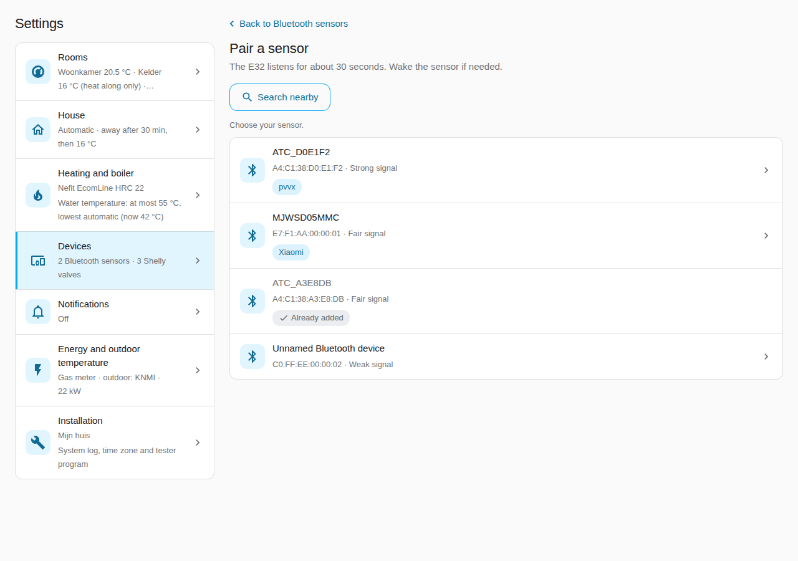

The E32's own page is the second way, and the only one without Home Assistant.

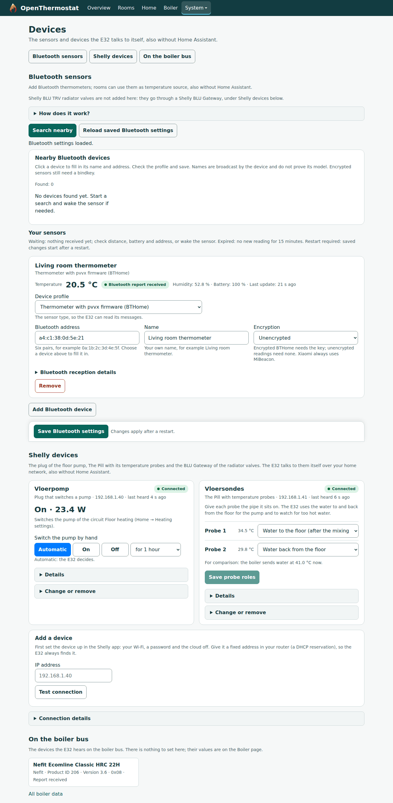

**If not:** "Waiting" means nothing has come in yet. Check the distance and the
battery. More in [Bluetooth thermometers](USER-GUIDE-REFERENCE.md#bluetooth-thermometers).
A sensor that is not found or read well: [Add a device: send a
capture](ADD-A-DEVICE.md).

### 6. Add your first room on the E32

**Do**

1. Open **Rooms** and choose **Add room**. Type a name, for example "Living room".
2. Set the **State** to **On**. Choose the **Heating type**: radiators or
   floor heating.
3. Under **Temperature sources**, choose your thermometer.
4. Turn on **Use a week program**. Under **Start from a template**, choose
   **Workdays and weekend**.
5. Choose **Save rooms**.

**You see:** the room with its temperature, its target and the status
**Measured**. On the **Overview**, one line says why the room heats or not.

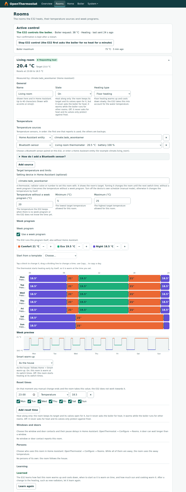

**If not:** no temperature? Go back to step 5. Does the page say **Managed in
Home Assistant**? Then set up the room in Home Assistant (step 10).

Floor heating without a mixing valve? It usually needs water of at most 45–50 °C.
Set that on the **Home** page under **Water temperature limits**, then **Save limits**.
Leave **Lowest water temperature: automatic** on: the E32 then finds the lowest
water temperature itself and never goes below 30 °C. Turn it off only if you
want a lowest value of your own; the line under the fields says what the E32
uses now.

### 7. Connect the E32 to the message broker

The E32 talks to Home Assistant through the broker. It needs its own login there.

**Do**

1. In Home Assistant, open **Settings → People → Users → Add user**. Name it
   `e32` and give it a password. (No **Users** tab? Turn on **Advanced mode** in
   your user profile.)
2. On the E32, open **System → Settings**, section **Home Assistant**, part **MQTT broker**.
3. Tick **Connect to the MQTT broker**.
4. **Broker address**: the address of your Home Assistant, for example
   `192.168.1.10`. **Broker port**: `1883`.
5. **User name** and **Password**: the login from point 1.
6. Choose **Save settings** and let the E32 restart.

**You see:** after the restart, **Connect to the MQTT broker** is still ticked. Step 9 checks the link.

**If not:** step 9 tells you what is missing. Check the user name and password.

### 8. Install the Home Assistant integration

**Do**

1. Open **Settings → Marketplace** and choose **Add from link** at the top
   right.
2. Enter `https://github.com/dielessen/openthermostat-ha` and choose **Add**
   (type **Integration** if it asks).
3. Search for **OpenThermostat**, open it and choose **Install**.
4. Restart Home Assistant: **Settings → System → Restart**.

**You see:** the Marketplace lists **OpenThermostat** as installed.

**If not:** see [installing with the Marketplace](INSTALL.md#91-with-the-marketplace-recommended).
Home Assistant 2026.10 or older? There the same steps are done in **HACS**.

### 9. Connect Home Assistant to the E32

**Do**

1. Open **Settings → Devices & services → Add integration**, choose **OpenThermostat**.
2. In **Set up your heating installation**, type an **Installation name**, for
   example "Home". Tick **Show the OpenThermostat dashboard**.
3. Choose **Add installation**.
4. Open OpenThermostat and choose **Configure** (the gear icon). Choose **E32
   connection**.
5. **E32 web address**: the address from step 1, with `http://`. **E32
   password**: the password from step 2.
6. Choose **Submit**. Wait up to two minutes. The E32 may restart once.

**You see:** **E32 connected**. The E32's **Overview** says **Home Assistant:
connected**. The sidebar now has the **OpenThermostat** dashboard. Under
**Settings → Devices & services → OpenThermostat** you find the device
**OpenThermostat E32**, your boiler (named after the model you choose on the
E32's Boiler page, else **Boiler**) with its values and settings, one device per
room and per Bluetooth sensor, and **Thermostat on the boiler bus** when the E32
hears another thermostat there.

From now on **Configure** has two items: **Open the settings page** (the way to
the dashboard's **Settings** tab) and **E32 connection**. Every setting is on the
dashboard's **Settings** tab. The name of the installation, the E32's system log,
time zone and tester program, and the maintenance (restoring a backup, tidying
entity IDs, removing old Home Assistant rooms) are under **Settings →
Installation**. Without the OpenThermostat dashboard, Configure keeps every setting
in its own item (**Rooms**, **House**, **Heating and boiler** …), with the same names.

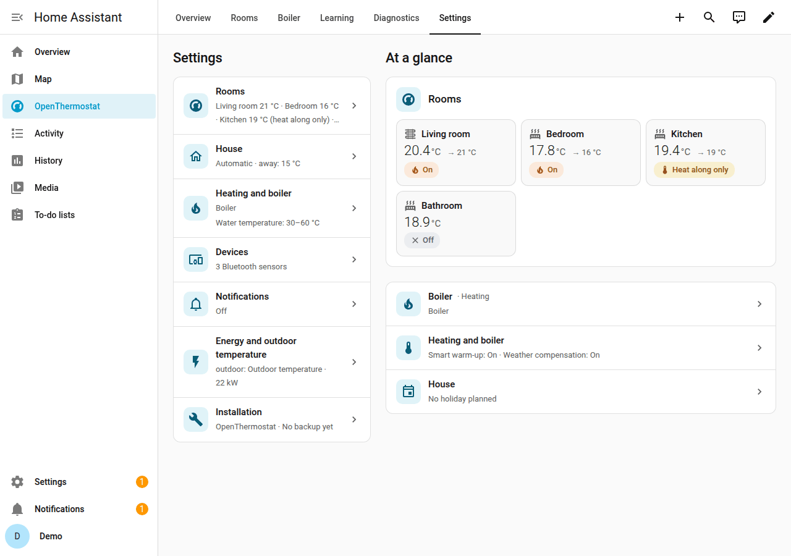

**If not:** the message says what is missing, mostly MQTT on the E32 (step 7).
More in [Connect E32 does not work](INSTALL.md#connect-e32-does-not-work).

### 10. Set up your rooms in Home Assistant

Your E32 rooms are already there. Here you add what Home Assistant knows.

**Do**

1. Open the **OpenThermostat** dashboard, tab **Settings**, then **Rooms**. Each
   room is a card: the temperature now, the target, its state (**On**, **Heat along
   only**, **Off**) and what it does now. Choose the room, or **+ Room** for a new
   one. (From a room's card on the **Overview**: **Settings**, bottom right.)
2. The room's screen has a section for each part, each with one line of what is
   set; tap a section to open it. The panel remembers which sections you opened.
3. **General**: the name, **Heating** (**On**, **Heat along only** or **Off**, with
   the explanation of the chosen one under it), **Heating type**, and **Off until**
   while the room is Off ("Off until 14:00, then on again" on the list and the
   card). On a room that heats along, **Heat along up to** is here too, right under
   **Heating**: "The valve opens up to this temperature; the room asks for no heat
   itself." It is the same setting as the temperature without a week program. A
   heat-along room with a week program shows a sentence instead and the button
   **Use one fixed temperature**: it asks first, removes the week program and
   keeps the temperature you give.
4. **Temperature**: **Add a source** and search for a thermostat, a temperature
   sensor or your Bluetooth thermometer; the first one with a fresh value is used,
   **Use first** moves a source to the top. Optional: a **Setting device** you turn
   by hand (Home Assistant keeps it at the room's temperature; turning it changes
   the room). On an On room a radiator valve as setting device gets a hint: it
   regulates on its own sensor and often closes before the room is warm. A device
   is the setting device or a valve the E32 drives, not both. And the
   **Temperature without a week program**, with a line under it that says where
   the target comes from now ("Now 14 °C from the reset time of 22:00") and,
   after two weeks, the advice of how far the room heats along for free, with the
   button **Use** to take it over.
5. **Week program**: the week planner itself, for this room, with its own **Save to
   E32** button (step 11). A new room starts with the standard program; switch off
   **Start with the standard week program** if it needs none.
6. **Windows and doors**: choose the **Window contacts** and **Door contacts**. The
   room pauses after the house's time (2 minutes for a window, 5 for a door); choose
   **Own value** to give this room its own.
7. **Radiator valves**: the room's valves with how each is driven, their battery
   and last report. **Add a valve** (or **Add from the BLU Gateway**), choose a
   valve's model when it is not recognised, or remove one. **Valve control** on:
   the valves follow the room, and the E32 puts a valve back within a minute when
   someone turns it. A valve that regulates itself (a Sonoff TRV Gen2) says "Regulates
   itself to the target; the position cannot be read". A thermometer of the E32
   that Home Assistant also lists offers **Use the E32's sensor**. A valve of
   another brand, or one that shows no battery or "set to"? [Add a device: send a
   capture](ADD-A-DEVICE.md); the [device matrix](DEVICES.md) says what is
   verified.
8. **Persons**: who uses this room (empty: the room follows the house), and the
   temperature while they are away.
9. **Notifications for this room**: which messages, and **Who gets them**:
   **Everyone with a phone** or **Chosen people** (pick them as chips; nobody
   chosen means the messages show in Home Assistant only). And **Temperature limits** (the lowest and highest target of the room).
10. The bar at the bottom appears as soon as you change something: choose
    **Save**. Repeat for every room.

Without the dashboard, Configure's room form holds the same fields: **Configure →
Rooms → Edit or remove a room**.

**You see:** the list of rooms, with what was saved. In Configure, for example
"Week program: none; the room keeps 14 °C without a week program."

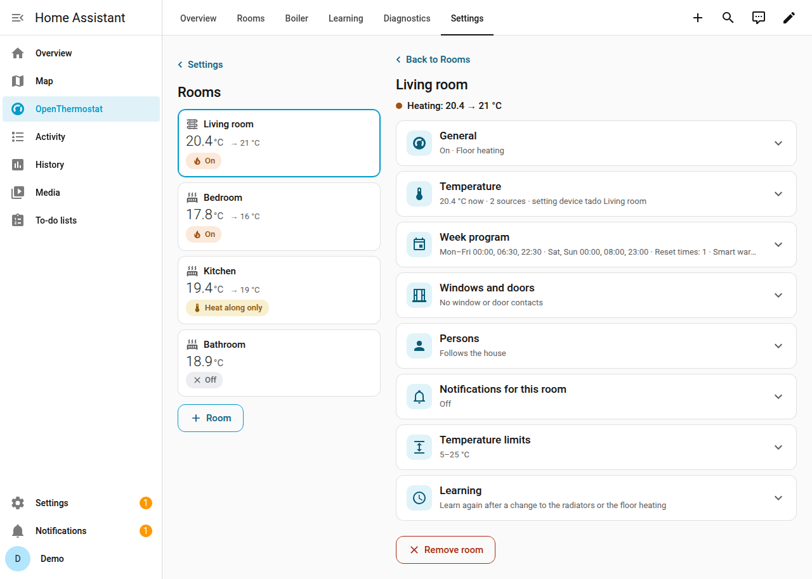

**You see:** on the dashboard's **Overview** tab, a card for each room. It shows
the temperature and one line why the room heats or not. Every tab of the dashboard
uses the whole width of your screen: one column on a phone, up to four on a large
monitor.

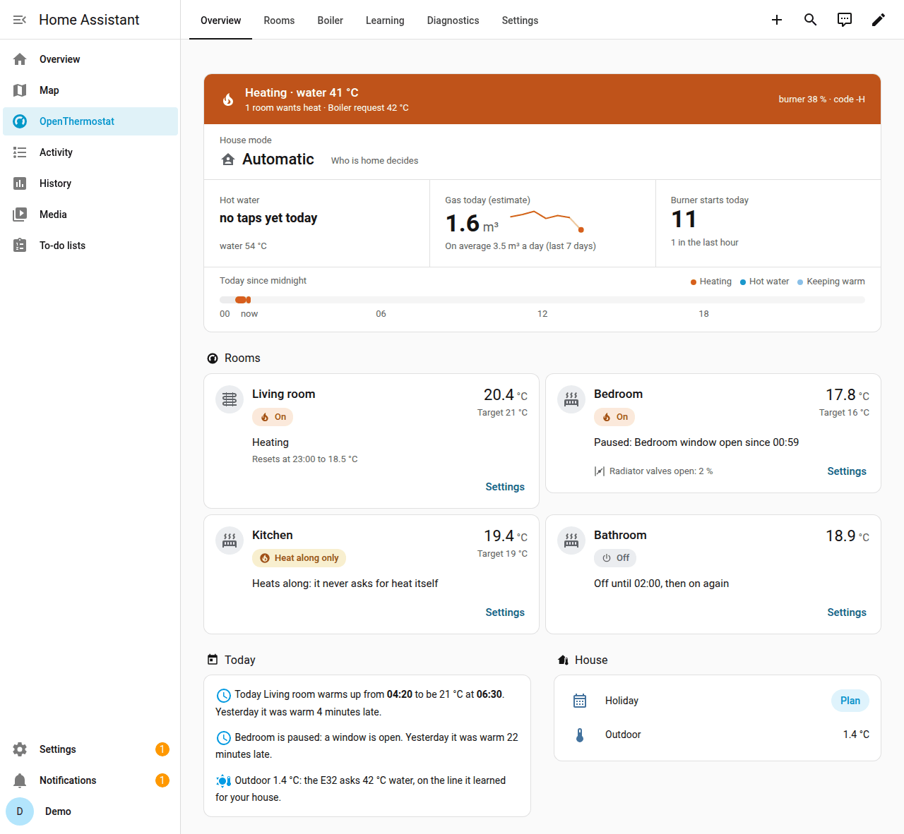

On the **Rooms** tab each room has one card:

- At the top the room's name and its **state**. Tap the state to choose **On**,
  **Heat along only** or **Off**.
- The **arc** shows the temperature now and a dot where you want it. Tap the arc
  for Home Assistant's thermostat. **Target** with **−** and **+** changes it by half
  a degree. A quiet line under it says when the room goes back to its program.
- The **presets** (**Program**, **Comfort**, **Eco**, **Night**, **Boost**) set
  the room to a level; every room has the same five. **Program** goes back to the
  week program. A room without a week program uses the room defaults of
  **Settings → House** for the levels, and the card says so under the presets.
- The **bar** is today from 0 to 24 hours in the colours of the levels. A
  hatched part is Smart warm-up heating early; the line over the bar says when.
- The **line** is the last 24 hours: the measured temperature (blue) and the
  target (orange).
- The **tiles** are the room's devices: thermometer, radiator valves, windows and
  doors, persons. A valve's tile also says what the E32 found, for example "put
  back to 17 °C".
- **Week program** and **Settings** at the bottom open the room's own screen.

What the E32 learns per room is on the **Learning** tab, not here.

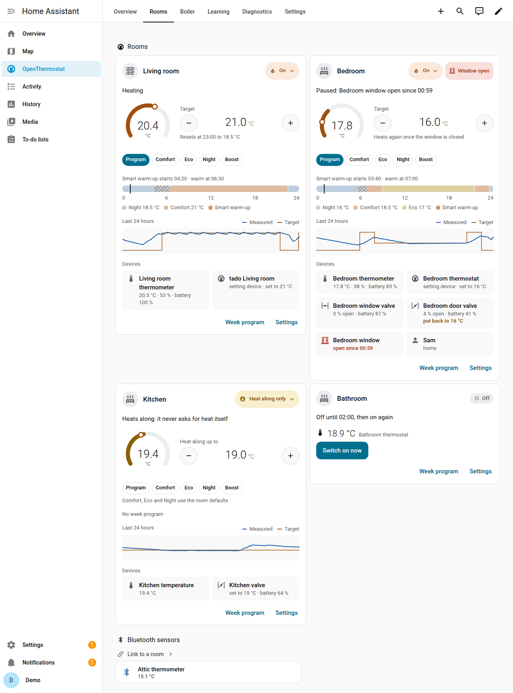

**If not:** a room says "No measurement"? Choose another temperature source.
The setting device does not follow the program? Open the room's thermostat in
Home Assistant and look under **Attributes**: `setting_device_error` says what
went wrong. After three failed tries in a row, **Settings → System → Repairs**
says so too, with what to check.
Details: [a room with a Home Assistant thermostat](USER-GUIDE-REFERENCE.md#a-room-with-a-home-assistant-thermostat-and-a-bluetooth-fallback),
[the setting device](USER-GUIDE-REFERENCE.md#week-program-and-setting-device)
and [windows and doors](USER-GUIDE-REFERENCE.md#windows-and-doors).

### 11. Set the week program

A time in the week program means "warm at that time". The E32 starts early by itself.

**Do**

1. Open the **OpenThermostat** dashboard, **Settings → Rooms**, the room, section
   **Week program**: the week planner of that room.
2. Set the temperatures of the three levels: **Comfort**, **Eco** and **Night**.
3. Paint the blocks of each day with these levels.
4. Use **Copy…** to copy a day to other days. **Undo** takes back a step.
5. Under the planner, choose the room's **Smart warm-up**: **As the house**, **On**
   or **Off**.
6. Choose **Save to E32**. The program, the reset times and Smart warm-up of the
   room are saved together.

**You see:** **Saved on the E32.** The room card shows the level now and the next
one. For example: "Comfort until 22:30, then Night 18.0 °C". A reset time shows
as a marker above its day: an arrow down at its time with its value.

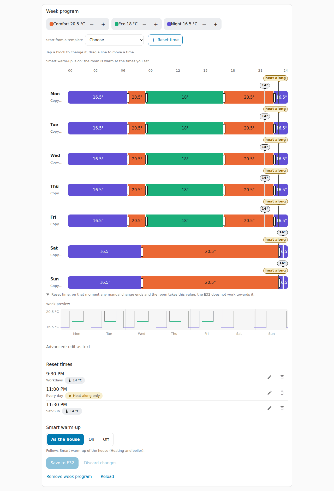

**If not:** the card says the program was changed elsewhere? Reload and make
your change again. More in
[week program and setting device](USER-GUIDE-REFERENCE.md#week-program-and-setting-device).

**All rooms in one planner (optional).** Since 1.4.1 the dashboard has no
**Week program** tab: each room's program is on its own screen. The planner is
still a card you can add by hand to a dashboard of your own (**Edit dashboard →
Add card → Manual**):

```yaml
type: custom:openthermostat-e32-week
entry_id: 0123456789abcdef0123456789abcdef
```

It shows every room, with a tab per room. Replace the `entry_id` by your
installation's: in **Settings → Devices & services → OpenThermostat**, open the
installation's devices; the address bar then ends with `config_entry=` and that
ID.

#### Set a room back at a fixed time

A **reset time** is a moment on chosen days. On that moment any manual change
ends and the room takes this value; the E32 does not work towards it. The value
is a temperature, or **On**, **Heat along only** or **Off**. After it, the room is
free again: a turn of its thermostat counts as always.

For example:

- A child's room that the child sets on the wall: every day at 22:00 back to
  14 °C. It never stays warm all night.
- Bathroom and hallway: every day at 23:00 back to Heat along only, also when
  someone made them warmer during the day.
- A bathroom with a program that warms it to 21 °C at 06:30 (warm on time): at
  08:00 back to Heat along only.

**Do, in Home Assistant**

1. Open the room's week planner: **Settings → Rooms**, the room, **Week program**.
2. Choose **+ Reset time**. A marker appears on the day you last touched, at 22:00,
   and its card opens. Set the time, tap the days it holds (or **Every day**,
   **Workdays**), and choose the value: **Temperature** (then − and + in half
   degrees) or **On**, **Heat along only** or **Off**. Choose **Done**. At most
   four.
3. To move one, drag its marker: it moves in steps of 15 minutes, on all its
   days. Tap a marker to change it or to **Remove** it.
4. Choose **Save to E32**.

Under the planner the list **Reset times** shows the same reset times, each with
a button to change it and one to remove it: handy with a keyboard, a screen
reader or on a phone.

Or in Configure's room form (step 10): fill in **Reset times (optional)**, one per
line. The days as in the week program (`mon-fri`, `sat-sun`,
`daily`), the time, then a temperature or `on`, `heat along` or `off`. For the
examples: `daily 22:00 14`, `daily 23:00 heat along`, `daily 08:00 heat along`.

**Do, on the E32**

1. Open **Rooms**, then the room and its block **Reset times**.
2. Choose **Add reset time**. Set the time, the days and the value. A room has
   at most four.
3. Choose **Save rooms**.

**You see:** the week planner shows each one as a marker above its day (an arrow
at its time, with "14°", "on", "heat along" or "off"), the list under it names
them, and on the day itself the room's card on the E32 says "Resets at 22:00 to
14.0 °C".

**If not:** no such field or block? The E32 needs firmware 1.4 or newer. More in
[reset times](USER-GUIDE-REFERENCE.md#reset-times).

### 12. Set up away and holiday

When everyone is out, the rooms go cooler. A holiday keeps them cool until you return.

**Do**

1. Open **Settings → House** on the dashboard, then **Presence and away
   temperature**.
2. Choose **Who lives here**. Set the **Temperature when nobody is home**
   (15 °C at the start). Choose **Save**.
3. For a holiday: **Settings → House → House mode and holiday**, then **Plan a
   holiday** under **Planned holidays**.
4. Choose when it **Starts** and when it **Ends (back home)**. Choose **Save**.

Without the dashboard: **Configure → House → Presence and away temperature**, and
**Configure → House → House mode and holiday → Plan a holiday**; choose
**Submit**.

**You see:** on the **Overview** tab, the **House** card. **Home or away** says
**Automatic**. **Holiday** shows your next holiday.

**If not:** "The E32 clock is not set yet"? Wait a minute and try again. More in
[away](USER-GUIDE-REFERENCE.md#away-the-whole-house-and-single-rooms) and
[the holiday planner](USER-GUIDE-REFERENCE.md#holiday-planner).

#### Summer

In summer the house needs no heating. The house mode **Summer** keeps it off
until you switch it off; hot water and frost protection stay.

**Do**

1. On the **Overview** tab, tap **Home or away** and choose **Summer**. (Or the
   house mode in **Settings → House → House mode and holiday**, or in
   **Configure → House → House mode and holiday**.)
2. When it gets colder, choose the mode you had before again. The banner at the
   top of the dashboard has a button for it.

**You see:** "Summer mode: the heating stays off until you switch this off; hot
water and frost protection stay." Each room says **Summer** and its thermostat
is off.

**If not:** no **Summer** in the list? The E32 needs firmware 1.4.1 or newer.
A thermostat that says "Summer mode is on: switch it off first." is not broken:
in summer no room heats. More in
[summer mode](USER-GUIDE-REFERENCE.md#summer-mode).

### 13. Let the E32 learn

There is nothing to set. **Smart warm-up** and **Weather compensation** are on.
You see the first results after step 14, once the E32 controls the boiler.

**What to expect**

1. **The first mornings:** the E32 guesses when to start. It says "(estimate)".
   A room can be warm a little early or late.
2. **Every morning** it checks whether the room was warm on time. It then starts
   a bit earlier or later, a little at a time: at most a quarter of an hour a
   morning, and not at all after a morning that was within 10 minutes. A room
   that is still short at its switch time keeps its warm water until it is warm.
   Floor heating is often still late: the warmth stored in the floor is hidden
   from the room sensor, so the same shortfall can need 10 minutes one morning
   and over an hour the next before the room starts to rise. A room counts as
   **learned** only when four of its last five usable mornings were within a
   quarter of an hour; that takes about a week, and again after an update to 1.4.6.
3. **After the first full day:** **Yesterday** shows how the day went.
4. **From the fifth day:** **Noticed** compares yesterday with your usual days.
5. **Over the first weeks:** Weather compensation learns your house. In mild
   weather this can take weeks.
6. It also sets the burner rest itself, at most one small step a day.
7. **Planning the heating:** the E32 keeps a model of each room and checks its
   predictions every day. About a week of good predictions makes it ready: Home
   Assistant tells you once, as a house message (when house messages are on).
   Choose **Let the E32 plan the heating** under **Today's plan** on the
   **Learning** tab (or on the E32 device) and confirm. Nothing changes until
   you confirm. If its predictions get worse, the E32 goes back to heating as
   before by itself and asks you again later.

**Optional, per room:** a room that need not be warm at its switch times (a
guest room, a hall) can start heating at them instead, which saves gas. Open
**Settings → Rooms** on the dashboard (or Configure's room form, step 10), choose the
room and set **Smart warm-up** to **Off**. **On** keeps that room warm on time even with Smart
warm-up off for the house; **As the house** (the standard choice) follows the
house. On the E32: **Rooms**, the room, **Week program → Smart warm-up**. More in
[Warm on time](USER-GUIDE-REFERENCE.md#warm-on-time-smart-warm-up).

**Optional:** a weather forecast helps it plan ahead. On the OpenThermostat
dashboard, open the tab **Settings → Energy and outdoor temperature** and choose a
weather entity under **Weather forecast** (a weather entity you chose as the
outdoor temperature is filled in already; without the dashboard: **Configure →
Energy and outdoor temperature**). The **Comfort style** (**Settings → Heating and
boiler → Smart warm-up and weather compensation**, or the same item under Configure
→ Heating and boiler without the dashboard) says
what the plan weighs: **Comfort first**, **Balanced** (the standard choice) or
**Save most**; each choice has its explanation right under it.

**You see:** the dashboard tab **Learning**. At the top is **What the E32
knows**, for example "The E32 knows your house: 62 %". Under it is the learning
path: for each thing the E32 learns a label, green when it is learned, amber
with what it still needs when it is not ("Warm on time Bedroom · 2 more
mornings"). The number rises by itself. Under it, **Per room**, each room has
a card with four facts: how long one degree takes, how fast the room cools,
the coolest water that warms in time, and the free heat. **A fact the E32 has
not learned yet says what it still needs** ("2 more warm-ups"), never a
number. The card also shows when Smart warm-up starts, seven dots for the last
mornings (green: warm on time), how far the room model is, and the advice.
Further down: the water temperature chart, **Yesterday**, and **What it
changed by itself**. With a plan, **Today's plan** shows what the E32 plans,
why, when the room should be warm, and how the last morning went ("This
morning: 6 minutes early."). On the E32:
**Home → What the E32 has learned**, and on that same page the panel **The
heating plan** with the same sentence, the button to confirm once it is ready,
and the **Comfort style** choice.

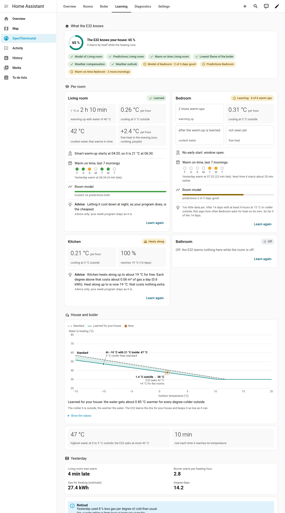

Under the water temperature chart the boiler's own figures say from which
water it **burns steadily**: cooler water would make your boiler switch itself
off and on, so the E32 asks a little more. Once a day the E32 tries 2 °C cooler
water for half an hour and keeps it when the boiler still burns steadily;
**What the E32 has learned** says what it tried.

**Changed your heating? Learn again.** After a rebuild (new radiators, a new
boiler, floor heating added, a room that is used differently) what the E32
learned may no longer be true. Choose **Learn again** and it forgets that and
learns it again by itself. It asks first, and it only touches what it learned:
your week programs and settings stay. On the E32, for one room: **Rooms**, the
room, block **Learning**. For the house: **Home**, under **What the E32 has
learned**. In Home Assistant: the room's screen under **Settings → Rooms** (block
**Learning**), **Settings → Heating and boiler** (**Learn again: house**) and a
button at the foot of the room's card on the **Learning** tab. An E32 older than
1.4.4 does not offer it.

- **For a room** it clears the warm-up and the cooling, warm on time, the room's
  model and the free heat.
- **For the house** it clears the weather compensation, how your boiler responds
  (its highest and lowest water temperature), the water temperature at which it
  burns steadily, and the settings the E32 set itself.
- **What stays:** the week programs, every setting you made, the days already
  recorded (yesterday, the heating hours, hot water) and the boiler's lowest
  flame.

Until it has learned a fact again, the E32 uses its start values, and the
tile says what it still needs ("6 more warm-ups"). Use **Learn again** only
after a real change: a quiet week is not a reason.

**If not:** a tile that says what it still needs is normal in the first weeks. **House and boiler**
fills in only after step 14. More in
[learning](USER-GUIDE-REFERENCE.md#learning-how-the-e32-tunes-itself).

### 14. Let the E32 control the boiler

This is the switch-over. Only after it does the E32 heat your home.
Do it while you are at home, near the boiler. It takes about 30 minutes.

Does the E32 hear your old thermostat? Then it first runs a **trial run**. It
works out what it would do, but sends nothing. The **Rooms** page then shows
**Ready for the E32 to control the boiler?**. You can wait until all its lines
are green, or start the test straight away.

**Do**

1. On the E32, open **Boiler → Boiler test and takeover** (right under **Now**).
   Choose **Start the boiler test**.
2. **No other thermostat on the boiler.** Have an old thermostat? Switch the
   boiler off, disconnect the thermostat, switch the boiler on.
3. **Confirm the takeover.** Confirm that the E32 may control the boiler.
4. **Start heating.** Wait. The burner starts within 10 minutes.
5. **Hot water while heating.** Open a hot tap for 3 minutes. No hot water from
   this boiler? Choose **My boiler makes no hot water: skip this step**.
6. **Stop heating.** Wait. The burner switches off and stays off for 5 minutes.

**You see:** "The E32 now controls your boiler." The week program carries on.
The **Overview** says **The E32 controls the boiler**.

**Then watch for two weeks:** are the rooms warm on time? Is the dashboard band
not red? Look at **Yesterday** each day.

**If not:** the page stops the test and says what to do. To go back, choose
**Give control back to my thermostat**. Then reconnect your old thermostat.
An EMS+ boiler? Skip this step: the E32 does not control it yet. See
[an EMS+ boiler](#an-ems-boiler-watch-test-and-share).
Details: [the switch-over](USER-GUIDE-REFERENCE.md#the-attended-switch-over) and
the switch-over procedure.

### 15. Keep it up to date

Update while someone is at home. Read the release notes first.

**Do**

1. First the integration. Open **Settings → Updates**. Choose **OpenThermostat**,
   then **Install**. Restart Home Assistant.
2. Then the firmware. In **Settings → Updates**, choose the E32's **Firmware**,
   then **Install**. Keep the E32 switched on.
3. Confirm again. Open **Settings → System → Repairs → Confirm again that the
   E32 may control the boiler**. Choose **Fix** and confirm.

**You see:** the new version on the **Firmware** entity. The repair is gone.

**If not:** until you confirm, the E32 only keeps frost protection. A new
firmware that does not start goes back by itself
([automatic rollback](INSTALL.md#135-automatic-rollback)). Coming from an older
version? The [update chain](INSTALL.md#131-update-order) says what each release
changes.

### 16. Boiler settings (only if you want it)

This is a preview. The E32 can change a few boiler settings, such as the hot
water temperature. It is off until you allow it.

**Do**

1. Open the dashboard's **Settings → Heating and boiler → Boiler settings
   (preview)**. No such row? Your E32 firmware does not have it yet.
2. Read the warning under **Allow the E32 to change boiler settings** (the list
   under it shows the boiler's values now). Tick **I understand: I watch the
   boiler after a change** and choose **Allow**.
3. Choose a setting in the list, for example **Selected hot water temperature**.
4. Choose the new value and **Change**. Switching heating or hot water off asks
   **Really switch it off?** first.
5. A setting marked **Verified on this boiler** is changed at once: the screen
   says **Saved**. Any other one opens **Watch your boiler**: watch it for up to
   15 minutes. Does it do what you expect?
6. Choose **Keep the new value** or **Put it back**.

**You see:** a line says "Kept: … stays at …" or "Put back: … is … again".
Choose **Done (the E32 puts it back after 15 minutes)** or do nothing, and the E32
puts the old value back after 15 minutes. The card **The change you are watching
now** brings the dialog back.

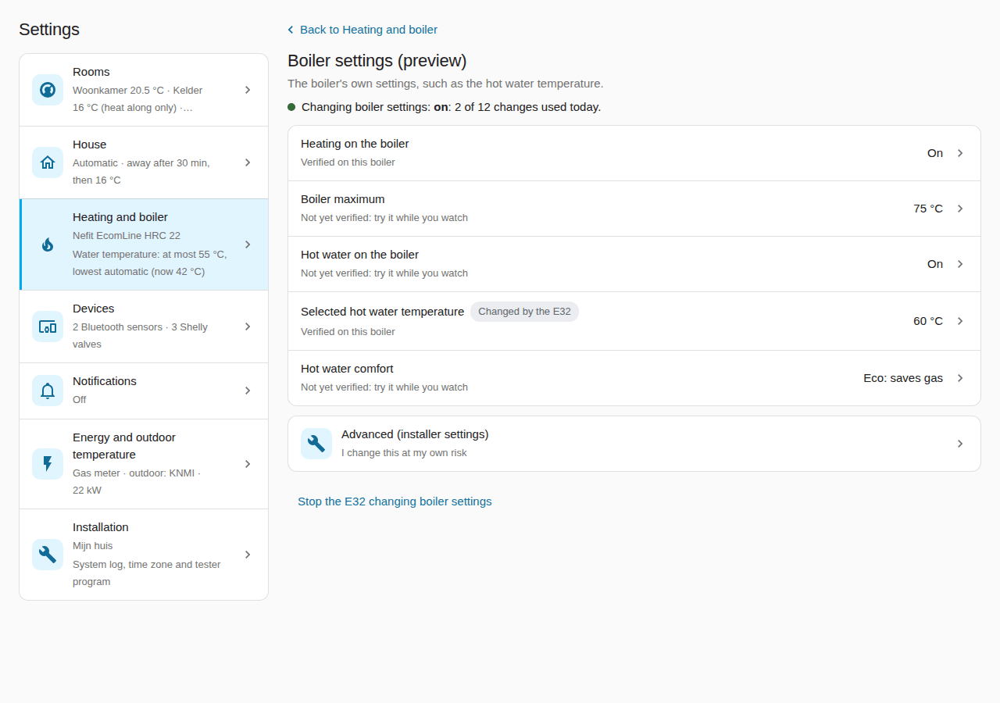

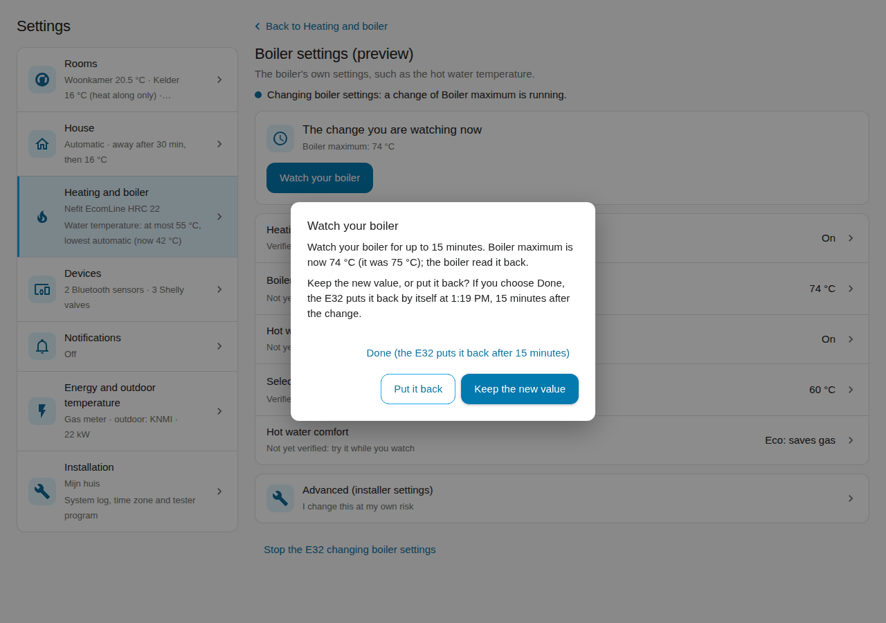

**If not:**

- The screen says **blocked** and shows **Check the boiler**? Check that setting
  on the boiler itself. Then choose **Boiler checked** (or **Fix** in the repair
  **Check the boiler: a setting could not be put back**).
- The message **Boiler setting put back**? Nobody kept the new value within
  15 minutes, or the boiler reported another value. Change it again if you
  want it.
- "The E32 changes at most 12 boiler settings a day"? Try again tomorrow.
- "The E32 is about to restart or update"? Try again in a minute. While the E32
  heats with the boiler, a change works as usual.
- An EMS+ boiler? Boiler settings work on EMS Classic boilers only, for now.

The installer settings are under **Advanced (installer settings)**: it asks
first and stays open for 30 minutes ("Advanced open, 25 min left"; **Close**
closes it sooner).

To stop, choose **Stop the E32 changing boiler settings** at the bottom of the
screen and confirm. The E32 **Boiler** page has the same. More in [boiler settings](USER-GUIDE-REFERENCE.md#boiler-settings-preview).

## Optional: Shelly devices for the floor pump and valves

Only for an E32 V2 with firmware 1.1 or newer, and only if you have them:

- a **Shelly Plug S Gen3** on the floor pump,
- **The Pill** with temperature probes on the floor pipes,
- a **Shelly BLU Gateway Gen3** with **Shelly BLU TRV** valves.

The E32 talks to them itself, over your home network. Home Assistant and the
message broker are not needed for it. Take these steps in order, and take
your time: each one first watches before anything is switched.

### 17. Add your Shelly devices

First set up each device in the **Shelly app**:

- your Wi-Fi, a password, the firmware up to date and the **cloud off**;
- a fixed address in your router (a **DHCP reservation**), so the E32 always
  finds it;
- for the valves: pair **every** valve with the BLU Gateway in the Shelly app.
  Give each one the name of its room there; the E32 shows that name.

Leave the floor pump running as it does now.

**Do**

1. On the E32, open **System → Devices**, section **Shelly devices**. (In Home
   Assistant the same is on the dashboard tab **Settings → Devices → Shelly
   devices**: choose **Shelly device** (the screen is called **Add a Shelly
   device**), type the address, **What does it do?**, a name and the **Device
   password**, and choose **Save**; the E32 tests the address when you save.
   Without the dashboard: **Configure → E32 devices → Shelly devices**.)
2. Under **Add a device**, type the device's **IP address**. Choose
   **Test connection**.
3. Choose **What does it do?**, type a **Name** and the **Device password**.
   Choose **Add device**. Repeat for each device.
4. The Pill: give each probe its pipe, for example **Water to the floor (after
   the mixing valve)** and **Water back from the floor**. Choose **Save probe
   roles**.
5. The BLU Gateway: choose **Look for valves at the gateway** (on the E32 page; in
   Home Assistant open the gateway's own screen under **Devices → Shelly
   devices**). The E32 asks the gateway, and the list shows the valves it has
   paired, with their names. **Tap a valve to add it**; a valve already in the
   list says **Already in the list**. (Or choose **Add a valve** and type the
   **Valve number**, usually 200, 201 and so on.)
6. Wait a day. The E32 only reads; it switches nothing yet.

**You see:** every device with **Connected** and "last heard … ago". The Plug
shows its power. The Pill shows its temperatures, beside the boiler's water.
The gateway lists its valves with target, opening, battery and signal.

**If not:** **Not reachable since …**? Check the address and that the device
has power. **The password is not accepted**? Type it again under **Change or
remove**. A valve **Not paired with the gateway**? Pair it in the Shelly app.
**The gateway gave no list of its valves**? Update the gateway's firmware in
the Shelly app, or add the valves by number. A weak signal? Move the gateway
closer to the valves.

### 18. Let the E32 watch the floor pump first, then switch it

Watching first shows what the E32 would do with the pump. You check that it is
right before the E32 switches anything.

**Do**

1. Open the **Home** page, **Heating settings → Heating circuits**. Choose
   **Add the floor circuit**.
2. Tick the floor rooms under **Rooms of this circuit**. Check the **Pump** and
   the two probes. Leave **Pump control by the E32** off. Choose **Save
   circuit**.
3. Try the pump by hand once. Under **Switch the pump by hand**, choose **On**,
   then **Off**. The power follows. Then choose **Automatic**.
4. Watch for two days. The card says, for example, "The E32 would switch the
   pump on now: a room needs heat." Does that match your floor?
5. Does it match, and does the E32 control your boiler (step 14)? Then tick
   **Pump control by the E32** and choose **Save circuit**. With Shelly valves,
   do step 19 first.

**You see:** **Pump on** or **Pump off**, why, the power, and the water to and
back from the floor. After step 5: **The E32 switches the pump.**

**Good to know:** after the heat the pump runs on while the water to the floor
is still warmer than the water back, so the floor takes up the rest of the
heat. The card then says, for example, "Running on: the water is still 3.8 °C
warmer than the water back". It stops when the water back has caught up, or
after 30 minutes at most. You change that under **Advanced**, or in Home
Assistant on the dashboard tab **Settings → Heating and boiler → Heating
circuits** (without the dashboard: **Configure → Heating and boiler → Heating
circuits**), with
**Highest water temperature to the floor** (50 °C is usual).

**Good to know:** when the E32 switches the pump off, the Plug switches it back
on by itself within 30 minutes, unless the E32 repeats the "off". So a failed
E32 or network never leaves the floor without its pump.

**If not:** **The pump draws no power: is the pump switch still in the way?**
The pump's own switch (a thermostat on the pipe) still holds it off. Have an
installer bridge it or set it to its lowest. Keep a maximum limiter in place.
**The floor water is too hot: check the mixing valve**? The E32 switched the
pump off. Check the mixing valve; the pump starts again by itself.

### 19. Add Shelly radiator and floor loop valves

Each valve gets a room and a role. A **radiator valve** gets the room's target
from the E32 and opens and closes to reach it. A **floor loop valve** on the
floor manifold is opened and closed by the E32.

**Do**

1. Open **Rooms**, then the room. Under **Radiator valves**, choose **Add Shelly
   valve**.
2. Pick the valve. Choose **Radiator valve** or **Floor loop valve**.
3. For one radiator, for example the bathroom, tick **Keep this radiator open as
   the water's path**. Keep it until you know your boiler has a bypass.
4. Tick **Drive these valves from the E32** and choose **Save valves**.
5. Start with one valve. Watch it for a day. Then add the others.

**You see:** each valve in the room with **Reporting**, its opening and
battery. The kept-open radiator says "held open as the water's path while the
boiler heats" when needed.

**If not:** **Gateway not reachable**? Check the gateway's USB power and Wi-Fi.
**Not found at the gateway**? Pair the valve again in the Shelly app, and check
its number on **System → Devices**, section **Shelly devices**. **Silent for 15 minutes**? Check the
valve's battery and its distance to the gateway.

More about Shelly devices, the pump rule and what happens when something is
away: [Shelly devices](USER-GUIDE-REFERENCE.md#shelly-devices-floor-pump-probes-and-valves).
The attended checks: Shelly acceptance.

## Does the E32 know your boiler?

The **Boiler** page has a block **My boiler**. It names the boiler the E32
found on the bus. It also says whether the E32 may control it.

**Do**

1. Open **Boiler**. Wait about 10 minutes after the E32 starts.
2. Read **My boiler**: the model, the product number and version, and one
   sentence.

**You see:** one sentence. It starts with one of these words.

| The sentence starts with | What it means for you |
| --- | --- |
| **Not recognised yet** | The E32 waits for the boiler to say which model it is. Nothing to do. |
| **Reading only** | An EMS+ boiler not tested yet. The E32 shows the values and what it would ask. It does not control it. |
| **Not in the list yet** / **Not tested with OpenThermostat yet** | An EMS Classic boiler that is not in the list. The E32 controls it the Classic way after step 14, as before. Share a recording so it can be listed. |
| **Tested by you** | A test on this boiler passed. An EMS Classic boiler: the E32 controls it after step 14. An EMS+ boiler: "the result waits for review"; the E32 still only watches. |
| **Verified** | This boiler model is checked. The E32 may control it after you confirm. |
| **A different boiler is connected** | The E32 found another boiler than before. An EMS+ boiler: it controls nothing until you confirm. An EMS Classic boiler: the Classic way goes on. |

Under the sentence, **Why** gives the reason in a few words. Home Assistant
shows the same on the sensor **Boiler recognition** (on the boiler device).

**If not:**

- No **My boiler** block? Your E32 firmware does not have it yet.
- Still **Not recognised yet** after 30 minutes? Check the boiler cable, and
  that the boiler is on.
- **A different boiler is connected**? Did you replace the boiler? Choose **I
  changed the boiler**. Or, in Home Assistant, open the repair **A different
  boiler is connected** and choose **Fix**. Not replaced? Check the cable
  between the E32 and the boiler.

More in [boiler recognition](USER-GUIDE-REFERENCE.md#boiler-recognition-my-boiler).

## An EMS+ boiler: watch, test and share

The E32 reads an EMS+ boiler (EMS 2.0), but does not control it yet. It
controls an EMS+ boiler only when its model is **Verified**. Today no EMS+
model is verified. Your thermostat keeps controlling the boiler.

You can help to get your model verified. Do the steps below in order. Each
one is optional.

### A. Let the E32 watch your EMS+ boiler (trial run)

In a trial run the E32 works out what it would ask. It sends nothing.

**Do**

1. Keep your thermostat connected. Do steps 1 to 13. Skip step 14.
2. Open **Boiler**. Find **Comparison with your thermostat (today)**.
3. Watch for at least one day. Let the heating run, and use hot water.

**You see:** the E32's heating time and burner starts next to your
thermostat's. They need not be equal. Both should heat on a cold morning, and
both should rest when the house is warm. In Home Assistant: the
**Comparison** view of the dashboard.

**If not:** "No comparison data yet", or **Without thermostat data** keeps
growing? Then the E32 does not hear what your thermostat asks. That is useful
to know: share it (step C).

### B. The attended test (only if you want to help)

This test proves two things on your boiler. It takes the E32's request for
heat, and it stops again when the E32 asks for no heat. It takes about 20
minutes. Stay at the boiler the whole time.

It runs from the **Boiler** page, in the block **Test your EMS+ boiler** under
**My boiler**. That block only shows on an EMS+ boiler. It says whether a test
is possible now. A test needs your model in the list: **Why** says **Not tested
with OpenThermostat yet**.

**Do**

1. Choose a quiet moment. The house is warm, and nobody needs hot water.
2. Take a photo of your thermostat's wiring at the boiler.
3. Switch the boiler off. Disconnect your thermostat. Switch the boiler on.
4. Wait 10 minutes. The E32 must hear no thermostat for 10 minutes. Until then
   the block says "The E32 still hears your thermostat", with the minutes left.
5. On the E32, open **Boiler**. In **Test your EMS+ boiler**, tick **The
   thermostat is disconnected**. Choose **Start the test**.
6. The E32 shows a code. Choose **I am at the boiler** within 60 seconds.
7. Keep the E32 page open, stay signed in and stay at the boiler. Do not change
   anything. The block shows each step, a countdown, and what the E32 asks and
   the boiler shows. **Stop the test** ends it at any moment.
8. When the burner heats, you may open a hot tap for 2 minutes. Not required.
9. When the test is done, the block says **Last test** and the result. Switch
   the boiler off. Reconnect your thermostat, as in the photo. Switch the boiler
   on. Check that hot water works.

**You see:** first the E32 asks three times for no heat. Then it asks for a low
water temperature, 5 °C above the lowest the E32 uses, for at most 10
minutes. The burner should start within 5 minutes. Then the E32 asks for no
heat again. The burner should go off within 2 minutes and stay off for 5
minutes. **Last test** then says **Passed**, and **My boiler** says **Tested by
you: the result waits for review**, until the E32 restarts.

**If not:** the E32 stops the test by itself when something looks wrong. It
asks the boiler three times for no heat, and ends. That happens when another
thermostat asks for heat, the boiler goes silent, or the water pressure drops
below 1 bar. It also happens when the water gets 15 °C warmer than asked, or
the boiler does not take the request. **Last test** then says why, in one
sentence. A stopped test is a useful result too: share it. Did the test not
start? The block says why, for example "Not confirmed in time. Start again."

**Never during the test:** do not reconnect the thermostat. Do not let EMS-ESP
or another device send on the same bus. Do not change boiler settings. Do not
sign out of the E32. During the test the E32 accepts no other changes; Home
Assistant changes wait until it is done. If you sign out, or your sign-in
ends, the E32 stops the test: that is on purpose, so nobody tests unwatched.

### C. Share your result

Nothing leaves your home by itself. You choose what to share.

**Do**

1. In Home Assistant, open the dashboard tab **Settings → Installation → Tester
   program**. Switch on **Take part in the tester program** and choose **Save**.
   (Without the dashboard: **Configure → Advanced and diagnostics → Tester
   program**, tick it and submit.)
2. Choose **Start a bus recording (30 minutes)**. In that time, let the boiler
   rest, heat and make hot water. Note what you did, for example "rest, then
   heating, then a hot water tap for 2 minutes".
3. Choose **Share result**. Home Assistant writes two files,
   `boiler-share-<date>.json` and the recording `boiler-share-<date>.emsrec.txt`,
   and shows a message.
4. Read the message. It lists what is in the files. Open the files and look
   through them.
5. Choose the link in the message. It opens the GitHub form **Boiler profile**,
   partly filled in.
6. Attach the two files. Add a photo of the boiler's type plate and a photo of
   the boiler's display next to the **Boiler** page, taken at the same moment.
   Write in one line what you did during the recording. Tick that you share the
   recording under the project's licence. Send the form.

**You see:** a GitHub issue with your result. A check posts a summary under
it, with what it found in your recording.

**If not:** no **Share result**? Tick **Take part in the tester program**
   first. The recording is
not available? Your E32 has no room for it, or its firmware is older. Share
the result without it.

Good to know: the files hold the boiler's messages, the product number and
the versions. They hold no passwords, network addresses or Wi-Fi names, and
no room names. The boiler's messages do hold room temperatures and the
thermostat's clock. More in
[the tester program](USER-GUIDE-REFERENCE.md#the-tester-program-and-the-path-to-verified).

The photos and the line are optional in the form, but the review needs them:
the type plate confirms the model, the display shows whether the E32 reads the
boiler's values correctly, and your line tells what the recording should show.
Forgot them? Add them to the issue later; you do not need to record again.

## The first days

After the takeover (step 14) the week program carries on and nothing needs
doing. This is what you see.

- **The first night.** The rooms follow their week program. In the morning
  the E32 starts heating early so the room is warm at your program time; in the
  first days that start is an estimate, so a room can be warm a little early or
  late. Frost protection is on all the time.
- **The next morning.** On the **Learning** tab each room says how the morning
  went ("Yesterday warm at 06:34 (4 min late)") and **The E32 knows your
  house** shows a percentage that rises by itself. A tile that says what it
  still needs ("2 more warm-ups") is normal.
- **After the first full day,** **Yesterday** shows heating hours, burner
  starts and gas. From the fifth day **Noticed** compares yesterday with your
  usual days.
- **How you know it works:** the **Overview** says **The E32 controls the
  boiler**, the band of the house card is not red, and every room that asks for
  heat says why. Not what you expect? [Something is not right?](#something-is-not-right)
  lists what to check.

## Every day

**Warmer or cooler.** Turn the room's thermostat on the dashboard. That is a
manual change. With a week program it lasts until the next switch time, for
example 22:00, however long that is. Without a week program it becomes the
room's temperature without a week program, for good. A temperature never
changes the state of the room: an Off room stays Off. **Boost** heats for one
hour.

**On the E32's own Overview** the room card has **Temperature**: type a
temperature and choose **Set**. A line says what it will do ("Until 22:00", or
"Becomes the temperature without a week program"). **Boost 1 hour** heats at once.
While a boost runs, the line under the field says "Set replaces the boost,
until 22:30" (or without the time on a room without a week program): choosing
**Set** ends the boost and takes your temperature instead. **Stop boost** stands
beside it: it ends the boost, also for
a room without a week program, and the card says what the room does next
("Boost stopped: the room follows its week program again."). **Back to the week
program** ends a manual change early on a room with a week program. There is no
duration to choose.

**A room off.** Open **Settings → Rooms** on the dashboard and choose the room.
Set **Heating** to **Off**, and fill in **Off until (optional)** for a stop that
ends by itself. (In Configure's room form: **Off (no heat demand)**.)
Its thermostat, its card and its page on the **Rooms** tab still show the room's
temperature, for example "Off · 17.2 °C (Bluetooth sensor)" (E32 1.4 or newer).

**A room that only heats along** (a hallway, a cellar). Set **Heating** to
**Heat along only**, or choose the preset **Heat along only** on the room's
thermostat. The room keeps its target and its radiator valves open for
it, but it never makes the boiler start. It warms while the boiler runs for the
other rooms. Its card says "Heats along". Below 8 °C it still asks for heat.
Switched off and on again, it heats along only again. A temperature you set on
its thermostat does not change that: the room stays on Heat along only and
the temperature becomes **Heat along up to** (or lasts until the next switch
time when the room has a week program). Choose another preset to change the state.

**A window or door open.** Nothing to do. The room pauses after 2 minutes for a
window, 5 for a door. It says "Paused: a window is open". Close it, and the room
heats again.

**Nobody home.** Nothing to do in **Automatic**. Leaving for longer? On the
**Overview**, tap **Home or away** and choose **Away**. Back home: **Automatic**.

**A holiday.** On the **Overview**, choose **Plan** under **Holiday**, or open
**Settings → House → House mode and holiday**. Then plan it as in step 12. The
house is warm again when you come back.

**Summer.** Tap **Home or away** on the **Overview** and choose **Summer**: the
heating stays off until you switch it off; hot water and frost protection stay.
After five warm days the E32 asks you, as a house message, whether to switch it
on, and in summer after three cold days whether to switch it off. It never
switches by itself.

More: [temporary changes, windows and away](USER-GUIDE-REFERENCE.md#temporary-changes-open-windows-and-away).

## The status light

The E32 has a small light on its board. It stays dark until you tell the E32
which board you have: **System → Settings → Advanced → Status light**. Choose
**E32 V2** or **E32 V2.2**, the name printed on the board, and **Save
settings**. The light starts at once.

| The light | What it means |
| --- | --- |
| On | All is well: the network, the MQTT broker and the boiler. |
| Slow blink (1 s on, 1 s off) | The E32 has no network or no MQTT broker, or has not heard the boiler for a minute. |
| Fast blink | An update is running. Leave the power on. |
| Two short flashes every 2 s | The E32 waits for you to confirm that it may control the boiler. |

From 22:00 to 07:00 the light is dimmed. The E32 V2.2 light also has a colour:
green (all is well), red (no connection), blue (update), amber (waiting).

## Notifications

A message on your phone when a room or the house needs you. Nothing is on until
you switch it on.

**Do**

1. Open the dashboard tab **Settings → Notifications**. The line at the top says
   where messages go now ("Messages go to Anna (Pixel 8) · house messages to
   nobody."). Two questions follow.
2. **Who gets messages**: tap a person. Choose their **Phone or app**: the
   Home Assistant app on their own phone stands chosen already as the suggestion;
   **Save** keeps it. Switch on **Also messages about the house** for the people
   who should get the house messages (off by default). The list then shows each
   person's phone and **Also house messages**.
3. **Which messages**: under **The house**, switch on **Notify about the house**
   and tick the **Problems** and the **Maintenance** messages you want; the grey
   line under each says what causes it. Choose **Save**.
4. Under **Rooms** on the same screen each room says what is on ("On: window
   open, too cold" or "Off"). Tap a room: its own screen opens at **Notifications
   for this room**; switch on **Notify about this room** and tick the messages you
   want.

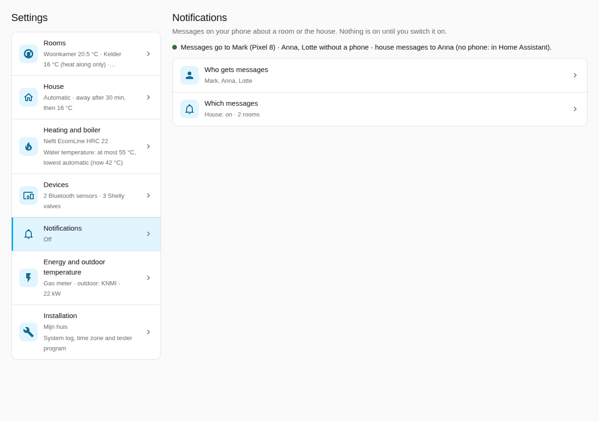

Without the dashboard: **Configure → Notifications**, with the same parts
(**People and phones**, **The house**, **Rooms**).

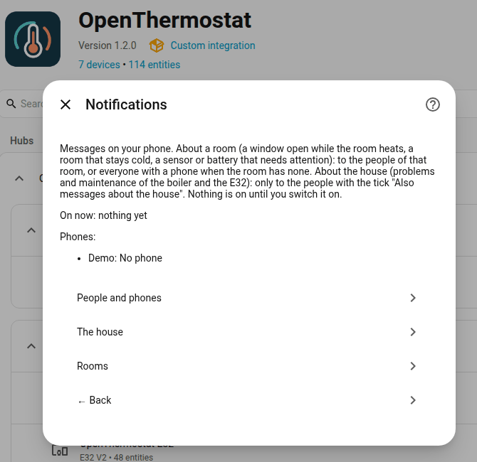

**Who gets what.** Room messages go to the room's **Recipients**: you choose
them per room, on the room's screen under **Notifications for this room**. A
room you never chose for sends to everyone with a phone; an empty list sends to
nobody (the message shows in Home Assistant). After the update to 1.4.2 every
room keeps the people it had. The **Persons** of a room (step 10) only decide
whether the room follows the house or is away. House messages go only to the people with **Also messages about the house**
on. When nobody has it on, **The house** says so, and the messages show in Home
Assistant (the bell) instead; the same for someone with the tick but no phone
(the line at the top says "Anna (no phone: in Home Assistant)").

- **Window or door open** and **Room stays cold** (more than 1 °C below its
  target for over an hour): only to those who are home.
- **Temperature sensor silent** (30 minutes; another device of the room with a
  battery 24 hours: "probably empty") and **Battery low**: home or not. Every
  battery counts: a thermometer, a radiator valve, a window or door contact and
  the setting device. The message names the device, and comes once more after
  7 days if the battery stays low. The limit (20 % unless you change it) is
  under **Settings → Devices → Batteries**, where all batteries are listed.
- **The house, Problems:** a boiler fault, the E32 not reporting for 10 minutes
  (and when it is back), the E32 waiting for your confirmation, frost protection
  and low water pressure. Day and night.
- **The house, Maintenance:** the boiler asking for maintenance (its H code,
  once per code), a new version of the E32 firmware or of this integration
  (once per version), the daily backup of the E32 settings that keeps
  failing (once, until a backup works again), the E32 ready to plan the
  heating (once each time it is ready for your confirmation), and the season
  hint (**Season: switch summer mode on or off?**): switch summer mode on after
  five warm days, or off when it gets colder (once per hint; on a phone with the
  Home Assistant app with the buttons **Switch summer mode on** or **off** and
  **Not now**). If your house messages were on before 1.4.1, the season hint is
  ticked for you once; untick it if you do not want it.

Each message comes once. The same message for a room comes at most once every
2 hours. Between 23:00 and 07:00 room messages wait for the morning, and come
only if the cause is still there. Someone without a phone sees the message in
Home Assistant (the bell) until the cause is gone. Automations get the event
`open_thermostat_notification` with the same title and text.

## Maintenance: put a backup back, tidy entity IDs, remove old rooms

Home Assistant keeps a backup of the E32's settings every day. You rarely need
the rest, but it is all in one place: the dashboard tab **Settings →
Installation**, under **Maintenance**.

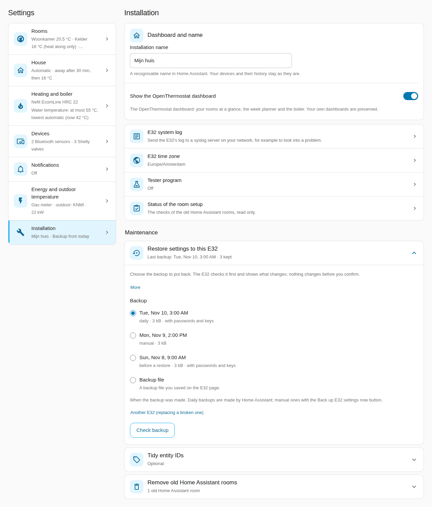

**Do**

1. **Put a backup back on this E32**: open **Restore settings to this E32**.
   Under **Backup**, choose one of the backups Home Assistant kept (newest
   first), or **Backup file** and **Choose a file…** for a backup file from the
   E32's own page, with its **Passphrase of this backup** (leave it empty to
   restore without passwords and keys). **Another E32 (replacing a broken one)**
   is for a new E32: type its address and password there.
   Choose **Check backup**: the screen says what the backup holds and what
   changes. Then choose **Restore**; one question (**Restore these settings?**)
   asks you to confirm, and the screen follows the E32 until it is back.
2. **Tidy entity IDs**: open **Tidy entity IDs** (optional). It says how many
   entities can get a shorter ID and how many of those your automations,
   scripts or dashboards use. Under **Which entities** choose **Only entities
   that are not used anywhere** (the safe choice) or **All, I will update the
   places where they are used**, tick **I have read the list and want to rename
   these entities** and choose **Tidy**. Within the days the screen names you can
   open **Undo the entity ID tidy** and choose **Put the old IDs back**.
3. **Remove old Home Assistant rooms**: only shown while older rooms are left.
   Open it, read what happens and confirm (**Remove the old Home Assistant
   rooms?**).

**You see:** each step says what it did. A restore ends with the E32 running on the
backup's settings; the heating carries on.

**If not:** "The passphrase is not correct." Check it and try again; the E32 page
shows nothing more than that. "Check the backup again before you restore it." The
check is older than 30 minutes: choose **Check backup** again. More in
[backup and restore](USER-GUIDE-REFERENCE.md#backup-and-restore).

## Something is not right?

A problem turns the band at the top of the **Overview** red, with **Attention**.
Tap it to open **Settings → System → Repairs**. Each problem clears itself once
the cause is gone. Still stuck? See [troubleshooting](INSTALL.md#17-troubleshooting).

| What you see | What it means | What to do |
| --- | --- | --- |
| No measurement in a room | The room has had no temperature for 30 minutes. It asks for no heat. | Check the sensor's battery and distance. |
| E32 not reporting | Home Assistant has not heard the E32 for 10 minutes. | Check the E32's power and Wi-Fi. |
| E32 sends no values | The E32 is online but sends no room and boiler values. | Restart the E32: **System → Restart device**. |
| Home Assistant lost the E32 | Rooms get no new targets from Home Assistant. | Choose **Configure → E32 connection** again. |
| Confirm again that the E32 may control the boiler | The E32 controlled your boiler, but something it was confirmed for changed (another boiler, another way to talk to it, a boiler it could not check, or a firmware with new takeover rules). Since 1.4.6 an ordinary update keeps the takeover. It waits for you, with frost protection only. | Choose **Fix** and confirm, or on the E32: **Boiler → Boiler test and takeover**. |
| Waiting for your confirmation | The E32 waits until you confirm that it may control the boiler. | On the E32: **Rooms → Active control**, and confirm. |
| Another thermostat is still active | Another thermostat still asks the boiler for heat. | Disconnect it from the boiler. |
| Boiler does not respond / Cannot reach the boiler | The E32 cannot get its request to the boiler. | Check the boiler cable, and that the boiler is on. |
| Room measurements lost | The E32 lost the room temperatures and stopped heating. | Check the room sensors: batteries and distance. |
| A room stays too cold | It has been too cold for 3 hours, despite heating. | Check the radiators get warm. Raise the highest water temperature. |
| Boiler water pressure low | The heating has too little water. | Top up to 1.5–2.0 bar, with the system cold. |
| Burner switches on and off too often | The E32 already lengthened the rest; it did not help. | Have your installer check the boiler's settings. |
| E32 still uses the default password | The E32 accepts no changes. | Choose **Fix** and set a new password. |
| E32 has no free web session | Too many E32 pages are open. | Close E32 pages on other phones and computers. |
| The E32 uses another time zone | Week programs would switch at the wrong time. | Choose **Fix**. |
| Choose a new temperature source | A sensor was renamed or removed. | Choose **Fix** and pick another sensor. |
| A device seems to run its own schedule | Your thermostat or valve changes by itself. | Set the device to manual mode. |
| No recent backup of the E32 settings | No backup for 3 days. | Check the E32 is on and its password in Home Assistant. |
| The E32 does not receive the room values | The E32 runs on its own sensors and programs. | If it stays, restart Home Assistant. |
| **Messages the E32 could not read: n, last: …** (Diagnostics, E32 1.4.4) | The E32 received device messages since it started that it could not read (too large, cut off, from no known device). Not a fault of your heating. | Note the topic and the reason, then [send a capture](ADD-A-DEVICE.md) of that device. The same line is on the E32 under **System → Diagnostics and system log**. |
| Radiator valve not reporting | The valve is silent for more than two hours. | Check its battery and the Zigbee connection. A low battery is a message and a line under Batteries, no longer a Repairs item. |
| **shortened** beside a room (Diagnostics, E32 1.4.5) | The room has so many valves with long names that the E32 left some of their details out to send the room at all. | Nothing: the valves still work. A blank battery or a missing "set to" line on such a valve is the reason. |
| A radiator valve says **Message too large to read** (E32 1.4.4) | The E32 cannot read the valve's Zigbee2MQTT message: it is larger than 6 KB or cut off. The room counts the valve as not working. Since E32 1.4.5 it says so after three unreadable messages in a row, within minutes. | Report it with the valve model and its size. Nothing needs to change on the valve. |
| Check the boiler: a setting could not be put back | A boiler setting may still have the new value. | Check it on the boiler, then choose **Fix**. |
| Boiler setting put back | Nobody kept a boiler setting within 15 minutes, or the boiler reported another value. | Nothing. Change it again if you want it. |
| A different boiler is connected | The E32 found another boiler on the bus. An EMS+ boiler: it controls nothing. An EMS Classic boiler: the Classic way goes on. | Replaced it? Choose **Fix**. If not, check the boiler cable. |
| My boiler: Not in the list yet, on an EMS Classic boiler | The model is not in the list. The E32 still controls it the Classic way. | Nothing. Want to help? Share a recording. |
| My boiler: Not recognised yet, for 30 minutes | The boiler has not said which model it is. | Check the boiler cable, and that the boiler is on. |
| My boiler: Reading only, on an EMS+ boiler | This model is not verified yet. The E32 only watches. | Nothing. Want to help? See [an EMS+ boiler](#an-ems-boiler-watch-test-and-share). |
| Why: Tested on this boiler, not yet reviewed | Your test passed. The result is not checked yet. | Share your result. Until then the E32 only watches. |
| Why: The boiler speaks two protocols, reading only | The E32 hears EMS Classic and EMS+ from the boiler. It only reads. | Share your result. |
| Why: Cannot be controlled safely (no clean stop) | A test showed the boiler does not stop on "no heat". The E32 never controls it. | Keep your thermostat. Share your result. |
| The E32 stopped controlling an EMS+ boiler | Another thermostat asked for heat, or the boiler twice ignored the E32. Only for a verified model. | Disconnect the other thermostat. Restart the E32 to try again. |
| A Bluetooth sensor stays "Waiting" | The E32 received nothing from it. | Move it closer; check the battery. |
| The E32 page does not open | The E32 is off or not on your network. | See [the E32 is not reachable](INSTALL.md#the-e32-is-not-reachable). |
| A room is warm a little late | Normal in the first days. | Nothing: it learns every morning. |
| The E32 could not save what it learned | Its settings memory has too few free places beside what it keeps for its own settings. It keeps what it learned in memory and tries again 6 hours later or at the next day change. | Nothing now. If it stays for days, share the E32's diagnostics (**System → Diagnostics**). |
| A Shelly device has a problem: see System → Devices | The E32 Overview line for any Shelly problem below. | Open **System → Devices**, section **Shelly devices**: the device says what is wrong. |
| Not reachable since … / the pump's Plug does not answer | The E32 has not heard the device for 3 minutes. | Check its power and Wi-Fi, and its fixed address. The pump comes back on by itself within 30 minutes. |
| The pump takes no power | The Plug is on, but the pump draws almost nothing. | Have the pump's own switch bridged or set to its lowest. |
| The supply probe gives no reading / probe gives no reading | A probe on The Pill has given no reading for 5 minutes. | Check its cable at The Pill, and that it sits firmly on the pipe. |
| The BLU Gateway does not answer | The valves keep their last target. No new commands. | Check the gateway's USB power and Wi-Fi. |
| Radiator valve not found at the BLU Gateway | The gateway does not know the valve, or it is not paired. | Pair it again in the Shelly app, or remove it from the room. |
| Water too hot, pump off | The floor water was too hot for 2 minutes. | Check the mixing valve. The pump starts again by itself. |


## Want to know more?

The [reference](USER-GUIDE-REFERENCE.md) explains how everything works:
[where you set what](USER-GUIDE-REFERENCE.md#where-do-i-set-what),
[the dashboard](USER-GUIDE-REFERENCE.md#the-dashboard-in-home-assistant),
[learning](USER-GUIDE-REFERENCE.md#learning-how-the-e32-tunes-itself),
[energy, gas and warnings](USER-GUIDE-REFERENCE.md#energy-gas-and-warnings),
[radiator valves](USER-GUIDE-REFERENCE.md#radiator-valves),
[the trial run and the switch-over](USER-GUIDE-REFERENCE.md#the-trial-run-and-the-switch-over),
[backup and restore](USER-GUIDE-REFERENCE.md#backup-and-restore),
[replacing a broken E32](USER-GUIDE-REFERENCE.md#replacing-a-broken-e32),
[logs](USER-GUIDE-REFERENCE.md#logs-and-the-diagnostics-console) and
[tidy entity IDs](USER-GUIDE-REFERENCE.md#tidy-entity-ids-optional).
